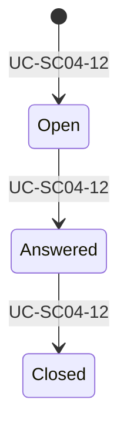

🏠 [Specs](../../../README.md) › 🏷️ [Sectors](../../README.md) › 🏠 [SC04 Home care](../README.md) ›
🗃️ [Data](README.md) › 🗃️ E-SC04-10 Complaint

# 🗃️ E-SC04-10 Complaint

**Status:** ✅ specified

## Purpose

A complaint and its handling.

## Fields

| Name | Type | Required | Validation | Default | Example | Personal data | Custom fields |
|---|---|---|---|---|---|---|---|
| recipient, date | records | yes | - | - | M. Petit, 2 Nov | yes | no |
| subject, answer | text | yes | BR-SC04-14 | - | late visit | yes | no |
| state | open, answered, closed | yes | - | open | closed | no | no |

## Relations

As its use cases.

## Lifecycle

## Indexes and search

By number, date, partner.

## Retention

Kept for the period of its kind of record in the country pack (D293), or else its kind's default in the
[retention schedule](../../../05-non-functional/data-retention.md).

## Audit

Every change.

## Import and export

CSV, FEC where relevant.

## Used by

- [UC-SC04-12](../use-cases/05-people-and-quality/uc-sc04-12-handle-quality-complaints-and-satisfaction.md)

## Open questions

None.

---

⬅️ [E-SC04-09 Tax-credit certificate](e-sc04-09-tax-credit-certificate.md) · ⬆️ [Up](README.md) ·
➡️ [E-SC04-11 Carer qualification](e-sc04-11-carer-qualification.md)
