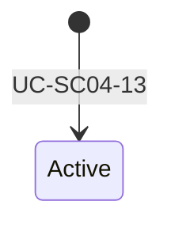

🏠 [Specs](../../../README.md) › 🏷️ [Sectors](../../README.md) › 🏠 [SC04 Home care](../README.md) ›
🗃️ [Data](README.md) › 🗃️ E-SC04-11 Carer qualification

# 🗃️ E-SC04-11 Carer qualification

**Status:** ✅ specified

## Purpose

A carer's skill or diploma.

## Fields

| Name | Type | Required | Validation | Default | Example | Personal data | Custom fields |
|---|---|---|---|---|---|---|---|
| carer, skill | records | yes | - | - | N. R., personal care | yes | no |
| expiry | date | no | BR-SC04-06 | - | 2028-01-31 | no | no |

## Relations

As its use cases.

## Lifecycle

## Indexes and search

By number, date, partner.

## Retention

Kept for the period of its kind of record in the country pack (D293), or else its kind's default in the
[retention schedule](../../../05-non-functional/data-retention.md).

## Audit

Every change.

## Import and export

CSV, FEC where relevant.

## Used by

- [UC-SC04-13](../use-cases/05-people-and-quality/uc-sc04-13-manage-carers-skills-and-training.md)

## Open questions

None.

---

⬅️ [E-SC04-10 Complaint](e-sc04-10-complaint.md) · ⬆️ [Up](README.md) ·
➡️ [E-SC04-12 Activity report](e-sc04-12-activity-report.md)
