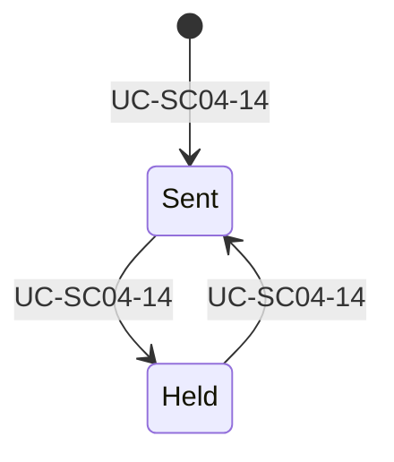

🏠 [Specs](../../../README.md) › 🏷️ [Sectors](../../README.md) › 🏠 [SC04 Home care](../README.md) ›
🗃️ [Data](README.md) › 🗃️ E-SC04-12 Activity report

# 🗃️ E-SC04-12 Activity report

**Status:** 🔄 waiting for the owner

## Purpose

A report to a funder or authority.

## Fields

| Name | Type | Required | Validation | Default | Example | Personal data | Custom fields |
|---|---|---|---|---|---|---|---|
| recipient of report, period | records | yes | - | - | département, Q4 | no | no |
| content | hours, recipients | yes | - | - | 2 140 h | no | no |

## Relations

(Proposed) As its use cases.

## Lifecycle

## Indexes and search

(Proposed) By number, date, partner.

## Retention

Kept for the period of its kind of record in the country pack (D293), or else its kind's default in the
[retention schedule](../../../05-non-functional/data-retention.md).

## Audit

Every change.

## Import and export

(Proposed) CSV, FEC where relevant.

## Used by

- [UC-SC04-14](../use-cases/05-people-and-quality/uc-sc04-14-report-activity-to-funders-and-authorities.md)

## Open questions

None.

---

⬅️ [E-SC04-11 Carer qualification](e-sc04-11-carer-qualification.md) · ⬆️ [Up](README.md) ·
➡️ [E-SC04-13 Immediate advance claim](e-sc04-13-immediate-advance-claim.md)
