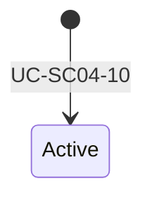

🏠 [Specs](../../../README.md) › 🏷️ [Sectors](../../README.md) › 🏠 [SC04 Home care](../README.md) ›
🗃️ [Data](README.md) › 🗃️ E-SC04-13 Immediate advance claim

# 🗃️ E-SC04-13 Immediate advance claim

**Status:** 🔄 waiting for the owner

## Purpose

(Proposed) The immediate advance claim the flow charts name with the words "Immediate advance"
([FL-SC04-04](../flows/fl-sc04-04-bill-and-fund.md)). The owner decided to create it
([D516](../../../06-decisions/foundations/d516-naming-rules-and-the-seven-classes-of-names.md)); what it holds waits for
the owner's confirmation.

## Fields

(Proposed) To define with the owner: the flow charts name the record, not its fields.

## Relations

(Proposed) To define with the owner, from the use cases below.

## Lifecycle

## Indexes and search

(Proposed) To define with the owner.

## Retention

(Proposed) As the other records of its capability, to confirm with the owner.

## Audit

(Proposed) Every change, as the other records of its capability.

## Import and export

(Proposed) To define with the owner.

## Used by

- [UC-SC04-10 Use the immediate advance](../use-cases/04-bill-and-fund/uc-sc04-10-use-the-immediate-advance.md)

## Open questions

(Proposed) Its fields, relations and states wait for the owner (waiting list, step 36e).

---

⬅️ [E-SC04-12 Activity report](e-sc04-12-activity-report.md) · ⬆️ [Up](README.md) ·
➡️ [E-SC04-14 Resident](e-sc04-14-resident.md)
