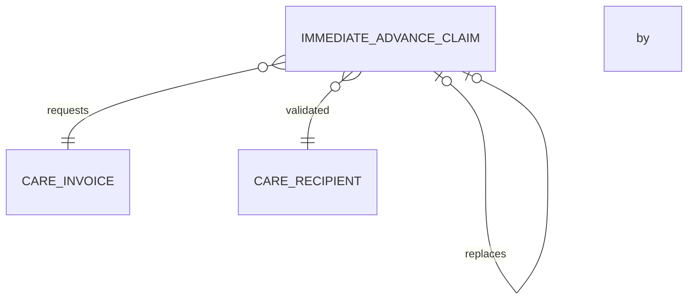
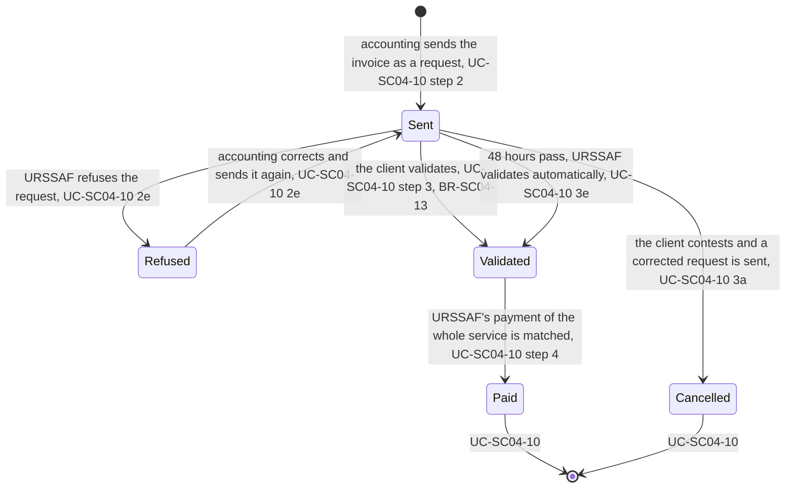

🏠 [Specs](../../../README.md) › 🏷️ [Sectors](../../README.md) › 🏠 [SC04 Home care](../README.md) ›
🗃️ [Data](README.md) › 🗃️ E-SC04-13 Immediate advance claim

# 🗃️ E-SC04-13 Immediate advance claim

**Status:** ✅ specified

## Purpose

The immediate advance claim the flow charts name with the words "Immediate advance"
([FL-SC04-04](../flows/fl-sc04-04-bill-and-fund.md)). The owner decided to create it
([D516](../../../06-decisions/foundations/d516-naming-rules-and-the-seven-classes-of-names.md)); its fields are derived
from the specifications and confirmed by the owner (D572).

## Fields

| Name | Type | Required | Validation | Default | Example | Personal data | Custom fields |
|---|---|---|---|---|---|---|---|
| title | text | yes | not empty | - | Advance claim, November 2026 | no | no |
| invoice | care invoice (E-SC04-08) | yes | an invoice of a client who joined the immediate advance | - | M. Petit, Nov | no | no |
| client | care recipient (E-SC04-01) | yes | the invoice's payer | the invoice's payer | M. Petit | yes | no |
| amount | amount | yes | the invoice's amount | the invoice's amount | 260.00 EUR | no | no |
| client share, tax credit | amounts, computed | yes | as [CR-FR-104](../../../10-country-packs/france/tax-and-vat/cr-fr-104-immediate-advance-of-tax-credit.md) says | computed | 130.00 EUR, 130.00 EUR | no | no |
| sent on | date | no | set when sent through the URSSAF connector | - | 2026-12-01 | no | no |
| validated on | date | no | set when the client validates, or 48 hours after sending when URSSAF validates it automatically | - | 2026-12-02 | no | no |
| validated by | client, automatic | no | set with the validation date | - | client | no | no |
| refusal reason | text | no | required in Refused | - | tax number unknown | no | no |
| paid on | date | no | set when URSSAF's payment of the whole service is matched | - | 2026-12-05 | no | no |
| replaces | immediate advance claim | no | a cancelled claim of the same invoice | - | Advance claim, November 2026 (contested) | no | no |
| state | Sent, Refused, Validated, Cancelled, Paid | yes | the lifecycle below | Sent | Validated | no | no |

Accounting sends each invoice of a client who joined as a request through URSSAF; the client validates it within
48 hours, or URSSAF validates it automatically once they have passed; URSSAF then pays the whole service to the provider
and debits the client for the remainder ([CR-FR-104](../../../10-country-packs/france/tax-and-vat/cr-fr-104-immediate-advance-of-tax-credit.md)), and URSSAF's payment is matched; a contested request is
cancelled and a corrected one sent, and a refusal shows its reason
([UC-SC04-10](../use-cases/04-bill-and-fund/uc-sc04-10-use-the-immediate-advance.md) steps 2 to 4, 3a, 2e, 3e and its
acceptance criteria, [BR-SC04-13](../business-rules/br-sc04-13-immediate-advance-on-request.md)). The care invoice
already records the request's state ([E-SC04-08 Care invoice](e-sc04-08-care-invoice.md), "advance request"). The
title and the state are the columns of
[S-SC04-L13 Immediate advance claims](../screens/00-lists/s-sc04-l13-immediate-advance-claims.md), whose example rows
read "Advance claim, October 2026"; the amounts are those of the validation mock-up of
[S-SC04-10 Immediate advance](../screens/04-bill-and-fund/s-sc04-10-immediate-advance.md), "You pay 130.00 EUR, URSSAF
pays 130.00 EUR".

## Relations

- [E-SC04-08 Care invoice](e-sc04-08-care-invoice.md): the invoice sent as a request
- [E-SC04-01 Care recipient](e-sc04-01-care-recipient.md): the client who joined and validates
- [UC-F8-06 Connect banks and reconcile](../../../02-functional/f08-accounting/use-cases/03-bank-and-collect/uc-f08-06-connect-banks-and-reconcile.md):
  where the client's share and URSSAF's payment are matched

## Lifecycle

## Indexes and search

By title and state, the sort and facet of
[S-SC04-L13 Immediate advance claims](../screens/00-lists/s-sc04-l13-immediate-advance-claims.md); searched by title,
client and invoice.

## Retention

As the other records of its capability.

## Audit

Every change, as the other records of its capability.

## Import and export

CSV or XLSX export of the rows and columns the user may see, from
[S-SC04-L13 Immediate advance claims](../screens/00-lists/s-sc04-l13-immediate-advance-claims.md), audited (T3); the
requests themselves go through the URSSAF connector (T12), not through a file; no import.

## Used by

- [UC-SC04-10 Use the immediate advance](../use-cases/04-bill-and-fund/uc-sc04-10-use-the-immediate-advance.md)

## Open questions

None. The automatic validation after 48 hours follows
[CR-FR-104](../../../10-country-packs/france/tax-and-vat/cr-fr-104-immediate-advance-of-tax-credit.md): the law wins over
the use case (D573).

---

⬅️ [E-SC04-12 Activity report](e-sc04-12-activity-report.md) · ⬆️ [Up](README.md) ·
➡️ [E-SC04-14 Resident](e-sc04-14-resident.md)
