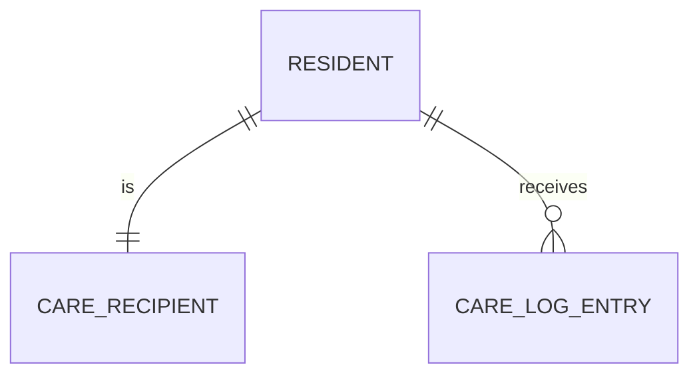
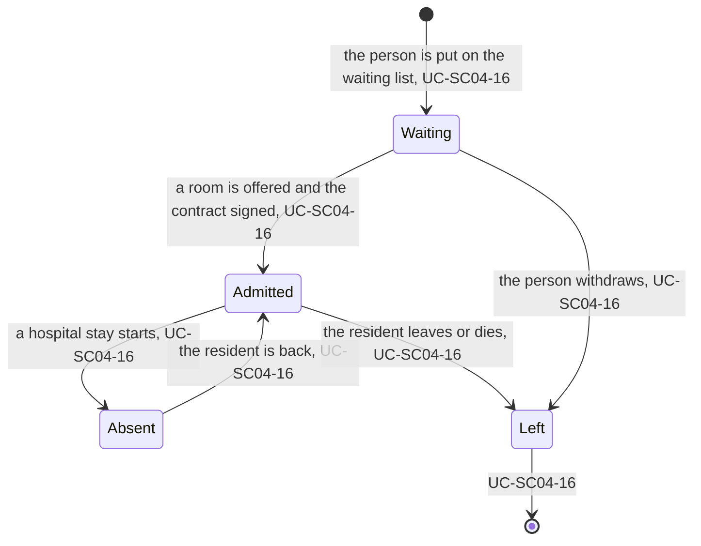

🏠 [Specs](../../../README.md) › 🏷️ [Sectors](../../README.md) › 🏠 [SC04 Home care](../README.md) ›
🗃️ [Data](README.md) › 🗃️ E-SC04-14 Resident

# 🗃️ E-SC04-14 Resident

**Status:** ✅ specified

## Purpose

A person living in the care home: their room, admission, dependency level, representative, stay contract and daily rates
([D548](../../../06-decisions/sectors/d548-benchmark-gaps-sc04-home-care.md)). The resident is a care recipient
([E-SC04-01 Care recipient](e-sc04-01-care-recipient.md)) of the home and adds what only a stay in a home needs: a room,
a contract and rates by the day.

## Fields

| Name | Type | Required | Validation | Default | Example | Personal data | Custom fields |
|---|---|---|---|---|---|---|---|
| care recipient | care recipient (E-SC04-01) | yes | a person of the company | - | Odette L. | yes | no |
| room | text | no | one resident per room | - | 12 | no | no |
| admitted on | date | no | set at admission | - | 2026-09-01 | no | no |
| dependency level | level 1 to 6 | yes | from the assessment | - | 2 | yes | no |
| representative | person | no | - | - | Paul L. | yes | no |
| contract signed on | date | no | required to be Admitted | - | 2026-09-01 | no | no |
| daily rates | amounts per day | yes | 0 or more | from the home's rates | 68.40 EUR | no | no |
| absent from | date | no | within a stay | - | 2026-12-02 | no | no |
| left on | date | no | after admission | - | - | no | no |
| state | Waiting, Admitted, Absent, Left | yes | the lifecycle below | Waiting | Admitted | no | no |
| owner | user | yes | a user of the company | the creator | Claire P. | yes | no |

## Relations

- [E-SC04-01 Care recipient](e-sc04-01-care-recipient.md)
- [E-SC04-02 Care funding](e-sc04-02-care-funding.md)
- [E-SC04-03 Care plan](e-sc04-03-care-plan.md)
- [E-SC04-06 Care log entry](e-sc04-06-care-log-entry.md)

## Lifecycle

## Indexes and search

By room, dependency level, state and admission date. Names are searched only by users with a care role.

## Retention

The care record is kept for the legal period of medical records and then erased
([BR-SC04-15](../business-rules/br-sc04-15-records-kept-no-longer-than-needed.md),
[CR-FR-052](../../../10-country-packs/france/data-protection/cr-fr-052-storage-limitation.md)).

## Audit

Every admission, contract, absence and departure, and every reading of the care record, with who, when and why.

## Import and export

Export of a resident's record for a doctor or a relative, on request and logged; no import.

## Used by

- [UC-SC04-16](../use-cases/06-care-homes-cesu-and-nursing/uc-sc04-16-run-a-care-home.md)
- [UC-SC04-01](../use-cases/01-take-on-a-recipient/uc-sc04-01-register-a-care-recipient-and-their-funding.md)

## Open questions

None.

---

⬅️ [E-SC04-13 Immediate advance claim](e-sc04-13-immediate-advance-claim.md) · ⬆️ [Up](README.md) ·
➡️ [E-SC04-15 CESU voucher](e-sc04-15-cesu-voucher.md)
