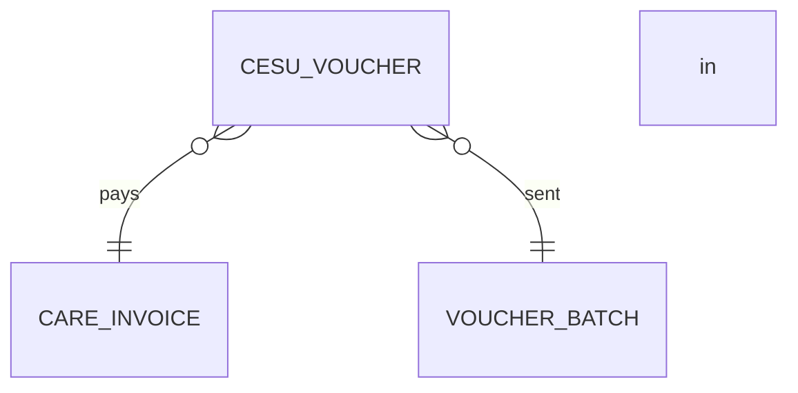
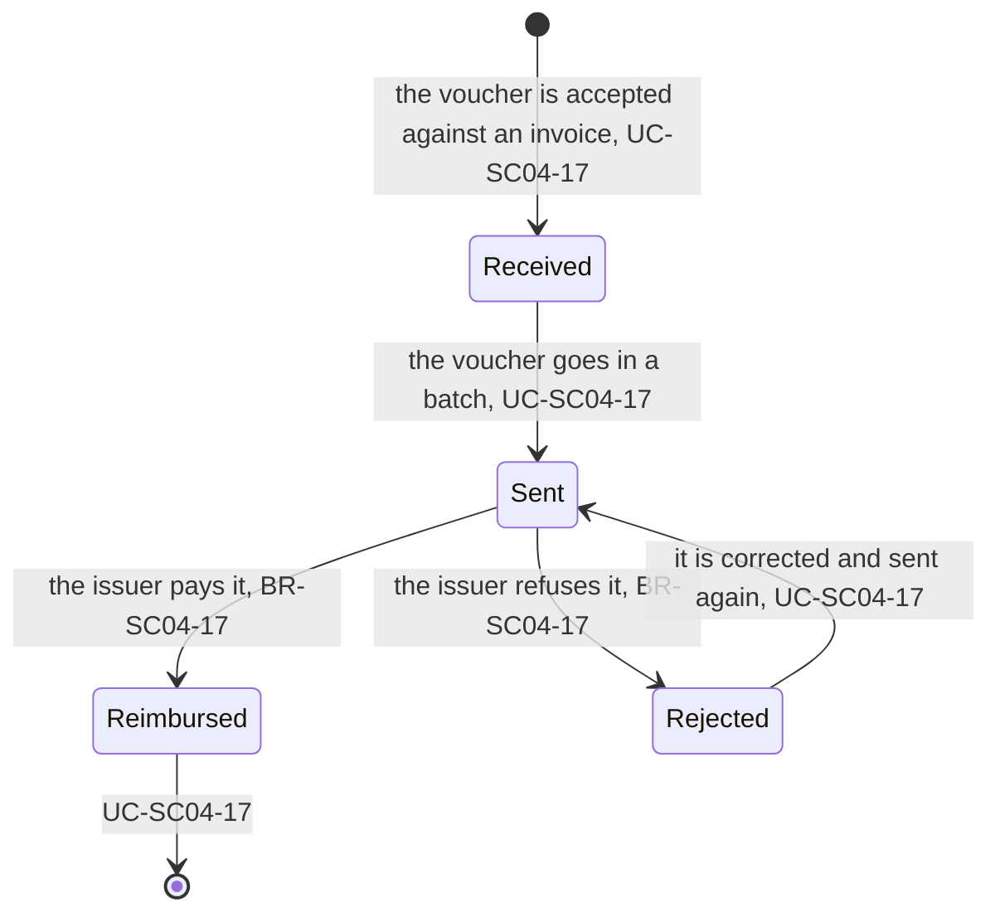

🏠 [Specs](../../../README.md) › 🏷️ [Sectors](../../README.md) › 🏠 [SC04 Home care](../README.md) ›
🗃️ [Data](README.md) › 🗃️ E-SC04-15 CESU voucher

# 🗃️ E-SC04-15 CESU voucher

**Status:** ✅ specified

## Purpose

A CESU voucher received as payment: its number, issuer, value, validity, invoice and batch
([D548](../../../06-decisions/sectors/d548-benchmark-gaps-sc04-home-care.md)). It pays part or all of a care invoice
([E-SC04-08 Care invoice](e-sc04-08-care-invoice.md)) and is reconciled with the issuer's payment.

## Fields

| Name | Type | Required | Validation | Default | Example | Personal data | Custom fields |
|---|---|---|---|---|---|---|---|
| number | text | yes | unique per issuer | - | CS-884120 | no | no |
| issuer | text | yes | an issuer the provider is registered with | - | CESU-Est | no | no |
| value | amount | yes | above 0 | - | 12.00 EUR | no | no |
| valid to | date | yes | not before the received date | - | 2027-03-31 | no | no |
| invoice | care invoice (E-SC04-08) | yes | an open invoice | - | 2026-441 | no | no |
| received on | date | yes | set by the system | today | 2026-11-05 | no | no |
| batch | text | no | set when sent | - | B-2026-11-02 | no | no |
| sent on | date | no | - | - | 2026-11-10 | no | no |
| paid on | date | no | - | - | 2026-11-13 | no | no |
| rejection reason | text | no | required in Rejected | - | expired | no | no |
| state | Received, Sent, Reimbursed, Rejected | yes | the lifecycle below | Received | Sent | no | no |
| owner | user | yes | a user of the company | the creator | Claire P. | yes | no |

## Relations

- [E-SC04-08 Care invoice](e-sc04-08-care-invoice.md)
- [E-SC04-02 Care funding](e-sc04-02-care-funding.md)

## Lifecycle

## Indexes and search

By number, issuer, batch, invoice and state.

## Retention

Kept ten years with the invoice it paid
([CR-FR-002](../../../10-country-packs/france/accounting/cr-fr-002-accounting-records-kept-ten-years.md)).

## Audit

Every voucher accepted, batched, reimbursed or rejected, and every batch, with who and when.

## Import and export

Export of a batch in the issuer's format; import of the issuer's payment file.

## Used by

- [UC-SC04-17](../use-cases/06-care-homes-cesu-and-nursing/uc-sc04-17-accept-cesu-vouchers.md)
- [UC-SC04-08](../use-cases/04-bill-and-fund/uc-sc04-08-bill-recipients-and-funders.md)

## Open questions

None.

---

⬅️ [E-SC04-14 Resident](e-sc04-14-resident.md) · ⬆️ [Up](README.md) · ➡️ [E-SC04-16 Mandate](e-sc04-16-mandate.md)
