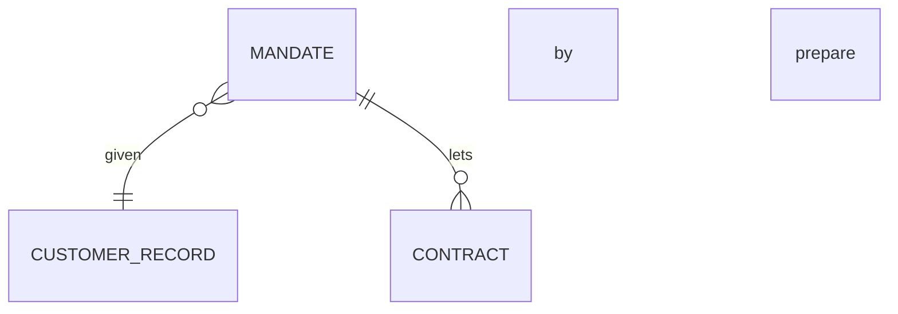
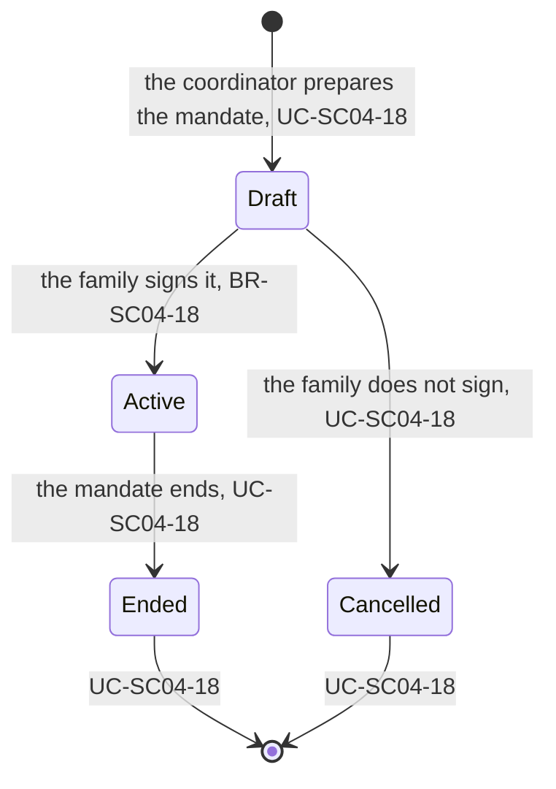

🏠 [Specs](../../../README.md) › 🏷️ [Sectors](../../README.md) › 🏠 [SC04 Home care](../README.md) ›
🗃️ [Data](README.md) › 🗃️ E-SC04-16 Mandate

# 🗃️ E-SC04-16 Mandate

**Status:** ✅ specified

## Purpose

The mandate a family gives the provider to help it employ a carer: scope, fee, signature and dates
([D548](../../../06-decisions/sectors/d548-benchmark-gaps-sc04-home-care.md)). The employment contract itself is a
contract record ([E-F9-02 Contract](../../../02-functional/f09-hr-and-projects/data/e-f09-02-contract.md)) in the
family's name; the mandate is what lets the provider prepare it.

## Fields

| Name | Type | Required | Validation | Default | Example | Personal data | Custom fields |
|---|---|---|---|---|---|---|---|
| family | customer (E-F6-01) | yes | a customer of the company | - | Martin family | yes | no |
| carer | employee (E-F9-01) | yes | a carer the family employs | - | Aisha T. | yes | no |
| scope | list of tasks | yes | search, contract, payslips, declarations | all | all four | no | no |
| monthly fee | amount | yes | 0 or more | - | 38.00 EUR | no | no |
| signed on | date and time | no | required to be Active | - | 2026-10-02 18:20 | no | no |
| start date | date | yes | after the signature | - | 2026-10-05 | no | no |
| end date | date | no | after the start | - | - | no | no |
| employer | the family | yes | never the provider | the family | Martin family | no | no |
| state | Draft, Active, Ended, Cancelled | yes | the lifecycle below | Draft | Active | no | no |
| owner | user | yes | a user of the company | the creator | Claire P. | yes | no |

## Relations

- [E-F6-01](../../../02-functional/f06-customers-and-sales/data/e-f06-01-customer-record.md)
- [E-F9-01](../../../02-functional/f09-hr-and-projects/data/e-f09-01-employee-record.md)
- [E-F9-02 Contract](../../../02-functional/f09-hr-and-projects/data/e-f09-02-contract.md)
- [E-F13-02](../../../02-functional/f13-payroll/data/e-f13-02-employee-pay-profile.md)

## Lifecycle

## Indexes and search

By family, carer, state and start date.

## Retention

Kept with the contract and the payslips of the family: payslips 50 years
([D445](../../../06-decisions/f13-payroll/d445-payslips-fifty-years-from-issue.md)), the mandate ten years after its
end.

## Audit

Every signature, scope change, contract and payslip prepared under the mandate, with who and when.

## Import and export

The family's documents are exported as one archive when the mandate ends.

## Used by

- [UC-SC04-18](../use-cases/06-care-homes-cesu-and-nursing/uc-sc04-18-run-the-agent-mode-for-family-employers.md)
- [UC-SC04-17](../use-cases/06-care-homes-cesu-and-nursing/uc-sc04-17-accept-cesu-vouchers.md)

## Open questions

None.

---

⬅️ [E-SC04-15 CESU voucher](e-sc04-15-cesu-voucher.md) · ⬆️ [Up](README.md) ·
➡️ [E-SC04-17 Childcare contract](e-sc04-17-childcare-contract.md)
