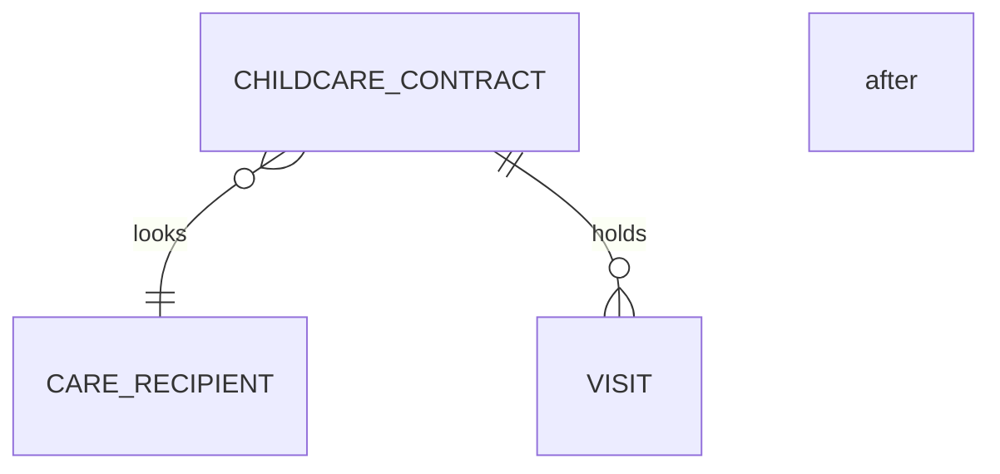
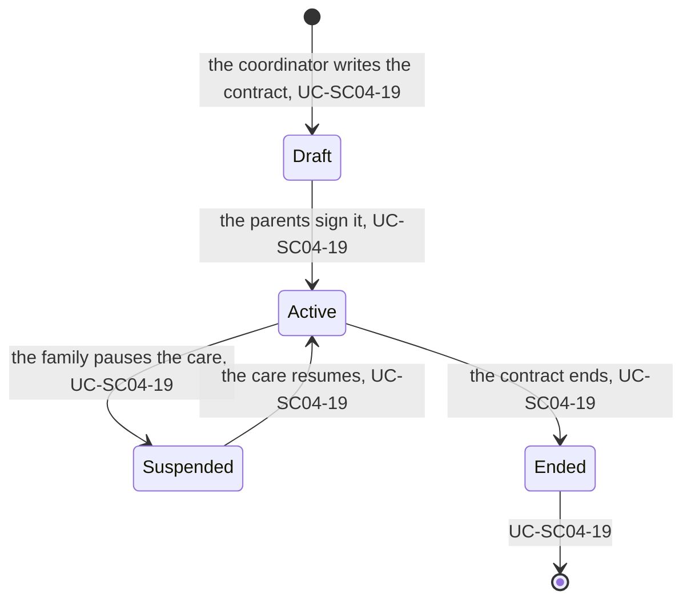

🏠 [Specs](../../../README.md) › 🏷️ [Sectors](../../README.md) › 🏠 [SC04 Home care](../README.md) ›
🗃️ [Data](README.md) › 🗃️ E-SC04-17 Childcare contract

# 🗃️ E-SC04-17 Childcare contract

**Status:** ✅ specified

## Purpose

A childcare contract at home: the child, the parents, the carer, the schedule, the rate and the aid
([D548](../../../06-decisions/sectors/d548-benchmark-gaps-sc04-home-care.md)). The child is a care recipient
([E-SC04-01 Care recipient](e-sc04-01-care-recipient.md)); the contract adds the hours, the rate and the aid, and each
visit is a visit ([E-SC04-04 Visit](e-sc04-04-visit.md)).

## Fields

| Name | Type | Required | Validation | Default | Example | Personal data | Custom fields |
|---|---|---|---|---|---|---|---|
| child | care recipient (E-SC04-01) | yes | a minor | - | Lea M. | yes | no |
| parents | customers (E-F6-01) | yes | at least one | - | Nadia and Karim M. | yes | no |
| carer | employee (E-F9-01) | yes | qualified for children | - | Aisha T. | yes | no |
| schedule | days and hours | yes | hours a week above 0 | - | Mon-Fri 08:30-14:30 | no | no |
| hourly rate | amount | yes | above 0 | - | 10.00 EUR | no | no |
| aid | amount per month | no | from the country pack's table | 0 | 480.00 EUR | no | no |
| parents' share | amount per month | yes | cost less aid | computed | 720.00 EUR | no | no |
| aid table version | text | no | set when the aid is computed | - | 2026 v2 | no | no |
| start date | date | yes | after the signature | - | 2026-11-02 | no | no |
| end date | date | no | after the start | - | - | no | no |
| state | Draft, Active, Suspended, Ended | yes | the lifecycle below | Draft | Active | no | no |
| owner | user | yes | a user of the company | the creator | Claire P. | yes | no |

## Relations

- [E-SC04-01 Care recipient](e-sc04-01-care-recipient.md)
- [E-SC04-04 Visit](e-sc04-04-visit.md)
- [E-SC04-02 Care funding](e-sc04-02-care-funding.md)
- [E-SC04-11 Carer qualification](e-sc04-11-carer-qualification.md)

## Lifecycle

## Indexes and search

By child, carer, parents, state and start date. Children are searched only by users with a care role.

## Retention

Kept with the invoices for ten years; the child's personal data is erased after the contract's retention
([BR-SC04-15](../business-rules/br-sc04-15-records-kept-no-longer-than-needed.md),
[CR-FR-052](../../../10-country-packs/france/data-protection/cr-fr-052-storage-limitation.md)).

## Audit

Every contract, amendment, aid computation and statement, with who, when and the table version.

## Import and export

The monthly statement is exported for the parents' aid declaration; no import.

## Used by

- [UC-SC04-19](../use-cases/06-care-homes-cesu-and-nursing/uc-sc04-19-provide-childcare-at-home.md)
- [UC-SC04-04](../use-cases/03-visit/uc-sc04-04-visit-on-the-carer-s-phone.md)

## Open questions

None.

---

⬅️ [E-SC04-16 Mandate](e-sc04-16-mandate.md) · ⬆️ [Up](README.md) · ➡️ [E-SC04-18 Care act](e-sc04-18-care-act.md)
