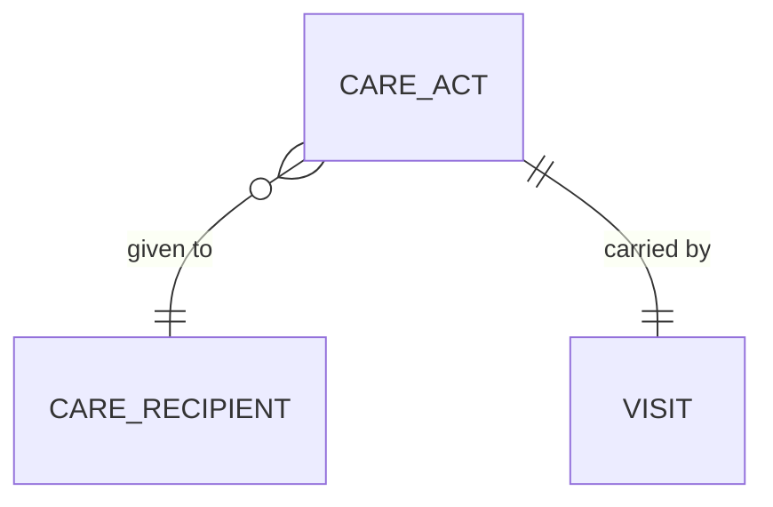
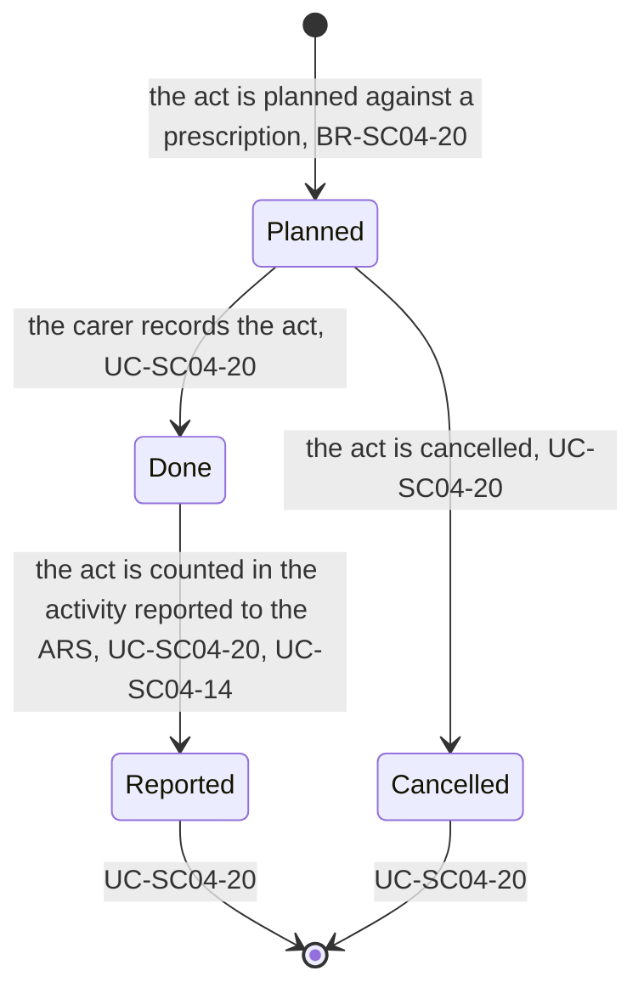

🏠 [Specs](../../../README.md) › 🏷️ [Sectors](../../README.md) › 🏠 [SC04 Home care](../README.md) ›
🗃️ [Data](README.md) › 🗃️ E-SC04-18 Care act

# 🗃️ E-SC04-18 Care act

**Status:** ✅ specified

## Purpose

A care act given at home on a prescription: the act, its performer, its time and the patient's signature, with the
prescription behind it ([D548](../../../06-decisions/sectors/d548-benchmark-gaps-sc04-home-care.md)). The act is carried
by a visit ([E-SC04-04 Visit](e-sc04-04-visit.md)) and written in the care log
([E-SC04-06 Care log entry](e-sc04-06-care-log-entry.md)); this record is what the service reports as its activity to
the ARS, which funds the care by a yearly global allowance: no act is billed
([CR-FR-233](../../../10-country-packs/france/health-practice/cr-fr-233-home-nursing-ssiad.md)).

## Fields

| Name | Type | Required | Validation | Default | Example | Personal data | Custom fields |
|---|---|---|---|---|---|---|---|
| patient | care recipient (E-SC04-01) | yes | a person of the company | - | Jeanne R. | yes | no |
| prescription | prescriber, date, the care assessed by the coordinating nurse (acts, period) | yes | valid and with acts left | - | Dr Henri B., 2026-11-01, dressing, 28 days | no | no |
| act | choice | yes | an act of the prescription | - | dressing | no | no |
| performed by | employee (E-F9-01) | yes | qualified for the act | - | Aisha T. | no | no |
| coordinating nurse | employee (E-F9-01) | no | required for a nursing assistant | - | Lea F. | no | no |
| performed at | date and time | no | within the prescription period | - | 2026-11-12 09:10 | no | no |
| note | text | no | health data | - | wound clean | yes | no |
| signed on | date and time | no | set at the patient's signature | - | 2026-11-12 09:25 | no | no |
| state | Planned, Done, Reported, Cancelled | yes | the lifecycle below | Planned | Done | no | no |
| owner | user | yes | a user of the company | the creator | Claire P. | yes | no |

## Relations

- [E-SC04-01 Care recipient](e-sc04-01-care-recipient.md)
- [E-SC04-04 Visit](e-sc04-04-visit.md)
- [E-SC04-06 Care log entry](e-sc04-06-care-log-entry.md)
- [E-SC04-02 Care funding](e-sc04-02-care-funding.md)

## Lifecycle

## Indexes and search

By patient, performer, prescription, state and date. Names are searched only by users with a care role.

## Retention

Kept for the legal period of medical records and as the proof of the activity reported
([BR-SC04-15](../business-rules/br-sc04-15-records-kept-no-longer-than-needed.md),
[CR-FR-052](../../../10-country-packs/france/data-protection/cr-fr-052-storage-limitation.md)).

## Audit

Every act planned, done, signed, reported or cancelled, and every reading of its note, with who, when and why.

## Import and export

The acts done are exported with the activity report to the ARS (UC-SC04-14); no import.

## Used by

- [UC-SC04-20](../use-cases/06-care-homes-cesu-and-nursing/uc-sc04-20-run-home-nursing-care.md)
- [UC-SC04-05](../use-cases/03-visit/uc-sc04-05-keep-the-care-log-and-report-incidents.md)

## Open questions

None.

---

⬅️ [E-SC04-17 Childcare contract](e-sc04-17-childcare-contract.md) · ⬆️ [Up](README.md)
