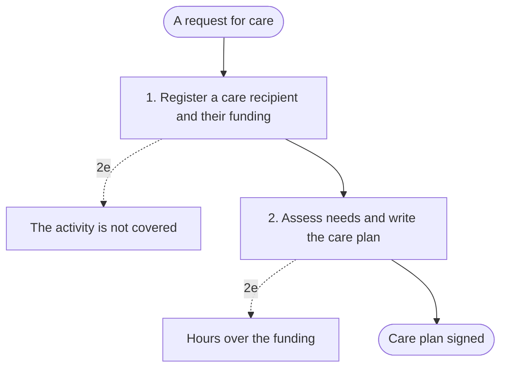

🏠 [Specs](../../../README.md) › 🏷️ [Sectors](../../README.md) › 🏠 [SC04 Home care](../README.md) ›
🔀 [Flows](README.md) › 🔀 FL-SC04-01 Take on a recipient

# 🔀 FL-SC04-01 Take on a recipient

**Status:** ✅ specified

## Summary

Taking on a recipient: registration, funding, consents and the care plan. It covers
[UC-SC04-01 Register a care recipient and their funding](../use-cases/01-take-on-a-recipient/uc-sc04-01-register-a-care-recipient-and-their-funding.md),
[UC-SC04-02 Assess needs and write the care plan](../use-cases/01-take-on-a-recipient/uc-sc04-02-assess-needs-and-write-the-care-plan.md).

## Personas

- [U09 Customer](../../../01-users/personas/u09-customer.md)
- [U25 Care coordinator](../../../01-users/personas/u25-care-coordinator.md)

## Flowchart

## Sequence diagram

See each use case.

## Steps

| Step | Persona | Screen | Use case | What happens |
|---|---|---|---|---|
| 1 | U25, U09 | [S-SC04-01](../screens/01-take-on-a-recipient/s-sc04-01-recipient.md) | [UC-SC04-01](../use-cases/01-take-on-a-recipient/uc-sc04-01-register-a-care-recipient-and-their-funding.md) | The care coordinator registers a recipient with contacts, address and access code, their funders and shares, and their consents, checking that the company's registration covers the activity there |
| 2 | U25, U09 | [S-SC04-02](../screens/01-take-on-a-recipient/s-sc04-02-care-plan.md) | [UC-SC04-02](../use-cases/01-take-on-a-recipient/uc-sc04-02-assess-needs-and-write-the-care-plan.md) | The care coordinator visits the recipient, assesses needs, writes the care plan with tasks, frequency, hours and funding, and has it signed, visits are planned only from a signed plan |

### Entities and screens

| Entity | States in this flow | Shown at step and screen | Aggregated view |
|---|---|---|---|
| [E-F16-01 Customer request](../../../02-functional/f16-customer-support-agents/data/e-f16-01-customer-request.md) | New, In progress, Resolved, Waiting, Escalated | Shown elsewhere: [S-F16-11 My requests](../../../02-functional/f16-customer-support-agents/screens/05-customer-side/s-f16-11-my-requests.md) | Customer requests |
| [E-SC04-01 Care recipient](../data/e-sc04-01-care-recipient.md) | Assessed, Served, Left, Paused | 1 [S-SC04-01](../screens/01-take-on-a-recipient/s-sc04-01-recipient.md) | Care recipients |
| [E-SC04-02 Care funding](../data/e-sc04-02-care-funding.md) | Active | 1 [S-SC04-01](../screens/01-take-on-a-recipient/s-sc04-01-recipient.md) | Care fundings |
| [E-SC04-03 Care plan](../data/e-sc04-03-care-plan.md) | Active | 2 [S-SC04-02](../screens/01-take-on-a-recipient/s-sc04-02-care-plan.md) | Care plans |
| [E-SC08-11 Volunteer hours](../../sc08-non-profit/data/e-sc08-11-volunteer-hours.md) | Active | Shown elsewhere: [S-SC08-11 Volunteer time](../../sc08-non-profit/screens/04-volunteers/s-sc08-11-volunteer-time.md) | Volunteer hours |

## Errors

- [UC-SC04-01](../use-cases/01-take-on-a-recipient/uc-sc04-01-register-a-care-recipient-and-their-funding.md) 2e. The
  activity is not covered: the registration is refused with the missing approval
  ([BR-SC04-02](../business-rules/br-sc04-02-activities-need-their-registration.md)).
- [UC-SC04-01](../use-cases/01-take-on-a-recipient/uc-sc04-01-register-a-care-recipient-and-their-funding.md) 3e. A
  funding agreement without end date: it is refused until dated.
- [UC-SC04-02](../use-cases/01-take-on-a-recipient/uc-sc04-02-assess-needs-and-write-the-care-plan.md) 2e. Hours over
  the funding: the recipient's extra share is shown before signing.
- [UC-SC04-02](../use-cases/01-take-on-a-recipient/uc-sc04-02-assess-needs-and-write-the-care-plan.md) 3e. The recipient
  cannot sign: the representative signs, or the refusal is recorded.

## Images

Every step and error, for each persona taking part, in light and dark mode (D120). Steps are numbered as in the Steps
table; E rows are the error cases.

| Step | Persona | Device | Light | Dark |
|---|---|---|---|---|
| 1 | U25 | desktop | [light](../images/01-take-on-a-recipient/u25-care-coordinator/1-recipient-desktop-light.png) | [dark](../images/01-take-on-a-recipient/u25-care-coordinator/1-recipient-desktop-dark.png) |
| 1 | U25 | phone | [light](../images/01-take-on-a-recipient/u25-care-coordinator/1-recipient-phone-light.png) | [dark](../images/01-take-on-a-recipient/u25-care-coordinator/1-recipient-phone-dark.png) |
| 1 | U09 | phone | [light](../images/01-take-on-a-recipient/u09-customer/1-recipient-phone-light.png) | [dark](../images/01-take-on-a-recipient/u09-customer/1-recipient-phone-dark.png) |
| 2 | U25 | desktop | [light](../images/01-take-on-a-recipient/u25-care-coordinator/2-care-plan-desktop-light.png) | [dark](../images/01-take-on-a-recipient/u25-care-coordinator/2-care-plan-desktop-dark.png) |
| 2 | U25 | phone | [light](../images/01-take-on-a-recipient/u25-care-coordinator/2-care-plan-phone-light.png) | [dark](../images/01-take-on-a-recipient/u25-care-coordinator/2-care-plan-phone-dark.png) |
| 2 | U09 | phone | [light](../images/01-take-on-a-recipient/u09-customer/2-care-plan-phone-light.png) | [dark](../images/01-take-on-a-recipient/u09-customer/2-care-plan-phone-dark.png) |
| E1 | U25 | desktop | [light](../images/01-take-on-a-recipient/u25-care-coordinator/e1-not-authorised-desktop-light.png) | [dark](../images/01-take-on-a-recipient/u25-care-coordinator/e1-not-authorised-desktop-dark.png) |
| E1 | U25 | phone | [light](../images/01-take-on-a-recipient/u25-care-coordinator/e1-not-authorised-phone-light.png) | [dark](../images/01-take-on-a-recipient/u25-care-coordinator/e1-not-authorised-phone-dark.png) |

## Open questions

None.

---

⬆️ [Up](README.md) · ➡️ [FL-SC04-02 Plan the rounds](fl-sc04-02-plan-the-rounds.md)
