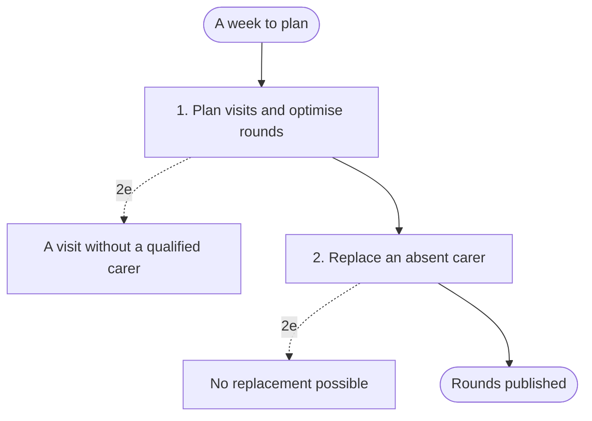

🏠 [Specs](../../../README.md) › 🏷️ [Sectors](../../README.md) › 🏠 [SC04 Home care](../README.md) ›
🔀 [Flows](README.md) › 🔀 FL-SC04-02 Plan the rounds

# 🔀 FL-SC04-02 Plan the rounds

**Status:** ✅ specified

## Summary

Rounds from care plans with the shared optimiser, and absences covered. It covers
[UC-SC04-03 Plan visits and optimise rounds](../use-cases/02-plan-the-rounds/uc-sc04-03-plan-visits-and-optimise-rounds.md),
[UC-SC04-06 Replace an absent carer](../use-cases/02-plan-the-rounds/uc-sc04-06-replace-an-absent-carer.md).

## Personas

- [U25 Care coordinator](../../../01-users/personas/u25-care-coordinator.md)
- [U26 Carer](../../../01-users/personas/u26-carer.md)

## Flowchart

## Sequence diagram

See each use case.

## Steps

| Step | Persona | Screen | Use case | What happens |
|---|---|---|---|---|
| 1 | U25 | [S-SC04-03](../screens/02-plan-the-rounds/s-sc04-03-rounds.md) | [UC-SC04-03](../use-cases/02-plan-the-rounds/uc-sc04-03-plan-visits-and-optimise-rounds.md) | The care coordinator generates the week's visits from the care plans and has the shared rounds optimiser assign carers by skills, continuity and travel time, then publishes the rounds to phones |
| 2 | U25, U26 | [S-SC04-06](../screens/02-plan-the-rounds/s-sc04-06-replacements.md), [S-SC04-04](../screens/02-plan-the-rounds/s-sc04-04-visit.md) | [UC-SC04-06](../use-cases/02-plan-the-rounds/uc-sc04-06-replace-an-absent-carer.md) | When a carer is absent, the care coordinator sees the visits to cover at once, reviews the replacements proposed and tells the recipients |

### Entities and screens

| Entity | States in this flow | Shown at step and screen | Aggregated view |
|---|---|---|---|
| [E-SC04-04 Visit](../data/e-sc04-04-visit.md) | Planned, Done, Cancelled, Missed | 1 [S-SC04-03](../screens/02-plan-the-rounds/s-sc04-03-rounds.md); 2 [S-SC04-06](../screens/02-plan-the-rounds/s-sc04-06-replacements.md); 2 [S-SC04-04](../screens/02-plan-the-rounds/s-sc04-04-visit.md) | Visits |
| [E-SC04-03 Care plan](../data/e-sc04-03-care-plan.md) | Active | Shown elsewhere: [S-SC04-02 Care plan](../screens/01-take-on-a-recipient/s-sc04-02-care-plan.md) | Care plans |

## Errors

- [UC-SC04-03](../use-cases/02-plan-the-rounds/uc-sc04-03-plan-visits-and-optimise-rounds.md) 2e. A visit without a
  qualified carer: it is flagged and stays to assign
  ([BR-SC04-06](../business-rules/br-sc04-06-carers-match-the-needs.md)).
- [UC-SC04-03](../use-cases/02-plan-the-rounds/uc-sc04-03-plan-visits-and-optimise-rounds.md) 3e. A split shift over the
  agreement's limit: it is flagged before publishing.
- [UC-SC04-06](../use-cases/02-plan-the-rounds/uc-sc04-06-replace-an-absent-carer.md) 2e. No replacement possible: the
  visit is flagged and the recipient called.
- [UC-SC04-06](../use-cases/02-plan-the-rounds/uc-sc04-06-replace-an-absent-carer.md) 3e. A replacement no longer free:
  the next proposal is offered.

## Images

Every step and error, for each persona taking part, in light and dark mode (D120). Steps are numbered as in the Steps
table; E rows are the error cases.

| Step | Persona | Device | Light | Dark |
|---|---|---|---|---|
| 1 | U25 | desktop | [light](../images/02-plan-the-rounds/u25-care-coordinator/1-rounds-desktop-light.png) | [dark](../images/02-plan-the-rounds/u25-care-coordinator/1-rounds-desktop-dark.png) |
| 1 | U25 | phone | [light](../images/02-plan-the-rounds/u25-care-coordinator/1-rounds-phone-light.png) | [dark](../images/02-plan-the-rounds/u25-care-coordinator/1-rounds-phone-dark.png) |
| 2 | U25 | desktop | [light](../images/02-plan-the-rounds/u25-care-coordinator/2-replacement-desktop-light.png) | [dark](../images/02-plan-the-rounds/u25-care-coordinator/2-replacement-desktop-dark.png) |
| 2 | U25 | phone | [light](../images/02-plan-the-rounds/u25-care-coordinator/2-replacement-phone-light.png) | [dark](../images/02-plan-the-rounds/u25-care-coordinator/2-replacement-phone-dark.png) |
| 2 | U26 | phone | [light](../images/02-plan-the-rounds/u26-carer/2-replacement-phone-light.png) | [dark](../images/02-plan-the-rounds/u26-carer/2-replacement-phone-dark.png) |
| E1 | U25 | desktop | [light](../images/02-plan-the-rounds/u25-care-coordinator/e1-no-carer-desktop-light.png) | [dark](../images/02-plan-the-rounds/u25-care-coordinator/e1-no-carer-desktop-dark.png) |
| E1 | U25 | phone | [light](../images/02-plan-the-rounds/u25-care-coordinator/e1-no-carer-phone-light.png) | [dark](../images/02-plan-the-rounds/u25-care-coordinator/e1-no-carer-phone-dark.png) |

## Open questions

None.

---

⬅️ [FL-SC04-01 Take on a recipient](fl-sc04-01-take-on-a-recipient.md) · ⬆️ [Up](README.md) ·
➡️ [FL-SC04-03 Visit](fl-sc04-03-visit.md)
