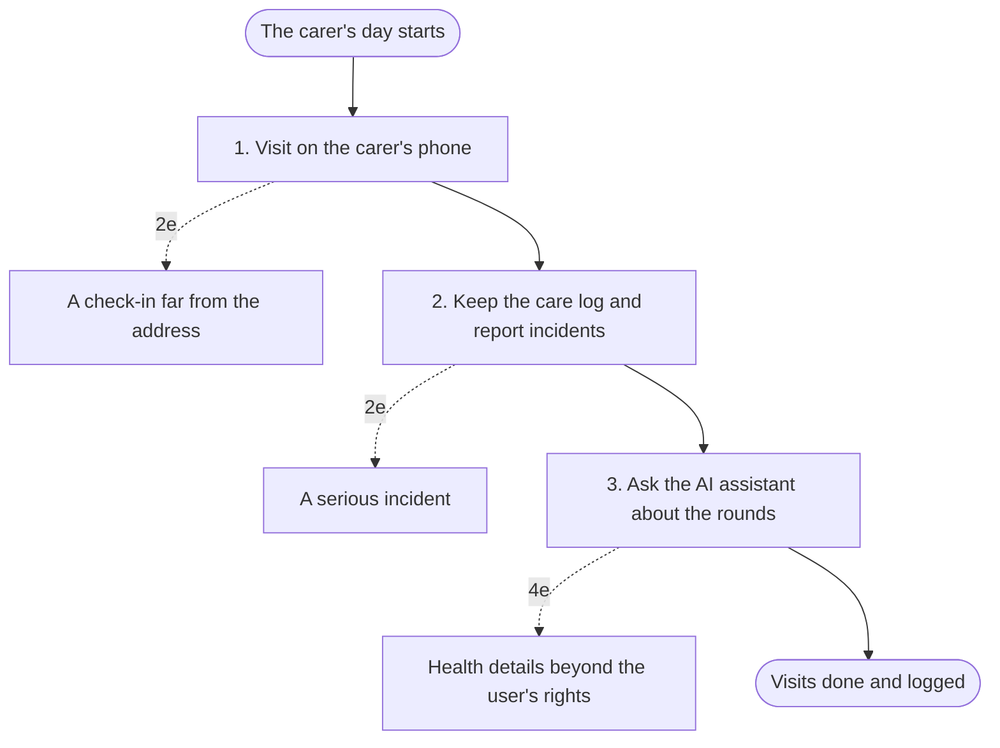

🏠 [Specs](../../../README.md) › 🏷️ [Sectors](../../README.md) › 🏠 [SC04 Home care](../README.md) ›
🔀 [Flows](README.md) › 🔀 FL-SC04-03 Visit

# 🔀 FL-SC04-03 Visit

**Status:** ✅ specified

## Summary

The visit on the carer's phone, the care log, and the AI assistant. It covers
[UC-SC04-04 Visit on the carer's phone](../use-cases/03-visit/uc-sc04-04-visit-on-the-carer-s-phone.md),
[UC-SC04-05 Keep the care log and report incidents](../use-cases/03-visit/uc-sc04-05-keep-the-care-log-and-report-incidents.md),
[UC-SC04-15 Ask the AI assistant about the rounds](../use-cases/03-visit/uc-sc04-15-ask-the-assistant-about-the-rounds.md).

## Personas

- [U09 Customer](../../../01-users/personas/u09-customer.md)
- [U25 Care coordinator](../../../01-users/personas/u25-care-coordinator.md)
- [U26 Carer](../../../01-users/personas/u26-carer.md)

## Flowchart

## Sequence diagram

See each use case.

## Steps

| Step | Persona | Screen | Use case | What happens |
|---|---|---|---|---|
| 1 | U26 | [S-SC04-04](../screens/02-plan-the-rounds/s-sc04-04-visit.md) | [UC-SC04-04](../use-cases/03-visit/uc-sc04-04-visit-on-the-carer-s-phone.md) | The carer opens today's round on the phone, checks in at each recipient, does the tasks and checks out, offline when there is no signal |
| 2 | U26, U25, U09 | [S-SC04-05](../screens/03-visit/s-sc04-05-care-log.md), [S-SC04-07](../screens/03-visit/s-sc04-07-family-access.md) | [UC-SC04-05](../use-cases/03-visit/uc-sc04-05-keep-the-care-log-and-report-incidents.md) | The carer writes the care log after each visit and reports incidents, the coordinator reads them, and serious incidents reach the family contact too |
| 3 | U25, U26 | [S-SC04-15](../screens/03-visit/s-sc04-15-rounds-assistant.md) | [UC-SC04-15](../use-cases/03-visit/uc-sc04-15-ask-the-assistant-about-the-rounds.md) | The care coordinator or a carer asks the AI assistant who is free, today's gaps or the next visit's tasks, within their role's rights, health details stay restricted |

### Entities and screens

| Entity | States in this flow | Shown at step and screen | Aggregated view |
|---|---|---|---|
| [E-SC04-04 Visit](../data/e-sc04-04-visit.md) | Planned, Done | 1 [S-SC04-04](../screens/02-plan-the-rounds/s-sc04-04-visit.md); 3 [S-SC04-15](../screens/03-visit/s-sc04-15-rounds-assistant.md) | Visits |
| [E-SC04-06 Care log entry](../data/e-sc04-06-care-log-entry.md) | Recorded | 2 [S-SC04-05](../screens/03-visit/s-sc04-05-care-log.md); 2 [S-SC04-07](../screens/03-visit/s-sc04-07-family-access.md) | Care log entries |
| [E-F1-03 User](../../../02-functional/f01-administration/data/e-f01-03-user.md) | Invited, Active, Deactivated | Shown elsewhere: [S-F1-03 Users](../../../02-functional/f01-administration/screens/03-user-lifecycle/s-f01-03-users.md) | Users |
| [E-F1-06 Role](../../../02-functional/f01-administration/data/e-f01-06-role.md) | Active | Shown elsewhere: [S-F1-06 Role editor](../../../02-functional/f01-administration/screens/04-edit-a-role/s-f01-06-role-editor.md) | Roles |

## Errors

- [UC-SC04-04](../use-cases/03-visit/uc-sc04-04-visit-on-the-carer-s-phone.md) 2e. A check-in far from the address: the
  carer is asked why and the coordinator sees it.
- [UC-SC04-04](../use-cases/03-visit/uc-sc04-04-visit-on-the-carer-s-phone.md) 4e. No check-out: the visit stays open
  and the coordinator is told.
- [UC-SC04-05](../use-cases/03-visit/uc-sc04-05-keep-the-care-log-and-report-incidents.md) 2e. A serious incident: the
  family contact is told at once too ([BR-SC04-08](../business-rules/br-sc04-08-incidents-reach-the-coordinator.md)).
- [UC-SC04-05](../use-cases/03-visit/uc-sc04-05-keep-the-care-log-and-report-incidents.md) 2f. No network: the incident
  is sent as soon as the network is back and the carer is told to call the coordinator.
- [UC-SC04-15](../use-cases/03-visit/uc-sc04-15-ask-the-assistant-about-the-rounds.md) 4e. Health details beyond the
  user's rights: the AI assistant refuses
  ([BR-SC04-04](../business-rules/br-sc04-04-health-data-hosted-and-restricted.md)).
- [UC-SC04-15](../use-cases/03-visit/uc-sc04-15-ask-the-assistant-about-the-rounds.md) 2e. No data to answer: the
  AI assistant says so and does not guess.

## Images

Every step and error, for each persona taking part, in light and dark mode (D120). Steps are numbered as in the Steps
table; E rows are the error cases.

| Step | Persona | Device | Light | Dark |
|---|---|---|---|---|
| 1 | U26 | phone | [light](../images/03-visit/u26-carer/1-check-in-phone-light.png) | [dark](../images/03-visit/u26-carer/1-check-in-phone-dark.png) |
| 2 | U26 | phone | [light](../images/03-visit/u26-carer/2-care-log-phone-light.png) | [dark](../images/03-visit/u26-carer/2-care-log-phone-dark.png) |
| 2 | U09 | phone | [light](../images/03-visit/u09-customer/2-care-log-phone-light.png) | [dark](../images/03-visit/u09-customer/2-care-log-phone-dark.png) |
| 2 | U25 | desktop | [light](../images/03-visit/u25-care-coordinator/2-care-log-desktop-light.png) | [dark](../images/03-visit/u25-care-coordinator/2-care-log-desktop-dark.png) |
| 2 | U25 | phone | [light](../images/03-visit/u25-care-coordinator/2-care-log-phone-light.png) | [dark](../images/03-visit/u25-care-coordinator/2-care-log-phone-dark.png) |
| 3 | U25 | phone | [light](../images/03-visit/u25-care-coordinator/3-assistant-phone-light.png) | [dark](../images/03-visit/u25-care-coordinator/3-assistant-phone-dark.png) |
| 3 | U25 | desktop | [light](../images/03-visit/u25-care-coordinator/3-assistant-desktop-light.png) | [dark](../images/03-visit/u25-care-coordinator/3-assistant-desktop-dark.png) |
| 3 | U26 | phone | [light](../images/03-visit/u26-carer/3-assistant-phone-light.png) | [dark](../images/03-visit/u26-carer/3-assistant-phone-dark.png) |
| E1 | U26 | phone | [light](../images/03-visit/u26-carer/e1-far-check-in-phone-light.png) | [dark](../images/03-visit/u26-carer/e1-far-check-in-phone-dark.png) |

## Open questions

None.

---

⬅️ [FL-SC04-02 Plan the rounds](fl-sc04-02-plan-the-rounds.md) · ⬆️ [Up](README.md) ·
➡️ [FL-SC04-04 Bill and fund](fl-sc04-04-bill-and-fund.md)
