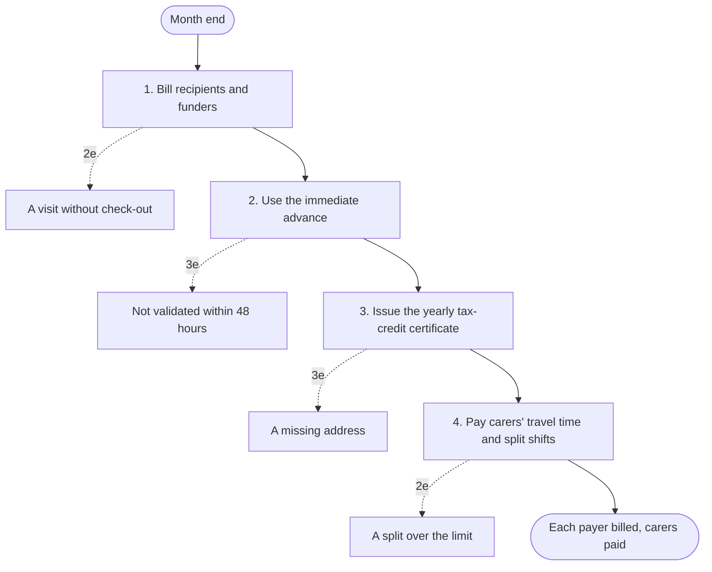

🏠 [Specs](../../../README.md) › 🏷️ [Sectors](../../README.md) › 🏠 [SC04 Home care](../README.md) ›
🔀 [Flows](README.md) › 🔀 FL-SC04-04 Bill and fund

# 🔀 FL-SC04-04 Bill and fund

**Status:** ✅ specified

## Summary

Money: multi-payer billing, the immediate advance, certificates and travel pay. It covers
[UC-SC04-08 Bill recipients and funders](../use-cases/04-bill-and-fund/uc-sc04-08-bill-recipients-and-funders.md),
[UC-SC04-10 Use the immediate advance](../use-cases/04-bill-and-fund/uc-sc04-10-use-the-immediate-advance.md),
[UC-SC04-09 Issue the yearly tax-credit certificate](../use-cases/04-bill-and-fund/uc-sc04-09-issue-the-yearly-tax-credit-certificate.md),
[UC-SC04-11 Pay carers' travel time and split shifts](../use-cases/04-bill-and-fund/uc-sc04-11-pay-carers-travel-time-and-split-shifts.md).

## Personas

- [U05 Accounting](../../../01-users/personas/u05-accounting.md)
- [U09 Customer](../../../01-users/personas/u09-customer.md)
- [U25 Care coordinator](../../../01-users/personas/u25-care-coordinator.md)

## Flowchart

## Sequence diagram

See each use case.

## Steps

| Step | Persona | Screen | Use case | What happens |
|---|---|---|---|---|
| 1 | U05, U25 | [S-SC04-08](../screens/04-bill-and-fund/s-sc04-08-billing.md) | [UC-SC04-08](../use-cases/04-bill-and-fund/uc-sc04-08-bill-recipients-and-funders.md) | Accounting closes the month, checks the visits done, and bills each payer its share through the shared multi-payer invoicing |
| 2 | U05, U09 | [S-SC04-10](../screens/04-bill-and-fund/s-sc04-10-immediate-advance.md) | [UC-SC04-10](../use-cases/04-bill-and-fund/uc-sc04-10-use-the-immediate-advance.md) | A client who chose the immediate advance of the tax credit validates each request within 48 hours, or it is validated automatically; URSSAF pays the whole service and debits the client's share |
| 3 | U05 | [S-SC04-09](../screens/04-bill-and-fund/s-sc04-09-tax-certificates.md) | [UC-SC04-09](../use-cases/04-bill-and-fund/uc-sc04-09-issue-the-yearly-tax-credit-certificate.md) | Accounting generates each client's yearly certificate of amounts paid for home services, checks the amounts and sends them before 31 March |
| 4 | U25, U05 | [S-SC04-11](../screens/04-bill-and-fund/s-sc04-11-travel-time.md) | [UC-SC04-11](../use-cases/04-bill-and-fund/uc-sc04-11-pay-carers-travel-time-and-split-shifts.md) | The care coordinator computes travel time and split shifts per carer from the rounds, checks them and sends them to payroll as pay inputs under the home-help agreement |

### Entities and screens

| Entity | States in this flow | Shown at step and screen | Aggregated view |
|---|---|---|---|
| [E-SC04-13 Immediate advance claim](../data/e-sc04-13-immediate-advance-claim.md) | Sent, Refused, Validated, Cancelled, Paid | 2 [S-SC04-10](../screens/04-bill-and-fund/s-sc04-10-immediate-advance.md) | Immediate advance claims |
| [E-SC04-09 Tax-credit certificate](../data/e-sc04-09-tax-credit-certificate.md) | Sent, Held | 3 [S-SC04-09](../screens/04-bill-and-fund/s-sc04-09-tax-certificates.md) | Tax-credit certificates |
| [E-F13-03 Pay input](../../../02-functional/f13-payroll/data/e-f13-03-pay-input.md) | Closed | Shown elsewhere: [S-F13-03 Pay inputs](../../../02-functional/f13-payroll/screens/02-monthly-pay-run/s-f13-03-pay-inputs.md) | Pay inputs |
| [E-F9-16 Shift](../../../02-functional/f09-hr-and-projects/data/e-f09-16-shift.md) | Draft, Published | Shown elsewhere: [S-F9-30 Scheduling board](../../../02-functional/f09-hr-and-projects/screens/12-schedule-customer-requests/s-f09-30-scheduling-board.md) | Shifts |
| [E-SC04-02 Care funding](../data/e-sc04-02-care-funding.md) | Active | Shown elsewhere: [S-SC04-01 Recipient](../screens/01-take-on-a-recipient/s-sc04-01-recipient.md) | Care fundings |

## Errors

- [UC-SC04-08](../use-cases/04-bill-and-fund/uc-sc04-08-bill-recipients-and-funders.md) 2e. A visit without check-out:
  it is held until the coordinator closes it.
- [UC-SC04-08](../use-cases/04-bill-and-fund/uc-sc04-08-bill-recipients-and-funders.md) 3e. A funding agreement expired:
  its share goes to the recipient and accounting is warned.
- [UC-SC04-10](../use-cases/04-bill-and-fund/uc-sc04-10-use-the-immediate-advance.md) 3e. Not validated within 48 hours:
  URSSAF validates it automatically and the client's share is debited.
- [UC-SC04-10](../use-cases/04-bill-and-fund/uc-sc04-10-use-the-immediate-advance.md) 2e. URSSAF refuses the request:
  the reason is shown and accounting corrects it.
- [UC-SC04-09](../use-cases/04-bill-and-fund/uc-sc04-09-issue-the-yearly-tax-credit-certificate.md) 3e. A missing
  address: the client is listed and the certificate held.
- [UC-SC04-09](../use-cases/04-bill-and-fund/uc-sc04-09-issue-the-yearly-tax-credit-certificate.md) 1e. An unpaid
  invoice: only amounts paid count.
- [UC-SC04-11](../use-cases/04-bill-and-fund/uc-sc04-11-pay-carers-travel-time-and-split-shifts.md) 2e. A split over the
  limit: it is flagged and needs the coordinator's reason.
- [UC-SC04-11](../use-cases/04-bill-and-fund/uc-sc04-11-pay-carers-travel-time-and-split-shifts.md) 3e. Payroll inputs
  already closed: the rest goes to next month as a correction.

## Images

Every step and error, for each persona taking part, in light and dark mode (D120). Steps are numbered as in the Steps
table; E rows are the error cases.

| Step | Persona | Device | Light | Dark |
|---|---|---|---|---|
| 1 | U05 | desktop | [light](../images/04-bill-and-fund/u05-accounting/1-billing-desktop-light.png) | [dark](../images/04-bill-and-fund/u05-accounting/1-billing-desktop-dark.png) |
| 1 | U25 | desktop | [light](../images/04-bill-and-fund/u25-care-coordinator/1-billing-desktop-light.png) | [dark](../images/04-bill-and-fund/u25-care-coordinator/1-billing-desktop-dark.png) |
| 1 | U25 | phone | [light](../images/04-bill-and-fund/u25-care-coordinator/1-billing-phone-light.png) | [dark](../images/04-bill-and-fund/u25-care-coordinator/1-billing-phone-dark.png) |
| 2 | U09 | phone | [light](../images/04-bill-and-fund/u09-customer/2-advance-phone-light.png) | [dark](../images/04-bill-and-fund/u09-customer/2-advance-phone-dark.png) |
| 2 | U05 | desktop | [light](../images/04-bill-and-fund/u05-accounting/2-advance-desktop-light.png) | [dark](../images/04-bill-and-fund/u05-accounting/2-advance-desktop-dark.png) |
| 3 | U05 | desktop | [light](../images/04-bill-and-fund/u05-accounting/3-certificate-desktop-light.png) | [dark](../images/04-bill-and-fund/u05-accounting/3-certificate-desktop-dark.png) |
| 4 | U25 | desktop | [light](../images/04-bill-and-fund/u25-care-coordinator/4-travel-time-desktop-light.png) | [dark](../images/04-bill-and-fund/u25-care-coordinator/4-travel-time-desktop-dark.png) |
| 4 | U25 | phone | [light](../images/04-bill-and-fund/u25-care-coordinator/4-travel-time-phone-light.png) | [dark](../images/04-bill-and-fund/u25-care-coordinator/4-travel-time-phone-dark.png) |
| 4 | U05 | desktop | [light](../images/04-bill-and-fund/u05-accounting/4-travel-time-desktop-light.png) | [dark](../images/04-bill-and-fund/u05-accounting/4-travel-time-desktop-dark.png) |
| E1 | U05 | desktop | [light](../images/04-bill-and-fund/u05-accounting/e1-visit-open-desktop-light.png) | [dark](../images/04-bill-and-fund/u05-accounting/e1-visit-open-desktop-dark.png) |

## Open questions

None.

---

⬅️ [FL-SC04-03 Visit](fl-sc04-03-visit.md) · ⬆️ [Up](README.md) ·
➡️ [FL-SC04-05 People and quality](fl-sc04-05-people-and-quality.md)
