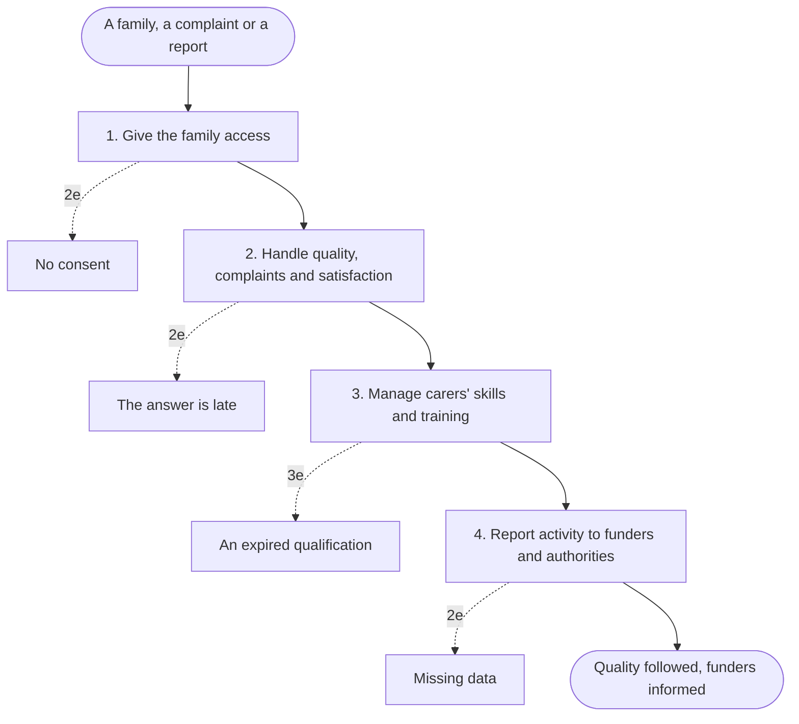

🏠 [Specs](../../../README.md) › 🏷️ [Sectors](../../README.md) › 🏠 [SC04 Home care](../README.md) ›
🔀 [Flows](README.md) › 🔀 FL-SC04-05 People and quality

# 🔀 FL-SC04-05 People and quality

**Status:** ✅ specified

## Summary

Families, quality, carers' skills and reports to funders. It covers
[UC-SC04-07 Give the family access](../use-cases/05-people-and-quality/uc-sc04-07-give-the-family-access.md),
[UC-SC04-12 Handle quality, complaints and satisfaction](../use-cases/05-people-and-quality/uc-sc04-12-handle-quality-complaints-and-satisfaction.md),
[UC-SC04-13 Manage carers' skills and training](../use-cases/05-people-and-quality/uc-sc04-13-manage-carers-skills-and-training.md),
[UC-SC04-14 Report activity to funders and authorities](../use-cases/05-people-and-quality/uc-sc04-14-report-activity-to-funders-and-authorities.md).

## Personas

- [U06 Human resources](../../../01-users/personas/u06-hr.md)
- [U09 Customer](../../../01-users/personas/u09-customer.md)
- [U13 Owner](../../../01-users/personas/u13-owner.md)
- [U25 Care coordinator](../../../01-users/personas/u25-care-coordinator.md)

## Flowchart

## Sequence diagram

See each use case.

## Steps

| Step | Persona | Screen | Use case | What happens |
|---|---|---|---|---|
| 1 | U09, U25 | [S-SC04-07](../screens/03-visit/s-sc04-07-family-access.md) | [UC-SC04-07](../use-cases/05-people-and-quality/uc-sc04-07-give-the-family-access.md) | The care coordinator invites a family member to the family portal, built on the shared portal capability, with the recipient's consent they see visits, the shared log and invoices |
| 2 | U25, U13 | [S-SC04-12](../screens/05-people-and-quality/s-sc04-12-quality.md) | [UC-SC04-12](../use-cases/05-people-and-quality/uc-sc04-12-handle-quality-complaints-and-satisfaction.md) | The care coordinator records complaints, answers them within the set delay and closes them with an action, the owner runs the yearly satisfaction survey |
| 3 | U25, U06 | [S-SC04-13](../screens/05-people-and-quality/s-sc04-13-carer-skills.md) | [UC-SC04-13](../use-cases/05-people-and-quality/uc-sc04-13-manage-carers-skills-and-training.md) | The care coordinator and HR record carers' qualifications, plan training before expiry, and the planning uses only current ones |
| 4 | U25, U13 | [S-SC04-14](../screens/05-people-and-quality/s-sc04-14-activity-reports.md) | [UC-SC04-14](../use-cases/05-people-and-quality/uc-sc04-14-report-activity-to-funders-and-authorities.md) | The care coordinator generates hours by funder, the quarterly statements and the yearly report, checks them and sends or files them, operating grants are followed as grants |

### Entities and screens

| Entity | States in this flow | Shown at step and screen | Aggregated view |
|---|---|---|---|
| [E-SC04-10 Complaint](../data/e-sc04-10-complaint.md) | Open, Answered, Closed | 2 [S-SC04-12](../screens/05-people-and-quality/s-sc04-12-quality.md) | Complaints |
| [E-SC04-07 Care incident](../data/e-sc04-07-care-incident.md) | Active | 1 [S-SC04-07](../screens/03-visit/s-sc04-07-family-access.md) | Care incidents |
| [E-F5-10 Consent and suppression record](../../../02-functional/f05-social-media/data/e-f05-10-consent-and-suppression-record.md) | Given, Withdrawn | Shown elsewhere: [S-F5-15 Consent register](../../../02-functional/f05-social-media/screens/06-audiences-consent-and-journeys/s-f05-15-consent-register.md) | Consent and suppression records |
| [E-SC12-09 Survey answer](../../sc12-education-and-training/data/e-sc12-09-survey-answer.md) | Recorded | Shown elsewhere: [S-SC12-09 Satisfaction](../../sc12-education-and-training/screens/03-deliver-and-assess/s-sc12-09-satisfaction.md) | Survey answers |
| [E-SC04-11 Carer qualification](../data/e-sc04-11-carer-qualification.md) | Active | 3 [S-SC04-13](../screens/05-people-and-quality/s-sc04-13-carer-skills.md) | Carer qualifications |
| [E-F9-22 Training session](../../../02-functional/f09-hr-and-projects/data/e-f09-22-training-session.md) | Planned, Closed, Held | Shown elsewhere: [S-F9-22 Training plan](../../../02-functional/f09-hr-and-projects/screens/09-train-and-protect/s-f09-22-training-plan.md) | Training sessions |
| [E-SC03-13 Satisfaction survey](../../sc03-services/data/e-sc03-13-satisfaction-survey.md) | Sent, Closed | Shown elsewhere: [S-SC03-12 Satisfaction](../../sc03-services/screens/05-client-and-people/s-sc03-12-satisfaction.md) | Satisfaction surveys |

## Errors

- [UC-SC04-07](../use-cases/05-people-and-quality/uc-sc04-07-give-the-family-access.md) 2e. No consent: no access is
  given.
- [UC-SC04-07](../use-cases/05-people-and-quality/uc-sc04-07-give-the-family-access.md) 3e. Consent withdrawn: access
  stops at once.
- [UC-SC04-12](../use-cases/05-people-and-quality/uc-sc04-12-handle-quality-complaints-and-satisfaction.md) 2e. The
  answer is late: the coordinator and the owner are alerted.
- [UC-SC04-12](../use-cases/05-people-and-quality/uc-sc04-12-handle-quality-complaints-and-satisfaction.md) 3e. A
  closing without action: it is refused.
- [UC-SC04-13](../use-cases/05-people-and-quality/uc-sc04-13-manage-carers-skills-and-training.md) 3e. An expired
  qualification: the carer is not assigned to visits needing it.
- [UC-SC04-13](../use-cases/05-people-and-quality/uc-sc04-13-manage-carers-skills-and-training.md) 1e. A certificate
  without a date: it is refused.
- [UC-SC04-14](../use-cases/05-people-and-quality/uc-sc04-14-report-activity-to-funders-and-authorities.md) 2e. Missing
  data: the missing items are listed.
- [UC-SC04-14](../use-cases/05-people-and-quality/uc-sc04-14-report-activity-to-funders-and-authorities.md) 3e. A filing
  deadline passed: the owner is alerted.

## Images

Every step and error, for each persona taking part, in light and dark mode (D120). Steps are numbered as in the Steps
table; E rows are the error cases.

| Step | Persona | Device | Light | Dark |
|---|---|---|---|---|
| 1 | U09 | phone | [light](../images/05-people-and-quality/u09-customer/1-family-phone-light.png) | [dark](../images/05-people-and-quality/u09-customer/1-family-phone-dark.png) |
| 1 | U25 | desktop | [light](../images/05-people-and-quality/u25-care-coordinator/1-family-desktop-light.png) | [dark](../images/05-people-and-quality/u25-care-coordinator/1-family-desktop-dark.png) |
| 1 | U25 | phone | [light](../images/05-people-and-quality/u25-care-coordinator/1-family-phone-light.png) | [dark](../images/05-people-and-quality/u25-care-coordinator/1-family-phone-dark.png) |
| 2 | U25 | desktop | [light](../images/05-people-and-quality/u25-care-coordinator/2-complaint-desktop-light.png) | [dark](../images/05-people-and-quality/u25-care-coordinator/2-complaint-desktop-dark.png) |
| 2 | U25 | phone | [light](../images/05-people-and-quality/u25-care-coordinator/2-complaint-phone-light.png) | [dark](../images/05-people-and-quality/u25-care-coordinator/2-complaint-phone-dark.png) |
| 2 | U13 | desktop | [light](../images/05-people-and-quality/u13-owner/2-complaint-desktop-light.png) | [dark](../images/05-people-and-quality/u13-owner/2-complaint-desktop-dark.png) |
| 2 | U13 | phone | [light](../images/05-people-and-quality/u13-owner/2-complaint-phone-light.png) | [dark](../images/05-people-and-quality/u13-owner/2-complaint-phone-dark.png) |
| 3 | U25 | desktop | [light](../images/05-people-and-quality/u25-care-coordinator/3-skills-desktop-light.png) | [dark](../images/05-people-and-quality/u25-care-coordinator/3-skills-desktop-dark.png) |
| 3 | U25 | phone | [light](../images/05-people-and-quality/u25-care-coordinator/3-skills-phone-light.png) | [dark](../images/05-people-and-quality/u25-care-coordinator/3-skills-phone-dark.png) |
| 3 | U06 | desktop | [light](../images/05-people-and-quality/u06-hr/3-skills-desktop-light.png) | [dark](../images/05-people-and-quality/u06-hr/3-skills-desktop-dark.png) |
| 4 | U25 | desktop | [light](../images/05-people-and-quality/u25-care-coordinator/4-report-desktop-light.png) | [dark](../images/05-people-and-quality/u25-care-coordinator/4-report-desktop-dark.png) |
| 4 | U25 | phone | [light](../images/05-people-and-quality/u25-care-coordinator/4-report-phone-light.png) | [dark](../images/05-people-and-quality/u25-care-coordinator/4-report-phone-dark.png) |
| 4 | U13 | desktop | [light](../images/05-people-and-quality/u13-owner/4-report-desktop-light.png) | [dark](../images/05-people-and-quality/u13-owner/4-report-desktop-dark.png) |
| 4 | U13 | phone | [light](../images/05-people-and-quality/u13-owner/4-report-phone-light.png) | [dark](../images/05-people-and-quality/u13-owner/4-report-phone-dark.png) |
| E1 | U25 | desktop | [light](../images/05-people-and-quality/u25-care-coordinator/e1-no-consent-desktop-light.png) | [dark](../images/05-people-and-quality/u25-care-coordinator/e1-no-consent-desktop-dark.png) |
| E1 | U25 | phone | [light](../images/05-people-and-quality/u25-care-coordinator/e1-no-consent-phone-light.png) | [dark](../images/05-people-and-quality/u25-care-coordinator/e1-no-consent-phone-dark.png) |

## Open questions

None.

---

⬅️ [FL-SC04-04 Bill and fund](fl-sc04-04-bill-and-fund.md) · ⬆️ [Up](README.md) ·
➡️ [FL-SC04-06 Care homes, CESU, agent mode, childcare and nursing](fl-sc04-06-care-homes-cesu-and-nursing.md)
