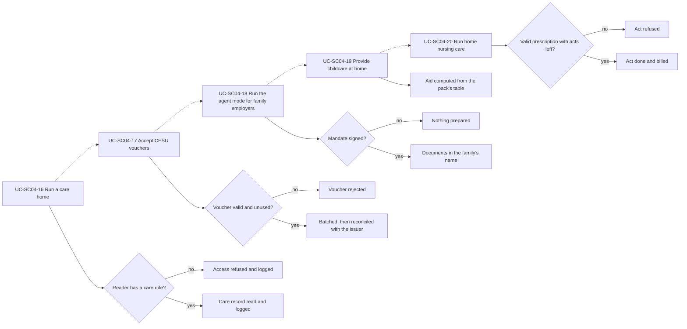
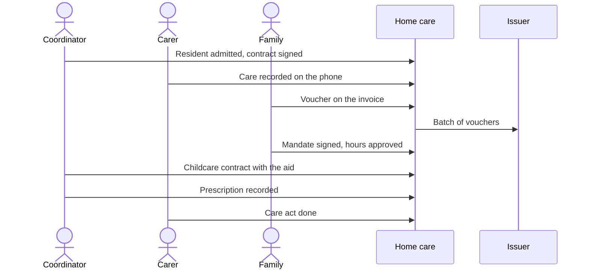

🏠 [Specs](../../../README.md) › 🏷️ [Sectors](../../README.md) › 🏠 [SC04 Home care](../README.md) ›
🔀 [Flows](README.md) › 🔀 FL-SC04-06 Care homes, CESU, agent mode, childcare and nursing

# 🔀 FL-SC04-06 Care homes, CESU, agent mode, childcare and nursing

**Status:** 🔄 waiting for the owner

## Summary

Five situations of home-care and care-home providers: running a care home with health-data protection, accepting CESU
vouchers, helping families employ carers in agent mode, providing childcare at home with the family allowance aid, and
giving home nursing care on a prescription
([D548](../../../06-decisions/sectors/d548-benchmark-gaps-sc04-home-care.md)).

## Personas

- [U25 Care coordinator](../../../01-users/personas/u25-care-coordinator.md), who admits, batches, prepares and bills
- [U26 Carer](../../../01-users/personas/u26-carer.md), who records the care on the phone
- [U09 Customer](../../../01-users/personas/u09-customer.md), who pays, signs and approves on the phone

## Flowchart

## Sequence diagram

## Steps

| Step | Persona | Screen | Use case | What happens |
|---|---|---|---|---|
| 1 | [U25](../../../01-users/personas/u25-care-coordinator.md) | [S-SC04-16](../screens/06-care-homes-cesu-and-nursing/s-sc04-16-care-home.md) | [UC-SC04-16](../use-cases/06-care-homes-cesu-and-nursing/uc-sc04-16-run-a-care-home.md) | The coordinator admits a resident under a signed stay contract and the carers write the care record that only they can read |
| 2 | [U25](../../../01-users/personas/u25-care-coordinator.md) | [S-SC04-17](../screens/06-care-homes-cesu-and-nursing/s-sc04-17-cesu.md) | [UC-SC04-17](../use-cases/06-care-homes-cesu-and-nursing/uc-sc04-17-accept-cesu-vouchers.md) | The coordinator records the vouchers a customer pays with, sends them to the issuer and reconciles its payment |
| 3 | [U25](../../../01-users/personas/u25-care-coordinator.md) | [S-SC04-18](../screens/06-care-homes-cesu-and-nursing/s-sc04-18-agent-mode.md) | [UC-SC04-18](../use-cases/06-care-homes-cesu-and-nursing/uc-sc04-18-run-the-agent-mode-for-family-employers.md) | The coordinator prepares the mandate and the family approves the carer's hours and signs on the phone |
| 4 | [U25](../../../01-users/personas/u25-care-coordinator.md) | [S-SC04-19](../screens/06-care-homes-cesu-and-nursing/s-sc04-19-childcare.md) | [UC-SC04-19](../use-cases/06-care-homes-cesu-and-nursing/uc-sc04-19-provide-childcare-at-home.md) | The coordinator agrees the childcare contract and the aid, and the carer records each visit on the phone |
| 5 | [U25](../../../01-users/personas/u25-care-coordinator.md) | [S-SC04-20](../screens/06-care-homes-cesu-and-nursing/s-sc04-20-home-nursing.md) | [UC-SC04-20](../use-cases/06-care-homes-cesu-and-nursing/uc-sc04-20-run-home-nursing-care.md) | The coordinator records the prescription and the carers record each care act against it |

### Entities and screens

| Entity | States in this flow | Shown at step and screen | Aggregated view |
|---|---|---|---|
| [E-SC04-14 Resident](../data/e-sc04-14-resident.md) | Waiting, Admitted, Absent, Left | 1 [S-SC04-16](../screens/06-care-homes-cesu-and-nursing/s-sc04-16-care-home.md) | Residents |
| [E-SC04-15 CESU voucher](../data/e-sc04-15-cesu-voucher.md) | Received, Sent, Reimbursed, Rejected | 2 [S-SC04-17](../screens/06-care-homes-cesu-and-nursing/s-sc04-17-cesu.md) | CESU vouchers |
| [E-SC04-16 Mandate](../data/e-sc04-16-mandate.md) | Draft, Active, Ended, Cancelled | 3 [S-SC04-18](../screens/06-care-homes-cesu-and-nursing/s-sc04-18-agent-mode.md) | Mandates |
| [E-SC04-17 Childcare contract](../data/e-sc04-17-childcare-contract.md) | Draft, Active, Suspended, Ended | 4 [S-SC04-19](../screens/06-care-homes-cesu-and-nursing/s-sc04-19-childcare.md) | Childcare contracts |
| [E-SC04-18 Care act](../data/e-sc04-18-care-act.md) | Planned, Done, Billed, Cancelled | 5 [S-SC04-20](../screens/06-care-homes-cesu-and-nursing/s-sc04-20-home-nursing.md) | Care acts |
| [E-SC04-01 Care recipient](../data/e-sc04-01-care-recipient.md) | Assessed, Served, Left, Paused | Shown elsewhere: [S-SC04-01 Recipient](../screens/01-take-on-a-recipient/s-sc04-01-recipient.md) | Care recipients |
| [E-SC04-04 Visit](../data/e-sc04-04-visit.md) | Planned, Done, Cancelled, Missed | Shown elsewhere: [S-SC04-04 Visit](../screens/02-plan-the-rounds/s-sc04-04-visit.md) | Visits |

## Errors

- **E1 The voucher is rejected.** The voucher is expired, already used or not eligible; it is rejected with the reason
  and the invoice stays open
  ([BR-SC04-17](../business-rules/br-sc04-17-cesu-vouchers-are-reconciled-with-the-issuer.md), step 2).

## Images

Every step and error, for each persona taking part, in light and dark mode (D120). Steps are numbered as in the Steps
table; E rows are the error cases.

| Step | Persona | Device | Light | Dark |
|---|---|---|---|---|
| 1 | U25 | desktop | [light](../images/06-care-homes-cesu-and-nursing/u25-care-coordinator/1-care-home-desktop-light.png) | [dark](../images/06-care-homes-cesu-and-nursing/u25-care-coordinator/1-care-home-desktop-dark.png) |
| 1 | U26 | phone | [light](../images/06-care-homes-cesu-and-nursing/u26-carer/1-care-home-phone-light.png) | [dark](../images/06-care-homes-cesu-and-nursing/u26-carer/1-care-home-phone-dark.png) |
| 1 | U25 | phone | [light](../images/06-care-homes-cesu-and-nursing/u25-care-coordinator/1-care-home-phone-light.png) | [dark](../images/06-care-homes-cesu-and-nursing/u25-care-coordinator/1-care-home-phone-dark.png) |
| 2 | U25 | desktop | [light](../images/06-care-homes-cesu-and-nursing/u25-care-coordinator/2-cesu-desktop-light.png) | [dark](../images/06-care-homes-cesu-and-nursing/u25-care-coordinator/2-cesu-desktop-dark.png) |
| 2 | U09 | phone | [light](../images/06-care-homes-cesu-and-nursing/u09-customer/2-cesu-phone-light.png) | [dark](../images/06-care-homes-cesu-and-nursing/u09-customer/2-cesu-phone-dark.png) |
| 2 | U25 | phone | [light](../images/06-care-homes-cesu-and-nursing/u25-care-coordinator/2-cesu-phone-light.png) | [dark](../images/06-care-homes-cesu-and-nursing/u25-care-coordinator/2-cesu-phone-dark.png) |
| 3 | U25 | desktop | [light](../images/06-care-homes-cesu-and-nursing/u25-care-coordinator/3-agent-mode-desktop-light.png) | [dark](../images/06-care-homes-cesu-and-nursing/u25-care-coordinator/3-agent-mode-desktop-dark.png) |
| 3 | U09 | phone | [light](../images/06-care-homes-cesu-and-nursing/u09-customer/3-agent-mode-phone-light.png) | [dark](../images/06-care-homes-cesu-and-nursing/u09-customer/3-agent-mode-phone-dark.png) |
| 3 | U25 | phone | [light](../images/06-care-homes-cesu-and-nursing/u25-care-coordinator/3-agent-mode-phone-light.png) | [dark](../images/06-care-homes-cesu-and-nursing/u25-care-coordinator/3-agent-mode-phone-dark.png) |
| 4 | U25 | desktop | [light](../images/06-care-homes-cesu-and-nursing/u25-care-coordinator/4-childcare-desktop-light.png) | [dark](../images/06-care-homes-cesu-and-nursing/u25-care-coordinator/4-childcare-desktop-dark.png) |
| 4 | U26 | phone | [light](../images/06-care-homes-cesu-and-nursing/u26-carer/4-childcare-phone-light.png) | [dark](../images/06-care-homes-cesu-and-nursing/u26-carer/4-childcare-phone-dark.png) |
| 4 | U25 | phone | [light](../images/06-care-homes-cesu-and-nursing/u25-care-coordinator/4-childcare-phone-light.png) | [dark](../images/06-care-homes-cesu-and-nursing/u25-care-coordinator/4-childcare-phone-dark.png) |
| 5 | U25 | desktop | [light](../images/06-care-homes-cesu-and-nursing/u25-care-coordinator/5-home-nursing-desktop-light.png) | [dark](../images/06-care-homes-cesu-and-nursing/u25-care-coordinator/5-home-nursing-desktop-dark.png) |
| 5 | U26 | phone | [light](../images/06-care-homes-cesu-and-nursing/u26-carer/5-home-nursing-phone-light.png) | [dark](../images/06-care-homes-cesu-and-nursing/u26-carer/5-home-nursing-phone-dark.png) |
| 5 | U25 | phone | [light](../images/06-care-homes-cesu-and-nursing/u25-care-coordinator/5-home-nursing-phone-light.png) | [dark](../images/06-care-homes-cesu-and-nursing/u25-care-coordinator/5-home-nursing-phone-dark.png) |
| E1 | U25 | desktop | [light](../images/06-care-homes-cesu-and-nursing/u25-care-coordinator/e1-the-voucher-is-rejected-desktop-light.png) | [dark](../images/06-care-homes-cesu-and-nursing/u25-care-coordinator/e1-the-voucher-is-rejected-desktop-dark.png) |
| E1 | U25 | phone | [light](../images/06-care-homes-cesu-and-nursing/u25-care-coordinator/e1-the-voucher-is-rejected-phone-light.png) | [dark](../images/06-care-homes-cesu-and-nursing/u25-care-coordinator/e1-the-voucher-is-rejected-phone-dark.png) |

## Open questions

None.

---

⬅️ [FL-SC04-05 People and quality](fl-sc04-05-people-and-quality.md) · ⬆️ [Up](README.md)
