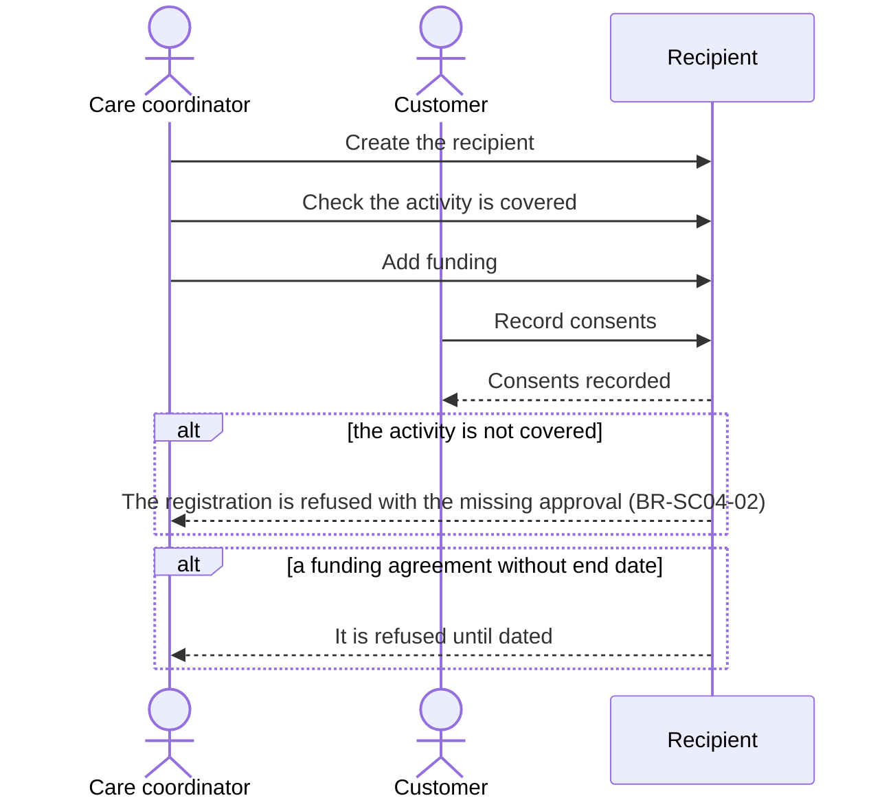

🏠 [Specs](../../../../README.md) › 🏷️ [Sectors](../../../README.md) › 🏠 [SC04 Home care](../../README.md) ›
📝 [Use cases](../README.md) › 📝 [Use cases: FL-SC04-01 Take on a recipient](README.md) ›
📝 UC-SC04-01 Register a care recipient and their funding

# 📝 UC-SC04-01 Register a care recipient and their funding

**Status:** ✅ specified

## Summary

The care coordinator registers a recipient with contacts, address and access code, their funders and shares, and their
consents, checking that the company's registration covers the activity there.

## Personas

- [U25 Care coordinator](../../../../01-users/personas/u25-care-coordinator.md)
- [U09 Customer](../../../../01-users/personas/u09-customer.md)

## Goal

A recipient ready for a care plan, with each payer's share known.

## Trigger

A new request from a family, a hospital or a funder.

## Frequency

A few a week per agency.

## Preconditions

- The SC04 sector pack is installed for the company,
  [UC-F14-02](../../../../02-functional/f14-plugin-store/use-cases/01-find-and-install/uc-f14-02-install-a-plugin-or-sector-pack.md),
  and its users have their roles,
  [UC-F1-06](../../../../02-functional/f01-administration/use-cases/04-edit-a-role/uc-f01-06-edit-a-role-and-its-record-rules.md).
- The company's declaration, approval or authorisation is recorded for the territory
  ([BR-SC04-02](../../business-rules/br-sc04-02-activities-need-their-registration.md)).

## Postconditions

- **Success:** the recipient is served, with funding agreements and consents recorded.
- **Failed:** the recipient is not registered; the request is closed with its reason.

## Main flow

1. The care coordinator creates the recipient on
   [S-SC04-01 Recipient](../../screens/01-take-on-a-recipient/s-sc04-01-recipient.md): name, address, access code and
   contacts.
2. Simple-ERP checks that the company may offer the activity in that territory
   ([BR-SC04-02](../../business-rules/br-sc04-02-activities-need-their-registration.md)).
3. The care coordinator adds each funder's agreement with its share, hours and dates, the shared multi-payer agreement,
   [UC-F6-20](../../../../02-functional/f06-customers-and-sales/use-cases/07-special-invoicing/uc-f06-20-invoice-several-payers-with-funders-and-caps.md).
4. The recipient or their representative gives consents: family access, health data use
   ([BR-SC04-04](../../business-rules/br-sc04-04-health-data-hosted-and-restricted.md)).

## Alternative flows

- 4a. A recipient under guardianship: the guardian signs and receives the documents.

## Error flows

- 2e. The activity is not covered: the registration is refused with the missing approval
  ([BR-SC04-02](../../business-rules/br-sc04-02-activities-need-their-registration.md)).
- 3e. A funding agreement without end date: it is refused until dated.
- Any step: a call to a service or an outside system fails: it is retried first
  ([BR-F3-32](../../../../02-functional/f03-assistant/business-rules/br-f03-32-retry-before-an-error.md)), then the
  error message pattern ([D122](../../../../06-decisions/ux/d122-error-message-standard.md)) says what failed; what was
  typed is kept.

## Business rules

- [BR-SC04-02 Activities need their registration](../../business-rules/br-sc04-02-activities-need-their-registration.md)
- [BR-SC04-04 Health data hosted and restricted](../../business-rules/br-sc04-04-health-data-hosted-and-restricted.md)
- [BR-SC04-01 Home care follows the country pack](../../business-rules/br-sc04-01-home-care-follows-the-country-pack.md)
- [BR-SC04-15 Records kept no longer than needed](../../business-rules/br-sc04-15-records-kept-no-longer-than-needed.md)
- [BR-F6-13 Each payer pays its share up to its cap](../../../../02-functional/f06-customers-and-sales/business-rules/br-f06-13-each-payer-pays-its-share-up-to-its-cap.md)

## Entities

- [E-SC04-01 Care recipient](../../data/e-sc04-01-care-recipient.md)
- [E-SC04-02 Care funding](../../data/e-sc04-02-care-funding.md)
- [E-F6-14 Funder agreement](../../../../02-functional/f06-customers-and-sales/data/e-f06-14-funder-agreement.md)

## Permissions

The care coordinator and customer roles; the record rules of their role and site apply,
[UC-F1-06](../../../../02-functional/f01-administration/use-cases/04-edit-a-role/uc-f01-06-edit-a-role-and-its-record-rules.md).

## Notifications

None beyond the in-app updates of the records concerned.

## Audit events

Every creation, change and state change of care recipient, funding, funder agreement records, with who, when and the
values before and after (T3).

## AI involvement

The AI assistant answers questions on the care recipient, funding, funder agreement records of this use case, with
links, and prepares them as drafts the user confirms. It works within the user's rights,
[BR-F3-34](../../../../02-functional/f03-assistant/business-rules/br-f03-34-every-capability-is-reachable-from-the-assistant.md),
and never deletes or does anything irreversible without the user's confirmation,
[BR-F3-07](../../../../02-functional/f03-assistant/business-rules/br-f03-07-no-deletes-no-irreversible-acts.md).

## API, MCP and A2A exposure

Through the API and webhooks (T5) and the MCP and A2A gateway (T6), with the caller's rights,
[BR-F3-34](../../../../02-functional/f03-assistant/business-rules/br-f03-34-every-capability-is-reachable-from-the-assistant.md),
reading, creating and changing the records of this use case; nothing irreversible without a person's confirmation.

## Screens

- [S-SC04-01 Recipient](../../screens/01-take-on-a-recipient/s-sc04-01-recipient.md)

## Flowchart

See [FL-SC04-01 Take on a recipient](../../flows/fl-sc04-01-take-on-a-recipient.md#flowchart).

## Sequence diagram

## Acceptance criteria

1. **Given** the example home-care service's recipient M. Petit, Lyon, access code 4471, funded by the département at 80
   % of 20 hours in 2026 **when** he is registered **then** his funding shows the département 80 % and himself 20 %.
2. **Given** M. Petit under a guardian **when** consents are recorded **then** the guardian signs and receives the
   documents.
3. **Given** personal care asked in a département the authorisation does not cover **when** the recipient is created
   **then** the registration is refused with the missing approval
   ([BR-SC04-02](../../business-rules/br-sc04-02-activities-need-their-registration.md)).

## Non-functional notes

[D408](../../../../06-decisions/technical/d408-performance-and-profiles.md)'s targets
([performance](../../../../05-non-functional/performance.md)): 95 % of screens within 1 second; lists paged on the
server, the first page within 1 second; reports within 5 seconds or in the background. WCAG 2.2 AA and RGAA
([D46](../../../../06-decisions/ux/d46-accessibility-standard.md)).

## Regulatory references

Legal values from the France country pack:
[CR-FR-102 Personal-services declaration, approval and authorisation](../../../../10-country-packs/france/home-care/cr-fr-102-personal-services-registration.md),
[CR-FR-055 Health data hosting](../../../../10-country-packs/france/data-protection/cr-fr-055-health-data-hosting.md).

## Related use cases

- [UC-SC04-02 Assess needs and write the care plan](uc-sc04-02-assess-needs-and-write-the-care-plan.md)

## Open questions

None.

---

⬆️ [Up](README.md) ·
➡️ [UC-SC04-02 Assess needs and write the care plan](uc-sc04-02-assess-needs-and-write-the-care-plan.md)
