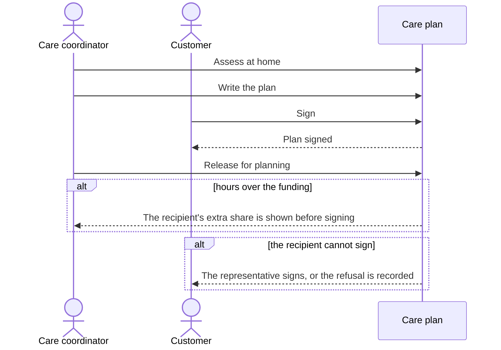

🏠 [Specs](../../../../README.md) › 🏷️ [Sectors](../../../README.md) › 🏠 [SC04 Home care](../../README.md) ›
📝 [Use cases](../README.md) › 📝 [Use cases: FL-SC04-01 Take on a recipient](README.md) ›
📝 UC-SC04-02 Assess needs and write the care plan

# 📝 UC-SC04-02 Assess needs and write the care plan

**Status:** ✅ specified

## Summary

The care coordinator visits the recipient, assesses needs, writes the care plan with tasks, frequency, hours and
funding, and has it signed; visits are planned only from a signed plan.

## Personas

- [U25 Care coordinator](../../../../01-users/personas/u25-care-coordinator.md)
- [U09 Customer](../../../../01-users/personas/u09-customer.md)

## Goal

A signed care plan the rounds can be built from.

## Trigger

A new recipient, or a change in needs.

## Frequency

Once per recipient, then at each review.

## Preconditions

- The SC04 sector pack is installed for the company,
  [UC-F14-02](../../../../02-functional/f14-plugin-store/use-cases/01-find-and-install/uc-f14-02-install-a-plugin-or-sector-pack.md),
  and its users have their roles,
  [UC-F1-06](../../../../02-functional/f01-administration/use-cases/04-edit-a-role/uc-f01-06-edit-a-role-and-its-record-rules.md).
- The recipient is registered ([UC-SC04-01](uc-sc04-01-register-a-care-recipient-and-their-funding.md)).

## Postconditions

- **Success:** the plan is signed and its visits can be generated.
- **Failed:** no visit is planned; the draft is kept.

## Main flow

1. The care coordinator assesses needs at home on the tablet on
   [S-SC04-02 Care plan](../../screens/01-take-on-a-recipient/s-sc04-02-care-plan.md).
2. The care coordinator writes tasks, frequency and hours; simple-ERP shows each payer's share.
3. The recipient signs the plan on the tablet,
   [UC-F2-14](../../../../02-functional/f02-no-code-configuration/use-cases/07-benchmark-additions/uc-f02-14-send-documents-for-e-signature.md).
4. The plan's visits go to planning ([BR-SC04-03](../../business-rules/br-sc04-03-care-plan-before-visits.md)).

## Alternative flows

- 1a. A review after a hospital stay: a new version replaces the old one from its date; the old one is kept.

## Error flows

- 2e. Hours over the funding: the recipient's extra share is shown before signing.
- 3e. The recipient cannot sign: the representative signs, or the refusal is recorded.
- Any step: a call to a service or an outside system fails: it is retried first
  ([BR-F3-32](../../../../02-functional/f03-assistant/business-rules/br-f03-32-retry-before-an-error.md)), then the
  error message pattern ([D122](../../../../06-decisions/ux/d122-error-message-standard.md)) says what failed; what was
  typed is kept.

## Business rules

- [BR-SC04-03 A care plan before visits](../../business-rules/br-sc04-03-care-plan-before-visits.md)
- [BR-SC04-04 Health data hosted and restricted](../../business-rules/br-sc04-04-health-data-hosted-and-restricted.md)

## Entities

- [E-SC04-03 Care plan](../../data/e-sc04-03-care-plan.md)

## Permissions

The care coordinator and customer roles; the record rules of their role and site apply,
[UC-F1-06](../../../../02-functional/f01-administration/use-cases/04-edit-a-role/uc-f01-06-edit-a-role-and-its-record-rules.md).

## Notifications

None beyond the in-app updates of the records concerned.

## Audit events

Every creation, change and state change of care plan records, with who, when and the values before and after (T3).

## AI involvement

The AI assistant answers questions on the care plan records of this use case, with links, and prepares them as drafts
the user confirms. It works within the user's rights,
[BR-F3-34](../../../../02-functional/f03-assistant/business-rules/br-f03-34-every-capability-is-reachable-from-the-assistant.md),
and never deletes or does anything irreversible without the user's confirmation,
[BR-F3-07](../../../../02-functional/f03-assistant/business-rules/br-f03-07-no-deletes-no-irreversible-acts.md).

## API, MCP and A2A exposure

Through the API and webhooks (T5) and the MCP and A2A gateway (T6), with the caller's rights,
[BR-F3-34](../../../../02-functional/f03-assistant/business-rules/br-f03-34-every-capability-is-reachable-from-the-assistant.md),
reading, creating and changing the records of this use case; nothing irreversible without a person's confirmation.

## Screens

- [S-SC04-02 Care plan](../../screens/01-take-on-a-recipient/s-sc04-02-care-plan.md)

## Flowchart

See [FL-SC04-01 Take on a recipient](../../flows/fl-sc04-01-take-on-a-recipient.md#flowchart).

## Sequence diagram

## Acceptance criteria

1. **Given** the example home-care service's plan v2 for M. Petit, meals 5 times a week, signed on 2 November **when**
   planning runs **then** 5 meal visits a week are generated from 2 November.
2. **Given** M. Petit's plan at 24 hours with 20 hours funded **when** the plan is written **then** the recipient's
   extra share is shown before signing.

## Non-functional notes

[D408](../../../../06-decisions/technical/d408-performance-and-profiles.md)'s targets
([performance](../../../../05-non-functional/performance.md)): 95 % of screens within 1 second; lists paged on the
server, the first page within 1 second; reports within 5 seconds or in the background. WCAG 2.2 AA and RGAA
([D46](../../../../06-decisions/ux/d46-accessibility-standard.md)).

## Regulatory references

None specific to this use case; the sector's legal rules are listed in [SC04 regulatory](../../regulatory.md).

## Related use cases

- [UC-SC04-03 Plan visits and optimise rounds](../02-plan-the-rounds/uc-sc04-03-plan-visits-and-optimise-rounds.md)

## Open questions

None.

---

⬅️ [UC-SC04-01 Register a care recipient and their funding](uc-sc04-01-register-a-care-recipient-and-their-funding.md) ·
⬆️ [Up](README.md) ·
➡️ [UC-SC04-03 Plan visits and optimise rounds](../02-plan-the-rounds/uc-sc04-03-plan-visits-and-optimise-rounds.md)
