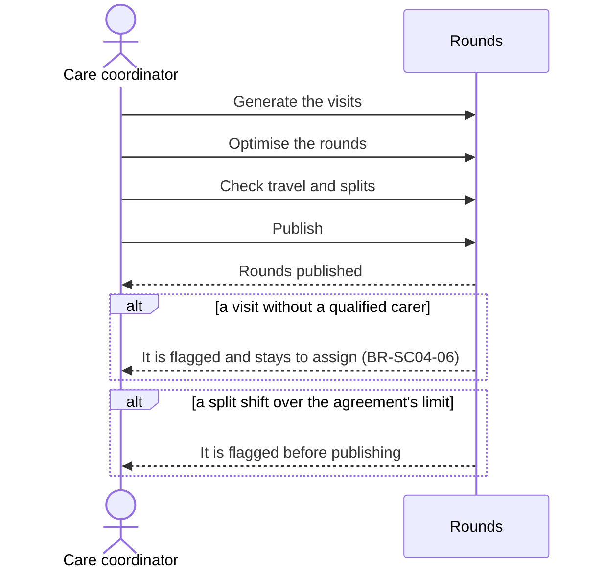

🏠 [Specs](../../../../README.md) › 🏷️ [Sectors](../../../README.md) › 🏠 [SC04 Home care](../../README.md) ›
📝 [Use cases](../README.md) › 📝 [Use cases: FL-SC04-02 Plan the rounds](README.md) ›
📝 UC-SC04-03 Plan visits and optimise rounds

# 📝 UC-SC04-03 Plan visits and optimise rounds

**Status:** ✅ specified

## Summary

The care coordinator generates the week's visits from the care plans and has the shared rounds optimiser assign carers
by skills, continuity and travel time, then publishes the rounds to phones.

## Personas

- [U25 Care coordinator](../../../../01-users/personas/u25-care-coordinator.md)

## Goal

Every visit covered by a qualified carer, with the least travel.

## Trigger

The weekly planning.

## Frequency

Weekly per agency; daily adjustments.

## Preconditions

- The SC04 sector pack is installed for the company,
  [UC-F14-02](../../../../02-functional/f14-plugin-store/use-cases/01-find-and-install/uc-f14-02-install-a-plugin-or-sector-pack.md),
  and its users have their roles,
  [UC-F1-06](../../../../02-functional/f01-administration/use-cases/04-edit-a-role/uc-f01-06-edit-a-role-and-its-record-rules.md).

## Postconditions

- **Success:** the rounds are published and each carer sees their day.
- **Failed:** the draft stays; carers keep the last published rounds.

## Main flow

1. The care coordinator generates the week's visits from the signed plans on
   [S-SC04-03 Rounds](../../screens/02-plan-the-rounds/s-sc04-03-rounds.md).
2. The shared optimiser orders visits into rounds by travel time, skills, continuity and time windows,
   [UC-F9-30](../../../../02-functional/f09-hr-and-projects/use-cases/11-capacity-rounds-and-partners/uc-f09-30-plan-rounds-and-optimise-routes.md),
   [BR-F9-22](../../../../02-functional/f09-hr-and-projects/business-rules/br-f09-22-rounds-respect-travel-skills-continuity-and-working-time.md).
3. The care coordinator checks travel time and split shifts against the agreement
   ([BR-SC04-05](../../business-rules/br-sc04-05-rounds-count-travel-time.md)).
4. The care coordinator publishes; carers see their rounds.

## Alternative flows

- 1a. Recurring visits: they repeat from the plan without being generated again.

## Error flows

- 2e. A visit without a qualified carer: it is flagged and stays to assign
  ([BR-SC04-06](../../business-rules/br-sc04-06-carers-match-the-needs.md)).
- 3e. A split shift over the agreement's limit: it is flagged before publishing.
- Any step: a call to a service or an outside system fails: it is retried first
  ([BR-F3-32](../../../../02-functional/f03-assistant/business-rules/br-f03-32-retry-before-an-error.md)), then the
  error message pattern ([D122](../../../../06-decisions/ux/d122-error-message-standard.md)) says what failed; what was
  typed is kept.

## Business rules

- [BR-SC04-05 Rounds count travel time](../../business-rules/br-sc04-05-rounds-count-travel-time.md)
- [BR-SC04-06 Carers match the needs](../../business-rules/br-sc04-06-carers-match-the-needs.md)
- [BR-F9-22 Rounds respect travel, skills, continuity and working time](../../../../02-functional/f09-hr-and-projects/business-rules/br-f09-22-rounds-respect-travel-skills-continuity-and-working-time.md)

## Entities

- [E-SC04-04 Visit](../../data/e-sc04-04-visit.md)
- [E-F9-26 Round](../../../../02-functional/f09-hr-and-projects/data/e-f09-26-round.md)
- [E-F9-26 Round](../../../../02-functional/f09-hr-and-projects/data/e-f09-26-round.md)

## Permissions

The care coordinator roles; the record rules of their role and site apply,
[UC-F1-06](../../../../02-functional/f01-administration/use-cases/04-edit-a-role/uc-f01-06-edit-a-role-and-its-record-rules.md).

## Notifications

- Each carer gets their rounds and any change on the phone.

## Audit events

Every creation, change and state change of visit, round, round records, with who, when and the values before and after
(T3).

## AI involvement

The AI assistant answers questions on the visit, round, round records of this use case, with links, and prepares them as
drafts the user confirms. It works within the user's rights,
[BR-F3-34](../../../../02-functional/f03-assistant/business-rules/br-f03-34-every-capability-is-reachable-from-the-assistant.md),
and never deletes or does anything irreversible without the user's confirmation,
[BR-F3-07](../../../../02-functional/f03-assistant/business-rules/br-f03-07-no-deletes-no-irreversible-acts.md).

## API, MCP and A2A exposure

Through the API and webhooks (T5) and the MCP and A2A gateway (T6), with the caller's rights,
[BR-F3-34](../../../../02-functional/f03-assistant/business-rules/br-f03-34-every-capability-is-reachable-from-the-assistant.md),
reading, creating and changing the records of this use case; nothing irreversible without a person's confirmation.

## Screens

- [S-SC04-03 Rounds](../../screens/02-plan-the-rounds/s-sc04-03-rounds.md)

## Flowchart

See [FL-SC04-02 Plan the rounds](../../flows/fl-sc04-02-plan-the-rounds.md#flowchart).

## Sequence diagram

## Acceptance criteria

1. **Given** the example home-care service's 312 visits and 14 carers in week 50 **when** the rounds are optimised
   **then** every visit has a qualified carer or is flagged, and each round shows its travel time.
2. **Given** personal care for M. Petit on Monday with no qualified carer free **when** rounds are optimised **then** it
   is flagged and stays to assign ([BR-SC04-06](../../business-rules/br-sc04-06-carers-match-the-needs.md)).

## Non-functional notes

[D408](../../../../06-decisions/technical/d408-performance-and-profiles.md)'s targets
([performance](../../../../05-non-functional/performance.md)): 95 % of screens within 1 second; lists paged on the
server, the first page within 1 second; reports within 5 seconds or in the background. WCAG 2.2 AA and RGAA
([D46](../../../../06-decisions/ux/d46-accessibility-standard.md)).

## Regulatory references

Legal values from the France country pack:
[CR-FR-106 Travel time and split shifts in home care](../../../../10-country-packs/france/labour/cr-fr-106-home-care-travel-and-split-shifts.md),
[CR-FR-042 Working time and rest](../../../../10-country-packs/france/labour/cr-fr-042-working-time-and-rest.md).

## Related use cases

- [UC-SC04-06 Replace an absent carer](uc-sc04-06-replace-an-absent-carer.md)
- [UC-SC04-04 Visit on the carer's phone](../03-visit/uc-sc04-04-visit-on-the-carer-s-phone.md)

## Open questions

None.

---

⬅️ [UC-SC04-02](../01-take-on-a-recipient/uc-sc04-02-assess-needs-and-write-the-care-plan.md) · ⬆️ [Up](README.md) ·
➡️ [UC-SC04-04 Visit on the carer's phone](../03-visit/uc-sc04-04-visit-on-the-carer-s-phone.md)
