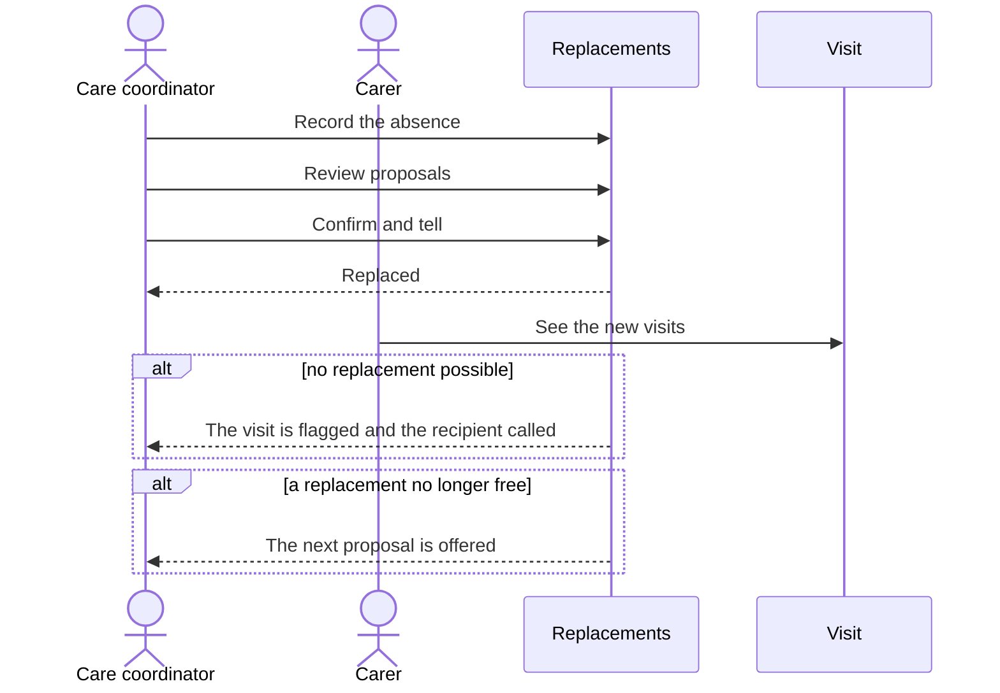

🏠 [Specs](../../../../README.md) › 🏷️ [Sectors](../../../README.md) › 🏠 [SC04 Home care](../../README.md) ›
📝 [Use cases](../README.md) › 📝 [Use cases: FL-SC04-02 Plan the rounds](README.md) ›
📝 UC-SC04-06 Replace an absent carer

# 📝 UC-SC04-06 Replace an absent carer

**Status:** ✅ specified

## Summary

When a carer is absent, the care coordinator sees the visits to cover at once, reviews the replacements proposed and
tells the recipients.

## Personas

- [U25 Care coordinator](../../../../01-users/personas/u25-care-coordinator.md)
- [U26 Carer](../../../../01-users/personas/u26-carer.md)

## Goal

No visit missed because a carer is absent.

## Trigger

An absence is recorded.

## Frequency

Several times a week.

## Preconditions

- The SC04 sector pack is installed for the company,
  [UC-F14-02](../../../../02-functional/f14-plugin-store/use-cases/01-find-and-install/uc-f14-02-install-a-plugin-or-sector-pack.md),
  and its users have their roles,
  [UC-F1-06](../../../../02-functional/f01-administration/use-cases/04-edit-a-role/uc-f01-06-edit-a-role-and-its-record-rules.md).

## Postconditions

- **Success:** each visit has a replacement and the recipients know.
- **Failed:** the visit is flagged and the recipient is called.

## Main flow

1. The care coordinator records the absence on
   [S-SC04-06 Replacements](../../screens/02-plan-the-rounds/s-sc04-06-replacements.md),
   [UC-F9-09](../../../../02-functional/f09-hr-and-projects/use-cases/03-time/uc-f09-09-request-and-approve-time-off.md);
   the visits to cover are listed ([BR-SC04-09](../../business-rules/br-sc04-09-a-replacement-for-every-absence.md)).
2. The optimiser proposes replacements by skills and travel,
   [UC-F9-30](../../../../02-functional/f09-hr-and-projects/use-cases/11-capacity-rounds-and-partners/uc-f09-30-plan-rounds-and-optimise-routes.md).
3. The care coordinator confirms; recipients and the new carers are told.
4. The replacement carers see the added visits in their round on the phone.

## Alternative flows

- 1a. A partial day: only the visits in the absence's hours are listed.

## Error flows

- 2e. No replacement possible: the visit is flagged and the recipient called.
- 3e. A replacement no longer free: the next proposal is offered.
- Any step: a call to a service or an outside system fails: it is retried first
  ([BR-F3-32](../../../../02-functional/f03-assistant/business-rules/br-f03-32-retry-before-an-error.md)), then the
  error message pattern ([D122](../../../../06-decisions/ux/d122-error-message-standard.md)) says what failed; what was
  typed is kept.

## Business rules

- [BR-SC04-09 A replacement for every absence](../../business-rules/br-sc04-09-a-replacement-for-every-absence.md)
- [BR-SC04-06 Carers match the needs](../../business-rules/br-sc04-06-carers-match-the-needs.md)
- [BR-F9-22 Rounds respect travel, skills, continuity and working time](../../../../02-functional/f09-hr-and-projects/business-rules/br-f09-22-rounds-respect-travel-skills-continuity-and-working-time.md)

## Entities

- [E-SC04-04 Visit](../../data/e-sc04-04-visit.md)
- [E-F9-26 Round](../../../../02-functional/f09-hr-and-projects/data/e-f09-26-round.md)

## Permissions

The care coordinator and carer roles; the record rules of their role and site apply,
[UC-F1-06](../../../../02-functional/f01-administration/use-cases/04-edit-a-role/uc-f01-06-edit-a-role-and-its-record-rules.md).

## Notifications

- Recipients are told of the replacement carer.
- The new carers get the visits on the phone.

## Audit events

Every creation, change and state change of visit, round records, with who, when and the values before and after (T3).

## AI involvement

The AI assistant answers questions on the visit, round records of this use case, with links, and prepares them as drafts
the user confirms. It works within the user's rights,
[BR-F3-34](../../../../02-functional/f03-assistant/business-rules/br-f03-34-every-capability-is-reachable-from-the-assistant.md),
and never deletes or does anything irreversible without the user's confirmation,
[BR-F3-07](../../../../02-functional/f03-assistant/business-rules/br-f03-07-no-deletes-no-irreversible-acts.md).

## API, MCP and A2A exposure

Through the API and webhooks (T5) and the MCP and A2A gateway (T6), with the caller's rights,
[BR-F3-34](../../../../02-functional/f03-assistant/business-rules/br-f03-34-every-capability-is-reachable-from-the-assistant.md),
reading, creating and changing the records of this use case; nothing irreversible without a person's confirmation.

## Screens

- [S-SC04-06 Replacements](../../screens/02-plan-the-rounds/s-sc04-06-replacements.md)
- [S-SC04-04 Visit](../../screens/02-plan-the-rounds/s-sc04-04-visit.md)

## Flowchart

See [FL-SC04-02 Plan the rounds](../../flows/fl-sc04-02-plan-the-rounds.md#flowchart).

## Sequence diagram

## Acceptance criteria

1. **Given** the example home-care service's carer N. R. absent on 11 November with 6 visits **when** the absence is
   recorded **then** the 6 visits are listed with replacements proposed.
2. **Given** N. R. absent on 11 November with 6 visits and no one free for 1 **when** proposals run **then** the visit
   is flagged and the recipient called.

## Non-functional notes

[D408](../../../../06-decisions/technical/d408-performance-and-profiles.md)'s targets
([performance](../../../../05-non-functional/performance.md)): 95 % of screens within 1 second; lists paged on the
server, the first page within 1 second; reports within 5 seconds or in the background. WCAG 2.2 AA and RGAA
([D46](../../../../06-decisions/ux/d46-accessibility-standard.md)).

## Regulatory references

None specific to this use case; the sector's legal rules are listed in [SC04 regulatory](../../regulatory.md).

## Related use cases

- [UC-SC04-03 Plan visits and optimise rounds](uc-sc04-03-plan-visits-and-optimise-rounds.md)

## Open questions

None.

---

⬅️ [UC-SC04-05](../03-visit/uc-sc04-05-keep-the-care-log-and-report-incidents.md) · ⬆️ [Up](README.md) ·
➡️ [UC-SC04-07 Give the family access](../05-people-and-quality/uc-sc04-07-give-the-family-access.md)
