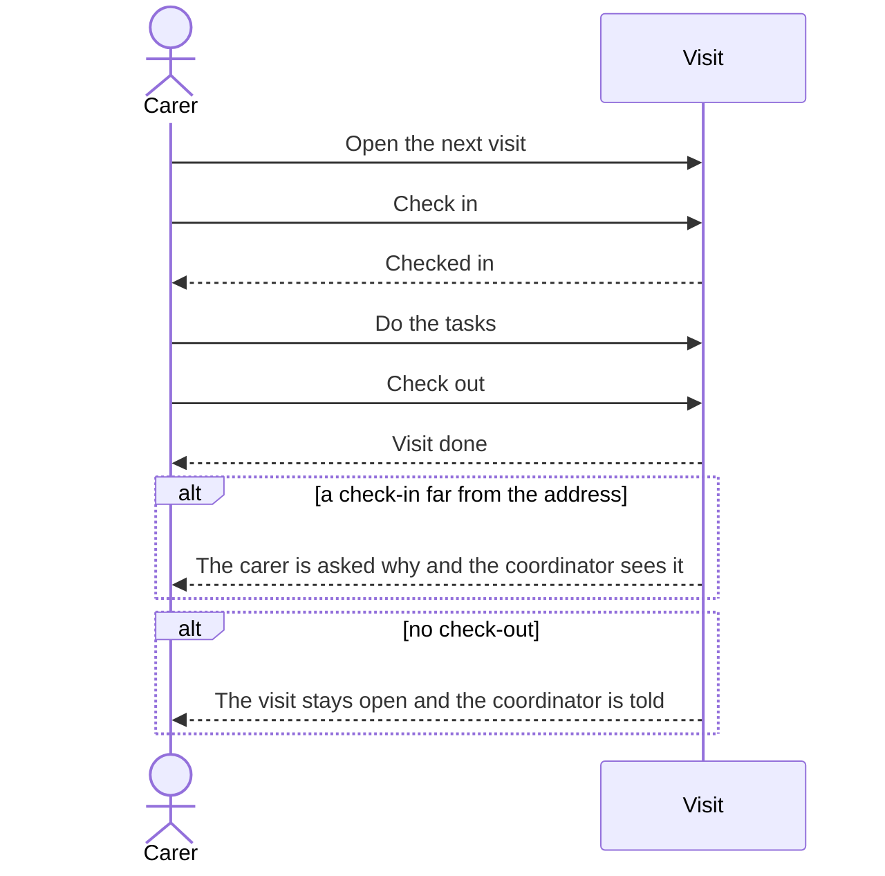

🏠 [Specs](../../../../README.md) › 🏷️ [Sectors](../../../README.md) › 🏠 [SC04 Home care](../../README.md) ›
📝 [Use cases](../README.md) › 📝 [Use cases: FL-SC04-03 Visit](README.md) › 📝 UC-SC04-04 Visit on the carer's phone

# 📝 UC-SC04-04 Visit on the carer's phone

**Status:** 🔄 waiting for the owner

## Summary

The carer opens today's round on the phone, checks in at each recipient, does the tasks and checks out, offline when
there is no signal.

## Personas

- [U26 Carer](../../../../01-users/personas/u26-carer.md)

## Goal

Visits done as planned, with real times proved.

## Trigger

The carer's working day.

## Frequency

Several visits a day per carer.

## Preconditions

- The SC04 sector pack is installed for the company,
  [UC-F14-02](../../../../02-functional/f14-plugin-store/use-cases/01-find-and-install/uc-f14-02-install-a-plugin-or-sector-pack.md),
  and its users have their roles,
  [UC-F1-06](../../../../02-functional/f01-administration/use-cases/04-edit-a-role/uc-f01-06-edit-a-role-and-its-record-rules.md).
- The visit form is set to work offline,
  [UC-F2-21](../../../../02-functional/f02-no-code-configuration/use-cases/09-portals-and-offline-forms/uc-f02-21-make-a-phone-form-work-offline.md).

## Postconditions

- **Success:** each visit is done with its check-in, check-out and tasks.
- **Failed:** the visit stays open and the coordinator is told.

## Main flow

1. The carer opens the next visit on [S-SC04-04 Visit](../../screens/02-plan-the-rounds/s-sc04-04-visit.md): address,
   access code and tasks,
   [UC-F2-22](../../../../02-functional/f02-no-code-configuration/use-cases/09-portals-and-offline-forms/uc-f02-22-fill-a-form-offline-on-the-phone.md).
2. The carer checks in; the location is read once, with consent
   ([BR-SC04-07](../../business-rules/br-sc04-07-visit-times-from-check-in.md)).
3. The carer ticks the tasks done.
4. The carer checks out; the visit is done.

## Alternative flows

- 2a. No signal: times and tasks are kept on the phone and synced later.

## Error flows

- 2e. A check-in far from the address: the carer is asked why and the coordinator sees it ((Proposed) over 300 metres).
- 4e. No check-out: the visit stays open and the coordinator is told.
- Any step: a call to a service or an outside system fails: it is retried first
  ([BR-F3-32](../../../../02-functional/f03-assistant/business-rules/br-f03-32-retry-before-an-error.md)), then the
  error message pattern ([D122](../../../../06-decisions/ux/d122-error-message-standard.md)) says what failed; what was
  typed is kept.

## Business rules

- [BR-SC04-07 Visit times from check-in](../../business-rules/br-sc04-07-visit-times-from-check-in.md)
- [BR-F2-21 Offline forms keep only what is needed and sync in order](../../../../02-functional/f02-no-code-configuration/business-rules/br-f02-21-offline-forms-keep-only-what-is-needed-and-sync-in-order.md)
- [BR-F9-06 Location only at check-in](../../../../02-functional/f09-hr-and-projects/business-rules/br-f09-06-location-only-at-check-in.md)

## Entities

- [E-SC04-04 Visit](../../data/e-sc04-04-visit.md)

## Permissions

The carer roles; the record rules of their role and site apply,
[UC-F1-06](../../../../02-functional/f01-administration/use-cases/04-edit-a-role/uc-f01-06-edit-a-role-and-its-record-rules.md).

## Notifications

None beyond the in-app updates of the records concerned.

## Audit events

Every creation, change and state change of visit records, with who, when and the values before and after (T3).

## AI involvement

The AI assistant answers questions on the visit records of this use case, with links, and prepares them as drafts the
user confirms. It works within the user's rights,
[BR-F3-34](../../../../02-functional/f03-assistant/business-rules/br-f03-34-every-capability-is-reachable-from-the-assistant.md),
and never deletes or does anything irreversible without the user's confirmation,
[BR-F3-07](../../../../02-functional/f03-assistant/business-rules/br-f03-07-no-deletes-no-irreversible-acts.md).

## API, MCP and A2A exposure

Through the API and webhooks (T5) and the MCP and A2A gateway (T6), with the caller's rights,
[BR-F3-34](../../../../02-functional/f03-assistant/business-rules/br-f03-34-every-capability-is-reachable-from-the-assistant.md),
reading, creating and changing the records of this use case; nothing irreversible without a person's confirmation.

## Screens

- [S-SC04-04 Visit](../../screens/02-plan-the-rounds/s-sc04-04-visit.md)

## Flowchart

See [FL-SC04-03 Visit](../../flows/fl-sc04-03-visit.md#flowchart).

## Sequence diagram

## Acceptance criteria

1. **Given** the example home-care service's visit to M. Petit on Monday at 09:00 by N. R. **when** she checks in at
   09:02 and out at 10:05 **then** the visit is done with those times.
2. **Given** a visit at M. Petit's with no signal **when** the carer checks out **then** times and tasks are kept on the
   phone and synced later.
3. **Given** a check-in 1 km away **when** N. R. checks in **then** the carer is asked why and the coordinator sees it
   ((Proposed) over 300 metres).

## Non-functional notes

Works offline on the phone,
[UC-F2-21](../../../../02-functional/f02-no-code-configuration/use-cases/09-portals-and-offline-forms/uc-f02-21-make-a-phone-form-work-offline.md).
[D408](../../../../06-decisions/technical/d408-performance-and-profiles.md)'s targets
([performance](../../../../05-non-functional/performance.md)): 95 % of screens within 1 second; lists paged on the
server, the first page within 1 second; reports within 5 seconds or in the background. WCAG 2.2 AA and RGAA
([D46](../../../../06-decisions/ux/d46-accessibility-standard.md)).

## Regulatory references

Legal values from the France country pack:
[CR-FR-054 Location only when needed and announced](../../../../10-country-packs/france/data-protection/cr-fr-054-location-with-consent.md).

## Related use cases

- [UC-SC04-05 Keep the care log and report incidents](uc-sc04-05-keep-the-care-log-and-report-incidents.md)

## Open questions

None open; the items marked (Proposed) wait for the owner in the [waiting list](../../../../09-waiting/README.md).

---

⬅️ [UC-SC04-03 Plan visits and optimise rounds](../02-plan-the-rounds/uc-sc04-03-plan-visits-and-optimise-rounds.md) ·
⬆️ [Up](README.md) ·
➡️ [UC-SC04-05 Keep the care log and report incidents](uc-sc04-05-keep-the-care-log-and-report-incidents.md)
