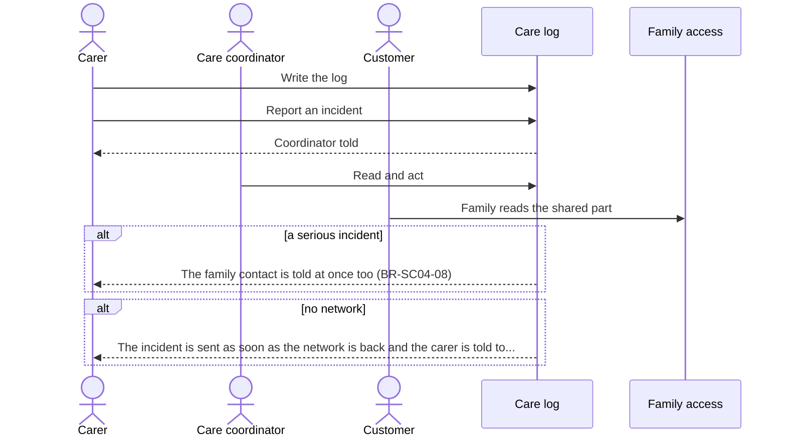

🏠 [Specs](../../../../README.md) › 🏷️ [Sectors](../../../README.md) › 🏠 [SC04 Home care](../../README.md) ›
📝 [Use cases](../README.md) › 📝 [Use cases: FL-SC04-03 Visit](README.md) ›
📝 UC-SC04-05 Keep the care log and report incidents

# 📝 UC-SC04-05 Keep the care log and report incidents

**Status:** ✅ specified

## Summary

The carer writes the care log after each visit and reports incidents; the coordinator reads them, and serious incidents
reach the family contact too.

## Personas

- [U26 Carer](../../../../01-users/personas/u26-carer.md)
- [U25 Care coordinator](../../../../01-users/personas/u25-care-coordinator.md)
- [U09 Customer](../../../../01-users/personas/u09-customer.md)

## Goal

A shared record of each visit and no incident left unseen.

## Trigger

The end of a visit, or an incident.

## Frequency

Each visit.

## Preconditions

- The SC04 sector pack is installed for the company,
  [UC-F14-02](../../../../02-functional/f14-plugin-store/use-cases/01-find-and-install/uc-f14-02-install-a-plugin-or-sector-pack.md),
  and its users have their roles,
  [UC-F1-06](../../../../02-functional/f01-administration/use-cases/04-edit-a-role/uc-f01-06-edit-a-role-and-its-record-rules.md).

## Postconditions

- **Success:** the log is saved; incidents reach the right people.
- **Failed:** the log waits on the phone until synced.

## Main flow

1. The carer writes the log on [S-SC04-05 Care log](../../screens/03-visit/s-sc04-05-care-log.md), marking what is
   shared with the family,
   [UC-F2-22](../../../../02-functional/f02-no-code-configuration/use-cases/09-portals-and-offline-forms/uc-f02-22-fill-a-form-offline-on-the-phone.md).
2. The carer reports an incident with its kind and seriousness
   ([BR-SC04-08](../../business-rules/br-sc04-08-incidents-reach-the-coordinator.md)).
3. The care coordinator reads it and records the actions.
4. The family reads the shared part of the log on the portal
   ([UC-SC04-07](../05-people-and-quality/uc-sc04-07-give-the-family-access.md)).

## Alternative flows

- 1a. A dictated log: the AI assistant turns the dictation into text the carer checks
  ([UC-SC04-15](uc-sc04-15-ask-the-assistant-about-the-rounds.md)).

## Error flows

- 2e. A serious incident: the family contact is told at once too
  ([BR-SC04-08](../../business-rules/br-sc04-08-incidents-reach-the-coordinator.md)).
- 2f. No network: the incident is sent as soon as the network is back and the carer is told to call the coordinator.
- Any step: a call to a service or an outside system fails: it is retried first
  ([BR-F3-32](../../../../02-functional/f03-assistant/business-rules/br-f03-32-retry-before-an-error.md)), then the
  error message pattern ([D122](../../../../06-decisions/ux/d122-error-message-standard.md)) says what failed; what was
  typed is kept.

## Business rules

- [BR-SC04-08 Incidents reach the coordinator](../../business-rules/br-sc04-08-incidents-reach-the-coordinator.md)
- [BR-SC04-04 Health data hosted and restricted](../../business-rules/br-sc04-04-health-data-hosted-and-restricted.md)
- [BR-F2-21 Offline forms keep only what is needed and sync in order](../../../../02-functional/f02-no-code-configuration/business-rules/br-f02-21-offline-forms-keep-only-what-is-needed-and-sync-in-order.md)

## Entities

- [E-SC04-06 Care log entry](../../data/e-sc04-06-care-log-entry.md)
- [E-SC04-07 Care incident](../../data/e-sc04-07-care-incident.md)

## Permissions

The carer, care coordinator and customer roles; the record rules of their role and site apply,
[UC-F1-06](../../../../02-functional/f01-administration/use-cases/04-edit-a-role/uc-f01-06-edit-a-role-and-its-record-rules.md).

## Notifications

- The coordinator gets every incident at once.
- The family contact gets serious incidents.

## Audit events

Every creation, change and state change of care log entry, incident records, with who, when and the values before and
after (T3).

## AI involvement

The AI assistant answers questions on the care log entry, incident records of this use case, with links, and prepares
them as drafts the user confirms. It works within the user's rights,
[BR-F3-34](../../../../02-functional/f03-assistant/business-rules/br-f03-34-every-capability-is-reachable-from-the-assistant.md),
and never deletes or does anything irreversible without the user's confirmation,
[BR-F3-07](../../../../02-functional/f03-assistant/business-rules/br-f03-07-no-deletes-no-irreversible-acts.md).

## API, MCP and A2A exposure

Through the API and webhooks (T5) and the MCP and A2A gateway (T6), with the caller's rights,
[BR-F3-34](../../../../02-functional/f03-assistant/business-rules/br-f03-34-every-capability-is-reachable-from-the-assistant.md),
reading, creating and changing the records of this use case; nothing irreversible without a person's confirmation.

## Screens

- [S-SC04-05 Care log](../../screens/03-visit/s-sc04-05-care-log.md)
- [S-SC04-07 Family access](../../screens/03-visit/s-sc04-07-family-access.md)

## Flowchart

See [FL-SC04-03 Visit](../../flows/fl-sc04-03-visit.md#flowchart).

## Sequence diagram

## Acceptance criteria

1. **Given** the example home-care service's visit V-3311 with the log "ate well" shared **when** the daughter opens the
   family portal **then** she reads "ate well" and nothing that is not shared.
2. **Given** a fall at M. Petit's on visit V-3311 **when** N. R. reports it as high **then** the family contact is told
   at once too ([BR-SC04-08](../../business-rules/br-sc04-08-incidents-reach-the-coordinator.md)).

## Non-functional notes

[D408](../../../../06-decisions/technical/d408-performance-and-profiles.md)'s targets
([performance](../../../../05-non-functional/performance.md)): 95 % of screens within 1 second; lists paged on the
server, the first page within 1 second; reports within 5 seconds or in the background. WCAG 2.2 AA and RGAA
([D46](../../../../06-decisions/ux/d46-accessibility-standard.md)).

## Regulatory references

None specific to this use case; the sector's legal rules are listed in [SC04 regulatory](../../regulatory.md).

## Related use cases

- [UC-SC04-07 Give the family access](../05-people-and-quality/uc-sc04-07-give-the-family-access.md)

## Open questions

None.

---

⬅️ [UC-SC04-04 Visit on the carer's phone](uc-sc04-04-visit-on-the-carer-s-phone.md) · ⬆️ [Up](README.md) ·
➡️ [UC-SC04-06 Replace an absent carer](../02-plan-the-rounds/uc-sc04-06-replace-an-absent-carer.md)
