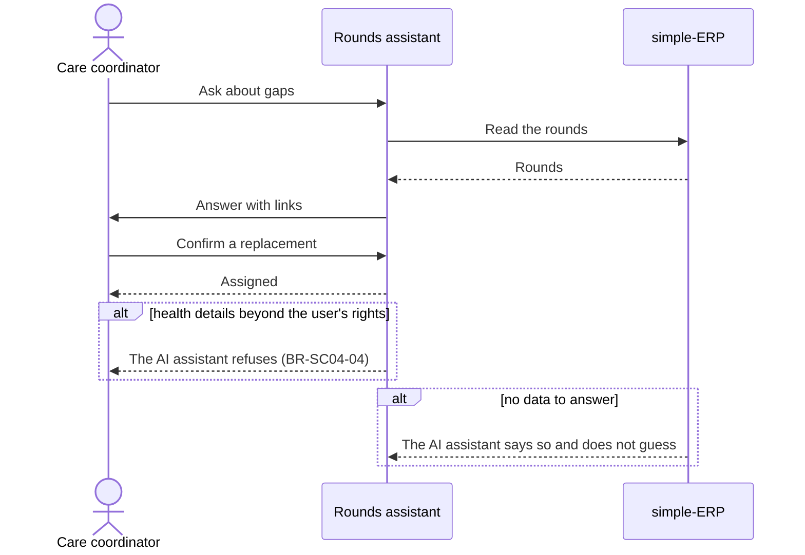

🏠 [Specs](../../../../README.md) › 🏷️ [Sectors](../../../README.md) › 🏠 [SC04 Home care](../../README.md) ›
📝 [Use cases](../README.md) › 📝 [Use cases: FL-SC04-03 Visit](README.md) ›
📝 UC-SC04-15 Ask the AI assistant about the rounds

# 📝 UC-SC04-15 Ask the AI assistant about the rounds

**Status:** ✅ specified

## Summary

The care coordinator or a carer asks the AI assistant who is free, today's gaps or the next visit's tasks, within their
role's rights; health details stay restricted.

## Personas

- [U25 Care coordinator](../../../../01-users/personas/u25-care-coordinator.md)
- [U26 Carer](../../../../01-users/personas/u26-carer.md)

## Goal

Answers without hunting through screens, health data protected.

## Trigger

A question to the AI assistant.

## Frequency

Daily.

## Preconditions

- The SC04 sector pack is installed for the company,
  [UC-F14-02](../../../../02-functional/f14-plugin-store/use-cases/01-find-and-install/uc-f14-02-install-a-plugin-or-sector-pack.md),
  and its users have their roles,
  [UC-F1-06](../../../../02-functional/f01-administration/use-cases/04-edit-a-role/uc-f01-06-edit-a-role-and-its-record-rules.md).

## Postconditions

- **Success:** the answer cites the records, or the prepared action is confirmed.
- **Failed:** the AI assistant says it cannot answer or act, and why.

## Main flow

1. The care coordinator asks on [S-SC04-15 Rounds assistant](../../screens/03-visit/s-sc04-15-rounds-assistant.md):
   "Which visits have no carer today?".
2. The AI assistant reads the rounds within the user's rights.
3. The AI assistant lists the visits with links.
4. The coordinator asks it to propose a replacement; it prepares it and assigns once confirmed,
   [UC-F3-03](../../../../02-functional/f03-assistant/use-cases/03-act-through-the-assistant/uc-f03-03-have-the-assistant-create-or-change-records.md).

## Alternative flows

- 1a. A carer asks for the tasks aloud: the AI assistant reads the next visit's tasks on the phone,
  [UC-F3-09](../../../../02-functional/f03-assistant/use-cases/09-assistant-on-a-phone/uc-f03-09-use-the-assistant-on-a-phone.md).

## Error flows

- 4e. Health details beyond the user's rights: the AI assistant refuses
  ([BR-SC04-04](../../business-rules/br-sc04-04-health-data-hosted-and-restricted.md)).
- 2e. No data to answer: the AI assistant says so and does not guess.
- Any step: a call to a service or an outside system fails: it is retried first
  ([BR-F3-32](../../../../02-functional/f03-assistant/business-rules/br-f03-32-retry-before-an-error.md)), then the
  error message pattern ([D122](../../../../06-decisions/ux/d122-error-message-standard.md)) says what failed; what was
  typed is kept.

## Business rules

- [BR-SC04-04 Health data hosted and restricted](../../business-rules/br-sc04-04-health-data-hosted-and-restricted.md)
- [BR-F3-34 All capabilities via the AI assistant](../../../../02-functional/f03-assistant/business-rules/br-f03-34-every-capability-is-reachable-from-the-assistant.md)
- [BR-F3-07 No deletes, no irreversible acts](../../../../02-functional/f03-assistant/business-rules/br-f03-07-no-deletes-no-irreversible-acts.md)

## Entities

- [E-SC04-04 Visit](../../data/e-sc04-04-visit.md)
- [E-F9-26 Round](../../../../02-functional/f09-hr-and-projects/data/e-f09-26-round.md)

## Permissions

The care coordinator and carer roles; the record rules of their role and site apply,
[UC-F1-06](../../../../02-functional/f01-administration/use-cases/04-edit-a-role/uc-f01-06-edit-a-role-and-its-record-rules.md).

## Notifications

None beyond the in-app updates of the records concerned.

## Audit events

Every creation, change and state change of visit, round records, with who, when and the values before and after (T3).

## AI involvement

The AI assistant answers questions on the visit, round records of this use case, with links, and prepares them as drafts
the user confirms. It works within the user's rights,
[BR-F3-34](../../../../02-functional/f03-assistant/business-rules/br-f03-34-every-capability-is-reachable-from-the-assistant.md),
and never deletes or does anything irreversible without the user's confirmation,
[BR-F3-07](../../../../02-functional/f03-assistant/business-rules/br-f03-07-no-deletes-no-irreversible-acts.md).

## API, MCP and A2A exposure

Through the API and webhooks (T5) and the MCP and A2A gateway (T6), with the caller's rights,
[BR-F3-34](../../../../02-functional/f03-assistant/business-rules/br-f03-34-every-capability-is-reachable-from-the-assistant.md),
reading, creating and changing the records of this use case; nothing irreversible without a person's confirmation.

## Screens

- [S-SC04-15 Rounds assistant](../../screens/03-visit/s-sc04-15-rounds-assistant.md)

## Flowchart

See [FL-SC04-03 Visit](../../flows/fl-sc04-03-visit.md#flowchart).

## Sequence diagram

## Acceptance criteria

1. **Given** the example home-care service's day with 1 visit without carer **when** the coordinator asks for gaps
   **then** the AI assistant lists that visit with its link.
2. **Given** a carer asking for another recipient's diagnosis **when** she asks **then** the AI assistant refuses
   ([BR-SC04-04](../../business-rules/br-sc04-04-health-data-hosted-and-restricted.md)).

## Non-functional notes

[D408](../../../../06-decisions/technical/d408-performance-and-profiles.md)'s targets
([performance](../../../../05-non-functional/performance.md)): 95 % of screens within 1 second; lists paged on the
server, the first page within 1 second; reports within 5 seconds or in the background. WCAG 2.2 AA and RGAA
([D46](../../../../06-decisions/ux/d46-accessibility-standard.md)).

## Regulatory references

None specific to this use case; the sector's legal rules are listed in [SC04 regulatory](../../regulatory.md).

## Related use cases

- [UC-SC04-06 Replace an absent carer](../02-plan-the-rounds/uc-sc04-06-replace-an-absent-carer.md)

## Open questions

None.

---

⬅️ [UC-SC04-14](../05-people-and-quality/uc-sc04-14-report-activity-to-funders-and-authorities.md) ·
⬆️ [Up](README.md) · ➡️ [UC-SC04-16 Run a care home](../06-care-homes-cesu-and-nursing/uc-sc04-16-run-a-care-home.md)
