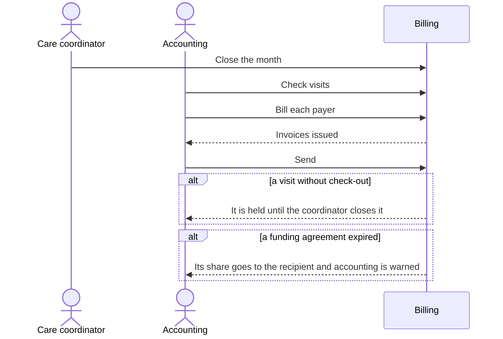

🏠 [Specs](../../../../README.md) › 🏷️ [Sectors](../../../README.md) › 🏠 [SC04 Home care](../../README.md) ›
📝 [Use cases](../README.md) › 📝 [Use cases: FL-SC04-04 Bill and fund](README.md) ›
📝 UC-SC04-08 Bill recipients and funders

# 📝 UC-SC04-08 Bill recipients and funders

**Status:** ✅ specified

## Summary

Accounting closes the month, checks the visits done, and bills each payer its share through the shared multi-payer
invoicing: the funder up to its cap, the recipient the rest.

## Personas

- [U05 Accounting](../../../../01-users/personas/u05-accounting.md)
- [U25 Care coordinator](../../../../01-users/personas/u25-care-coordinator.md)

## Goal

Each payer billed exactly its share of the visits done.

## Trigger

Month end.

## Frequency

Monthly.

## Preconditions

- The SC04 sector pack is installed for the company,
  [UC-F14-02](../../../../02-functional/f14-plugin-store/use-cases/01-find-and-install/uc-f14-02-install-a-plugin-or-sector-pack.md),
  and its users have their roles,
  [UC-F1-06](../../../../02-functional/f01-administration/use-cases/04-edit-a-role/uc-f01-06-edit-a-role-and-its-record-rules.md).

## Postconditions

- **Success:** one invoice per payer is issued; the shares add up to the visits' price.
- **Failed:** nothing is billed; the blocking visits are listed.

## Main flow

1. The care coordinator closes the month's visits on
   [S-SC04-08 Billing](../../screens/04-bill-and-fund/s-sc04-08-billing.md).
2. Accounting checks visits done with their real times.
3. Simple-ERP splits each visit per funder and cap and issues one invoice per payer,
   [UC-F6-20](../../../../02-functional/f06-customers-and-sales/use-cases/07-special-invoicing/uc-f06-20-invoice-several-payers-with-funders-and-caps.md),
   [BR-F6-13](../../../../02-functional/f06-customers-and-sales/business-rules/br-f06-13-each-payer-pays-its-share-up-to-its-cap.md).
4. The département's invoice goes in its format; the recipient's goes by email or the immediate advance
   ([UC-SC04-10](uc-sc04-10-use-the-immediate-advance.md)).

## Alternative flows

- 2a. A missed visit already billed: a credit note is issued to each payer,
  [UC-F6-09](../../../../02-functional/f06-customers-and-sales/use-cases/03-invoice-and-get-paid/uc-f06-09-credit-note-and-refund.md).

## Error flows

- 2e. A visit without check-out: it is held until the coordinator closes it.
- 3e. A funding agreement expired: its share goes to the recipient and accounting is warned.
- Any step: a call to a service or an outside system fails: it is retried first
  ([BR-F3-32](../../../../02-functional/f03-assistant/business-rules/br-f03-32-retry-before-an-error.md)), then the
  error message pattern ([D122](../../../../06-decisions/ux/d122-error-message-standard.md)) says what failed; what was
  typed is kept.

## Business rules

- [BR-SC04-11 Billing splits between funders](../../business-rules/br-sc04-11-billing-splits-between-funders.md)
- [BR-SC04-02 Activities need their registration](../../business-rules/br-sc04-02-activities-need-their-registration.md)
- [BR-F6-13 Each payer pays its share up to its cap](../../../../02-functional/f06-customers-and-sales/business-rules/br-f06-13-each-payer-pays-its-share-up-to-its-cap.md)

## Entities

- [E-SC04-08 Care invoice](../../data/e-sc04-08-care-invoice.md)
- [E-F6-14 Funder agreement](../../../../02-functional/f06-customers-and-sales/data/e-f06-14-funder-agreement.md)

## Permissions

The accounting and care coordinator roles; the record rules of their role and site apply,
[UC-F1-06](../../../../02-functional/f01-administration/use-cases/04-edit-a-role/uc-f01-06-edit-a-role-and-its-record-rules.md).

## Notifications

None beyond the in-app updates of the records concerned.

## Audit events

Every creation, change and state change of care invoice, funder agreement records, with who, when and the values before
and after (T3).

## AI involvement

The AI assistant answers questions on the care invoice, funder agreement records of this use case, with links, and
prepares them as drafts the user confirms. It works within the user's rights,
[BR-F3-34](../../../../02-functional/f03-assistant/business-rules/br-f03-34-every-capability-is-reachable-from-the-assistant.md),
and never deletes or does anything irreversible without the user's confirmation,
[BR-F3-07](../../../../02-functional/f03-assistant/business-rules/br-f03-07-no-deletes-no-irreversible-acts.md).

## API, MCP and A2A exposure

Through the API and webhooks (T5) and the MCP and A2A gateway (T6), with the caller's rights,
[BR-F3-34](../../../../02-functional/f03-assistant/business-rules/br-f03-34-every-capability-is-reachable-from-the-assistant.md),
reading, creating and changing the records of this use case; nothing irreversible without a person's confirmation.

## Screens

- [S-SC04-08 Billing](../../screens/04-bill-and-fund/s-sc04-08-billing.md)

## Flowchart

See [FL-SC04-04 Bill and fund](../../flows/fl-sc04-04-bill-and-fund.md#flowchart).

## Sequence diagram

## Acceptance criteria

1. **Given** the example home-care service's M. Petit with 10 hours in November at 26 EUR, the département paying 80 %
   **when** November is billed **then** the département is billed 208 EUR and M. Petit 52 EUR.
2. **Given** visit V-3311 with no check-out **when** the month is billed **then** it is held until the coordinator
   closes it.

## Non-functional notes

[D408](../../../../06-decisions/technical/d408-performance-and-profiles.md)'s targets
([performance](../../../../05-non-functional/performance.md)): 95 % of screens within 1 second; lists paged on the
server, the first page within 1 second; reports within 5 seconds or in the background. WCAG 2.2 AA and RGAA
([D46](../../../../06-decisions/ux/d46-accessibility-standard.md)).

## Regulatory references

Legal values from the France country pack:
[CR-FR-105 Billing the département for allowances](../../../../10-country-packs/france/home-care/cr-fr-105-departmental-allowances-billing.md),
[CR-FR-102 Personal-services declaration, approval and authorisation](../../../../10-country-packs/france/home-care/cr-fr-102-personal-services-registration.md).

## Related use cases

- [UC-SC04-10 Use the immediate advance](uc-sc04-10-use-the-immediate-advance.md)
- [UC-SC04-09 Issue the yearly tax-credit certificate](uc-sc04-09-issue-the-yearly-tax-credit-certificate.md)

## Open questions

None.

---

⬅️ [UC-SC04-07 Give the family access](../05-people-and-quality/uc-sc04-07-give-the-family-access.md) ·
⬆️ [Up](README.md) ·
➡️ [UC-SC04-09 Issue the yearly tax-credit certificate](uc-sc04-09-issue-the-yearly-tax-credit-certificate.md)
