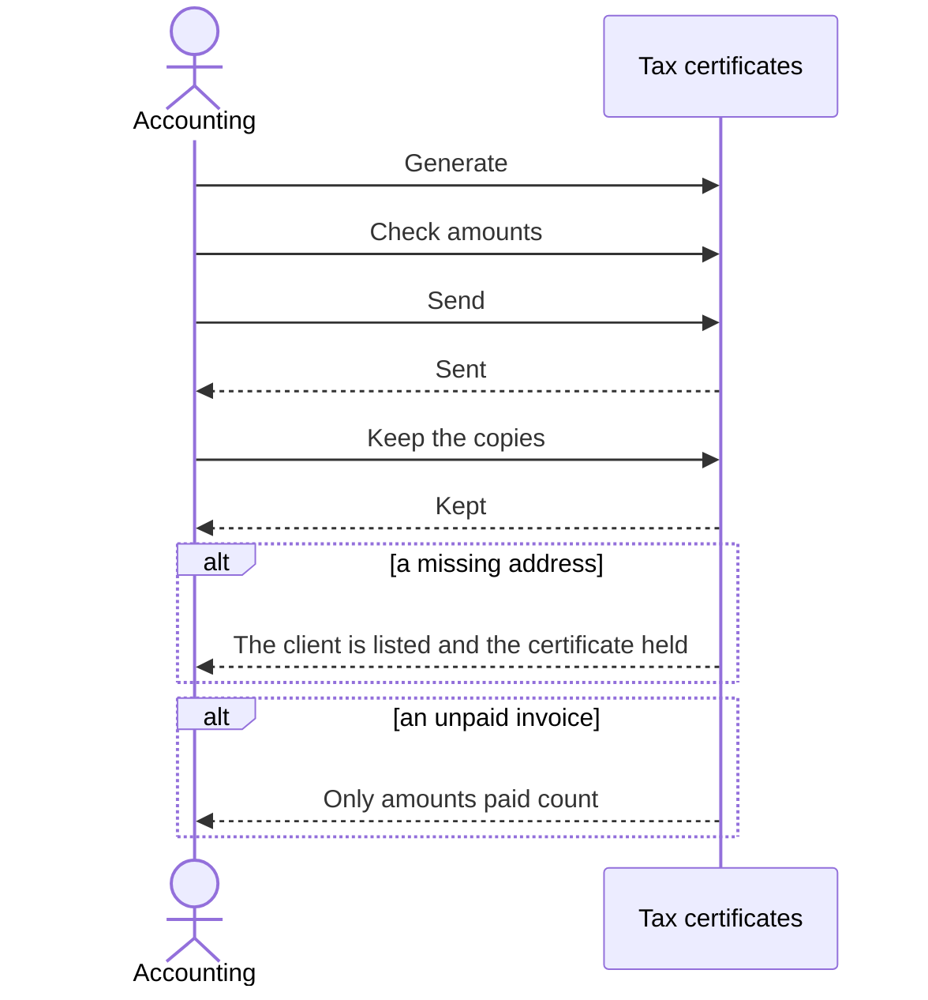

🏠 [Specs](../../../../README.md) › 🏷️ [Sectors](../../../README.md) › 🏠 [SC04 Home care](../../README.md) ›
📝 [Use cases](../README.md) › 📝 [Use cases: FL-SC04-04 Bill and fund](README.md) ›
📝 UC-SC04-09 Issue the yearly tax-credit certificate

# 📝 UC-SC04-09 Issue the yearly tax-credit certificate

**Status:** ✅ specified

## Summary

Accounting generates each client's yearly certificate of amounts paid for home services, checks the amounts and sends
them before 31 March.

## Personas

- [U05 Accounting](../../../../01-users/personas/u05-accounting.md)

## Goal

Every client gets a correct certificate before 31 March.

## Trigger

January, for the previous year.

## Frequency

Yearly.

## Preconditions

- The SC04 sector pack is installed for the company,
  [UC-F14-02](../../../../02-functional/f14-plugin-store/use-cases/01-find-and-install/uc-f14-02-install-a-plugin-or-sector-pack.md),
  and its users have their roles,
  [UC-F1-06](../../../../02-functional/f01-administration/use-cases/04-edit-a-role/uc-f01-06-edit-a-role-and-its-record-rules.md).

## Postconditions

- **Success:** every certificate is sent before 31 March.
- **Failed:** the missing ones are listed.

## Main flow

1. Accounting generates the certificates on
   [S-SC04-09 Tax certificates](../../screens/04-bill-and-fund/s-sc04-09-tax-certificates.md).
2. Accounting checks amounts paid net of funders and advance.
3. Accounting sends them by email or post
   ([BR-SC04-12](../../business-rules/br-sc04-12-yearly-certificate-before-march.md)).
4. Each certificate is kept with the client's record for the legal period.

## Alternative flows

- 3a. A corrected certificate: a new one replaces it and says so.

## Error flows

- 3e. A missing address: the client is listed and the certificate held.
- 1e. An unpaid invoice: only amounts paid count.
- Any step: a call to a service or an outside system fails: it is retried first
  ([BR-F3-32](../../../../02-functional/f03-assistant/business-rules/br-f03-32-retry-before-an-error.md)), then the
  error message pattern ([D122](../../../../06-decisions/ux/d122-error-message-standard.md)) says what failed; what was
  typed is kept.

## Business rules

- [BR-SC04-12 Yearly certificate before 31 March](../../business-rules/br-sc04-12-yearly-certificate-before-march.md)

## Entities

- [E-SC04-09 Tax-credit certificate](../../data/e-sc04-09-tax-credit-certificate.md)

## Permissions

The accounting roles; the record rules of their role and site apply,
[UC-F1-06](../../../../02-functional/f01-administration/use-cases/04-edit-a-role/uc-f01-06-edit-a-role-and-its-record-rules.md).

## Notifications

None beyond the in-app updates of the records concerned.

## Audit events

Every creation, change and state change of tax-credit certificate records, with who, when and the values before and
after (T3).

## AI involvement

The AI assistant answers questions on the tax-credit certificate records of this use case, with links, and prepares them
as drafts the user confirms. It works within the user's rights,
[BR-F3-34](../../../../02-functional/f03-assistant/business-rules/br-f03-34-every-capability-is-reachable-from-the-assistant.md),
and never deletes or does anything irreversible without the user's confirmation,
[BR-F3-07](../../../../02-functional/f03-assistant/business-rules/br-f03-07-no-deletes-no-irreversible-acts.md).

## API, MCP and A2A exposure

Through the API and webhooks (T5) and the MCP and A2A gateway (T6), with the caller's rights,
[BR-F3-34](../../../../02-functional/f03-assistant/business-rules/br-f03-34-every-capability-is-reachable-from-the-assistant.md),
reading, creating and changing the records of this use case; nothing irreversible without a person's confirmation.

## Screens

- [S-SC04-09 Tax certificates](../../screens/04-bill-and-fund/s-sc04-09-tax-certificates.md)

## Flowchart

See [FL-SC04-04 Bill and fund](../../flows/fl-sc04-04-bill-and-fund.md#flowchart).

## Sequence diagram

## Acceptance criteria

1. **Given** the example home-care service's M. Petit with 3,120 EUR paid in 2026 **when** certificates are sent on 10
   February 2027 **then** his certificate states 3,120 EUR.
2. **Given** a client without an email or postal address **when** certificates are sent **then** the client is listed
   and the certificate held.

## Non-functional notes

[D408](../../../../06-decisions/technical/d408-performance-and-profiles.md)'s targets
([performance](../../../../05-non-functional/performance.md)): 95 % of screens within 1 second; lists paged on the
server, the first page within 1 second; reports within 5 seconds or in the background. WCAG 2.2 AA and RGAA
([D46](../../../../06-decisions/ux/d46-accessibility-standard.md)).

## Regulatory references

Legal values from the France country pack:
[CR-FR-103 Tax credit for home services and its yearly certificate](../../../../10-country-packs/france/tax-and-vat/cr-fr-103-home-services-tax-credit.md).

## Related use cases

- [UC-SC04-10 Use the immediate advance](uc-sc04-10-use-the-immediate-advance.md)

## Open questions

None.

---

⬅️ [UC-SC04-08 Bill recipients and funders](uc-sc04-08-bill-recipients-and-funders.md) · ⬆️ [Up](README.md) ·
➡️ [UC-SC04-10 Use the immediate advance](uc-sc04-10-use-the-immediate-advance.md)
