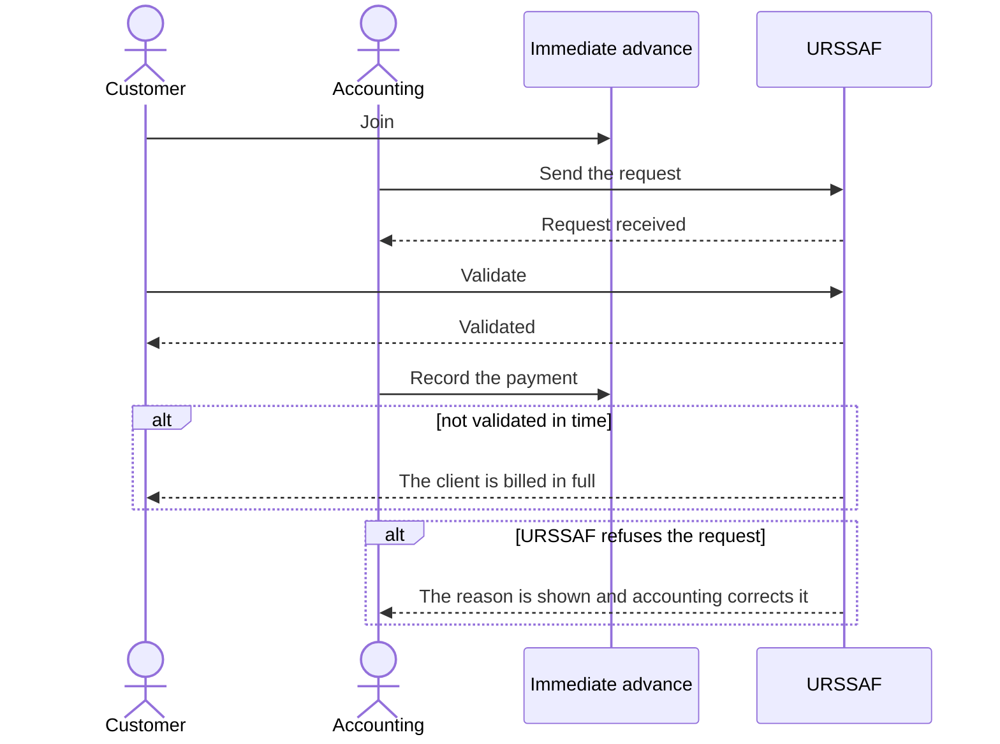

🏠 [Specs](../../../../README.md) › 🏷️ [Sectors](../../../README.md) › 🏠 [SC04 Home care](../../README.md) ›
📝 [Use cases](../README.md) › 📝 [Use cases: FL-SC04-04 Bill and fund](README.md) ›
📝 UC-SC04-10 Use the immediate advance

# 📝 UC-SC04-10 Use the immediate advance

**Status:** ✅ specified

## Summary

A client who chose the immediate advance of the tax credit pays only their share: each invoice is sent as a request
through URSSAF and the client validates it.

## Personas

- [U05 Accounting](../../../../01-users/personas/u05-accounting.md)
- [U09 Customer](../../../../01-users/personas/u09-customer.md)

## Goal

Clients pay only what is left after the tax credit, at once.

## Trigger

An invoice for a client who joined.

## Frequency

Monthly per client.

## Preconditions

- The SC04 sector pack is installed for the company,
  [UC-F14-02](../../../../02-functional/f14-plugin-store/use-cases/01-find-and-install/uc-f14-02-install-a-plugin-or-sector-pack.md),
  and its users have their roles,
  [UC-F1-06](../../../../02-functional/f01-administration/use-cases/04-edit-a-role/uc-f01-06-edit-a-role-and-its-record-rules.md).

## Postconditions

- **Success:** the request is validated and the client pays their share.
- **Failed:** the client is billed in full.

## Main flow

1. The client joins the immediate advance on
   [S-SC04-10 Immediate advance](../../screens/04-bill-and-fund/s-sc04-10-immediate-advance.md).
2. Accounting sends each invoice as a request through the URSSAF connector (T12).
3. The client validates the request.
4. The client's share and URSSAF's payment are matched,
   [UC-F8-06](../../../../02-functional/f08-accounting/use-cases/03-bank-and-collect/uc-f08-06-connect-banks-and-reconcile.md).

## Alternative flows

- 3a. The client contests a request: the request is cancelled and a corrected one sent.

## Error flows

- 3e. Not validated in time: the client is billed in full.
- 2e. URSSAF refuses the request: the reason is shown and accounting corrects it.
- Any step: a call to a service or an outside system fails: it is retried first
  ([BR-F3-32](../../../../02-functional/f03-assistant/business-rules/br-f03-32-retry-before-an-error.md)), then the
  error message pattern ([D122](../../../../06-decisions/ux/d122-error-message-standard.md)) says what failed; what was
  typed is kept.

## Business rules

- [BR-SC04-13 Immediate advance on request](../../business-rules/br-sc04-13-immediate-advance-on-request.md)

## Entities

- [E-SC04-08 Care invoice](../../data/e-sc04-08-care-invoice.md)
- [E-SC04-13 Immediate advance claim](../../data/e-sc04-13-immediate-advance-claim.md)

## Permissions

The accounting and customer roles; the record rules of their role and site apply,
[UC-F1-06](../../../../02-functional/f01-administration/use-cases/04-edit-a-role/uc-f01-06-edit-a-role-and-its-record-rules.md).

## Notifications

None beyond the in-app updates of the records concerned.

## Audit events

Every creation, change and state change of care invoice records, with who, when and the values before and after (T3).

## AI involvement

The AI assistant answers questions on the care invoice records of this use case, with links, and prepares them as drafts
the user confirms. It works within the user's rights,
[BR-F3-34](../../../../02-functional/f03-assistant/business-rules/br-f03-34-every-capability-is-reachable-from-the-assistant.md),
and never deletes or does anything irreversible without the user's confirmation,
[BR-F3-07](../../../../02-functional/f03-assistant/business-rules/br-f03-07-no-deletes-no-irreversible-acts.md).

## API, MCP and A2A exposure

Through the API and webhooks (T5) and the MCP and A2A gateway (T6), with the caller's rights,
[BR-F3-34](../../../../02-functional/f03-assistant/business-rules/br-f03-34-every-capability-is-reachable-from-the-assistant.md),
reading, creating and changing the records of this use case; nothing irreversible without a person's confirmation.

## Screens

- [S-SC04-10 Immediate advance](../../screens/04-bill-and-fund/s-sc04-10-immediate-advance.md)

## Flowchart

See [FL-SC04-04 Bill and fund](../../flows/fl-sc04-04-bill-and-fund.md#flowchart).

## Sequence diagram

## Acceptance criteria

1. **Given** the example home-care service's M. Petit's November invoice of 260 EUR with the advance **when** he
   validates **then** he pays 130 EUR and the tax credit's 130 EUR comes from URSSAF.
2. **Given** a request of 260 EUR not validated before the deadline **when** the deadline passes **then** the client is
   billed in full.

## Non-functional notes

[D408](../../../../06-decisions/technical/d408-performance-and-profiles.md)'s targets
([performance](../../../../05-non-functional/performance.md)): 95 % of screens within 1 second; lists paged on the
server, the first page within 1 second; reports within 5 seconds or in the background. WCAG 2.2 AA and RGAA
([D46](../../../../06-decisions/ux/d46-accessibility-standard.md)).

## Regulatory references

Legal values from the France country pack:
[CR-FR-104 Immediate advance of the tax credit](../../../../10-country-packs/france/tax-and-vat/cr-fr-104-immediate-advance-of-tax-credit.md),
[CR-FR-103 Tax credit for home services and its yearly certificate](../../../../10-country-packs/france/tax-and-vat/cr-fr-103-home-services-tax-credit.md).

## Related use cases

- [UC-SC04-08 Bill recipients and funders](uc-sc04-08-bill-recipients-and-funders.md)

## Open questions

None.

---

⬅️ [UC-SC04-09 Issue the yearly tax-credit certificate](uc-sc04-09-issue-the-yearly-tax-credit-certificate.md) ·
⬆️ [Up](README.md) ·
➡️ [UC-SC04-11 Pay carers' travel time and split shifts](uc-sc04-11-pay-carers-travel-time-and-split-shifts.md)
