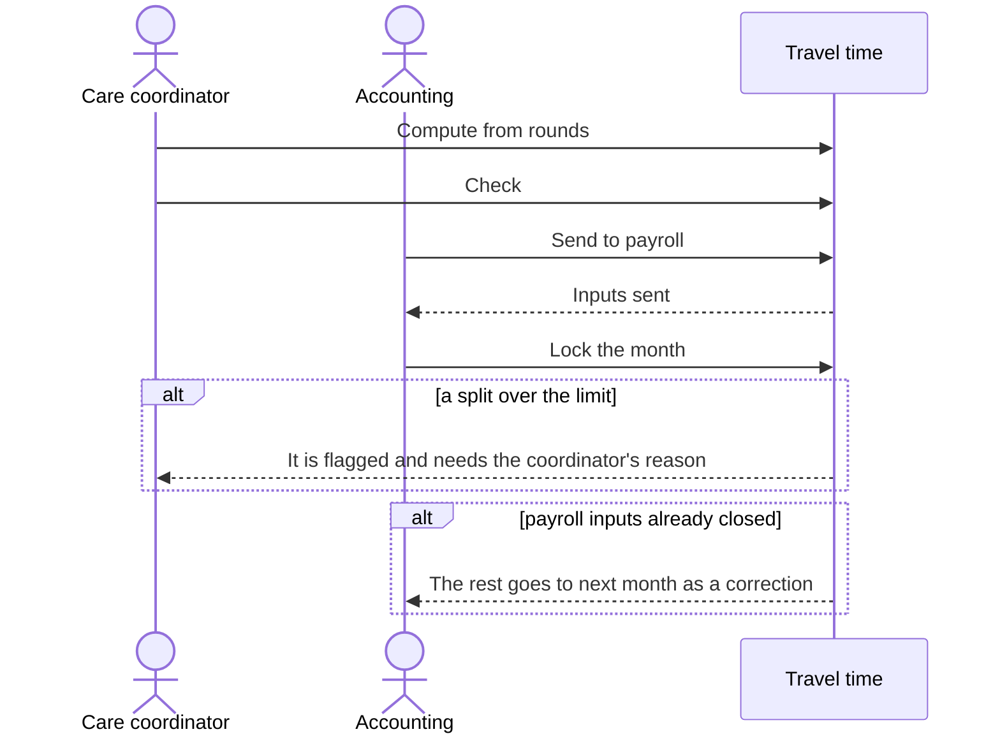

🏠 [Specs](../../../../README.md) › 🏷️ [Sectors](../../../README.md) › 🏠 [SC04 Home care](../../README.md) ›
📝 [Use cases](../README.md) › 📝 [Use cases: FL-SC04-04 Bill and fund](README.md) ›
📝 UC-SC04-11 Pay carers' travel time and split shifts

# 📝 UC-SC04-11 Pay carers' travel time and split shifts

**Status:** ✅ specified

## Summary

The care coordinator computes travel time and split shifts per carer from the rounds, checks them and sends them to
payroll as pay inputs under the home-help agreement.

## Personas

- [U25 Care coordinator](../../../../01-users/personas/u25-care-coordinator.md)
- [U05 Accounting](../../../../01-users/personas/u05-accounting.md)

## Goal

Carers paid for travel and splits as the agreement says.

## Trigger

Month end.

## Frequency

Monthly.

## Preconditions

- The SC04 sector pack is installed for the company,
  [UC-F14-02](../../../../02-functional/f14-plugin-store/use-cases/01-find-and-install/uc-f14-02-install-a-plugin-or-sector-pack.md),
  and its users have their roles,
  [UC-F1-06](../../../../02-functional/f01-administration/use-cases/04-edit-a-role/uc-f01-06-edit-a-role-and-its-record-rules.md).

## Postconditions

- **Success:** travel and splits are sent to payroll.
- **Failed:** the month's inputs stay open.

## Main flow

1. Simple-ERP computes travel time and splits per carer from the rounds on
   [S-SC04-11 Travel time](../../screens/04-bill-and-fund/s-sc04-11-travel-time.md)
   ([BR-SC04-05](../../business-rules/br-sc04-05-rounds-count-travel-time.md)).
2. The care coordinator checks and corrects.
3. The inputs go to payroll,
   [UC-F13-03](../../../../02-functional/f13-payroll/use-cases/02-monthly-pay-run/uc-f13-03-collect-pay-inputs-from-f9.md),
   [UC-F13-31](../../../../02-functional/f13-payroll/use-cases/09-collective-agreements-by-family/uc-f13-31-apply-the-home-help-agreement.md).
4. Once payroll has run, the month's travel inputs are locked,
   [BR-F13-03](../../../../02-functional/f13-payroll/business-rules/br-f13-03-inputs-closed-before-the-run.md).

## Alternative flows

- 1a. Mileage allowance: kilometres with the carer's own car are paid at the agreement's rate.

## Error flows

- 2e. A split over the limit: it is flagged and needs the coordinator's reason.
- 3e. Payroll inputs already closed: the rest goes to next month as a correction.
- Any step: a call to a service or an outside system fails: it is retried first
  ([BR-F3-32](../../../../02-functional/f03-assistant/business-rules/br-f03-32-retry-before-an-error.md)), then the
  error message pattern ([D122](../../../../06-decisions/ux/d122-error-message-standard.md)) says what failed; what was
  typed is kept.

## Business rules

- [BR-SC04-05 Rounds count travel time](../../business-rules/br-sc04-05-rounds-count-travel-time.md)
- [BR-F13-03 Inputs closed before the run](../../../../02-functional/f13-payroll/business-rules/br-f13-03-inputs-closed-before-the-run.md)

## Entities

- [E-F9-26 Round](../../../../02-functional/f09-hr-and-projects/data/e-f09-26-round.md)

## Permissions

The care coordinator and accounting roles; the record rules of their role and site apply,
[UC-F1-06](../../../../02-functional/f01-administration/use-cases/04-edit-a-role/uc-f01-06-edit-a-role-and-its-record-rules.md).

## Notifications

None beyond the in-app updates of the records concerned.

## Audit events

Every creation, change and state change of round records, with who, when and the values before and after (T3).

## AI involvement

The AI assistant answers questions on the round records of this use case, with links, and prepares them as drafts the
user confirms. It works within the user's rights,
[BR-F3-34](../../../../02-functional/f03-assistant/business-rules/br-f03-34-every-capability-is-reachable-from-the-assistant.md),
and never deletes or does anything irreversible without the user's confirmation,
[BR-F3-07](../../../../02-functional/f03-assistant/business-rules/br-f03-07-no-deletes-no-irreversible-acts.md).

## API, MCP and A2A exposure

Through the API and webhooks (T5) and the MCP and A2A gateway (T6), with the caller's rights,
[BR-F3-34](../../../../02-functional/f03-assistant/business-rules/br-f03-34-every-capability-is-reachable-from-the-assistant.md),
reading, creating and changing the records of this use case; nothing irreversible without a person's confirmation.

## Screens

- [S-SC04-11 Travel time](../../screens/04-bill-and-fund/s-sc04-11-travel-time.md)

## Flowchart

See [FL-SC04-04 Bill and fund](../../flows/fl-sc04-04-bill-and-fund.md#flowchart).

## Sequence diagram

## Acceptance criteria

1. **Given** the example home-care service's N. R. on 11 November with 6 visits and 95 minutes of travel **when** the
   month is computed **then** 95 minutes of working time for travel are sent to payroll for that day.
2. **Given** N. R.'s day with 3 splits **when** the month is checked **then** it is flagged and needs the coordinator's
   reason.

## Non-functional notes

[D408](../../../../06-decisions/technical/d408-performance-and-profiles.md)'s targets
([performance](../../../../05-non-functional/performance.md)): 95 % of screens within 1 second; lists paged on the
server, the first page within 1 second; reports within 5 seconds or in the background. WCAG 2.2 AA and RGAA
([D46](../../../../06-decisions/ux/d46-accessibility-standard.md)).

## Regulatory references

Legal values from the France country pack:
[CR-FR-106 Travel time and split shifts in home care](../../../../10-country-packs/france/labour/cr-fr-106-home-care-travel-and-split-shifts.md).

## Related use cases

- [UC-SC04-03 Plan visits and optimise rounds](../02-plan-the-rounds/uc-sc04-03-plan-visits-and-optimise-rounds.md)

## Open questions

None.

---

⬅️ [UC-SC04-10 Use the immediate advance](uc-sc04-10-use-the-immediate-advance.md) · ⬆️ [Up](README.md) ·
➡️ [UC-SC04-12](../05-people-and-quality/uc-sc04-12-handle-quality-complaints-and-satisfaction.md)
