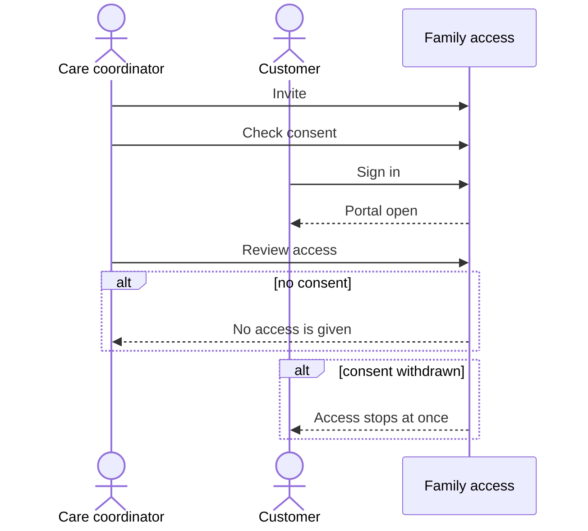

🏠 [Specs](../../../../README.md) › 🏷️ [Sectors](../../../README.md) › 🏠 [SC04 Home care](../../README.md) ›
📝 [Use cases](../README.md) › 📝 [Use cases: FL-SC04-05 People and quality](README.md) ›
📝 UC-SC04-07 Give the family access

# 📝 UC-SC04-07 Give the family access

**Status:** ✅ specified

## Summary

The care coordinator invites a family member to the family portal, built on the shared portal capability; with the
recipient's consent they see visits, the shared log and invoices.

## Personas

- [U09 Customer](../../../../01-users/personas/u09-customer.md)
- [U25 Care coordinator](../../../../01-users/personas/u25-care-coordinator.md)

## Goal

Families informed, the recipient's privacy kept.

## Trigger

A family asks to follow their relative's care.

## Frequency

Once per family member.

## Preconditions

- The SC04 sector pack is installed for the company,
  [UC-F14-02](../../../../02-functional/f14-plugin-store/use-cases/01-find-and-install/uc-f14-02-install-a-plugin-or-sector-pack.md),
  and its users have their roles,
  [UC-F1-06](../../../../02-functional/f01-administration/use-cases/04-edit-a-role/uc-f01-06-edit-a-role-and-its-record-rules.md).

## Postconditions

- **Success:** the family member signs in and sees only what is shared.
- **Failed:** no access is given.

## Main flow

1. The care coordinator invites the family member on
   [S-SC04-07 Family access](../../screens/03-visit/s-sc04-07-family-access.md),
   [UC-F1-19](../../../../02-functional/f01-administration/use-cases/12-portal-accounts-and-integrations/uc-f01-19-manage-portal-accounts.md).
2. The recipient's consent is checked ([BR-SC04-10](../../business-rules/br-sc04-10-family-sees-what-is-shared.md)).
3. The family member signs in on the portal, which shows the chosen fields of the relative's records,
   [UC-F2-20](../../../../02-functional/f02-no-code-configuration/use-cases/09-portals-and-offline-forms/uc-f02-20-expose-a-record-type-on-a-portal.md),
   [BR-F2-20](../../../../02-functional/f02-no-code-configuration/business-rules/br-f02-20-a-portal-shows-only-the-chosen-fields-of-the-persons-own-records.md).
4. The care coordinator reviews family accounts when a recipient leaves; access ends with the service.

## Alternative flows

- 1a. Several family members: each gets their own account.

## Error flows

- 2e. No consent: no access is given.
- 3e. Consent withdrawn: access stops at once.
- Any step: a call to a service or an outside system fails: it is retried first
  ([BR-F3-32](../../../../02-functional/f03-assistant/business-rules/br-f03-32-retry-before-an-error.md)), then the
  error message pattern ([D122](../../../../06-decisions/ux/d122-error-message-standard.md)) says what failed; what was
  typed is kept.

## Business rules

- [BR-SC04-10 Family sees what is shared](../../business-rules/br-sc04-10-family-sees-what-is-shared.md)
- [BR-F2-20 A portal shows only the chosen fields of the person's own records](../../../../02-functional/f02-no-code-configuration/business-rules/br-f02-20-a-portal-shows-only-the-chosen-fields-of-the-persons-own-records.md)

## Entities

- [E-SC04-01 Care recipient](../../data/e-sc04-01-care-recipient.md)
- [E-SC04-06 Care log entry](../../data/e-sc04-06-care-log-entry.md)

## Permissions

The customer and care coordinator roles; the record rules of their role and site apply,
[UC-F1-06](../../../../02-functional/f01-administration/use-cases/04-edit-a-role/uc-f01-06-edit-a-role-and-its-record-rules.md).

## Notifications

None beyond the in-app updates of the records concerned.

## Audit events

Every creation, change and state change of care recipient, care log entry records, with who, when and the values before
and after (T3).

## AI involvement

The AI assistant answers questions on the care recipient, care log entry records of this use case, with links, and
prepares them as drafts the user confirms. It works within the user's rights,
[BR-F3-34](../../../../02-functional/f03-assistant/business-rules/br-f03-34-every-capability-is-reachable-from-the-assistant.md),
and never deletes or does anything irreversible without the user's confirmation,
[BR-F3-07](../../../../02-functional/f03-assistant/business-rules/br-f03-07-no-deletes-no-irreversible-acts.md).

## API, MCP and A2A exposure

Through the API and webhooks (T5) and the MCP and A2A gateway (T6), with the caller's rights,
[BR-F3-34](../../../../02-functional/f03-assistant/business-rules/br-f03-34-every-capability-is-reachable-from-the-assistant.md),
reading, creating and changing the records of this use case; nothing irreversible without a person's confirmation.

## Screens

- [S-SC04-07 Family access](../../screens/03-visit/s-sc04-07-family-access.md)

## Flowchart

See [FL-SC04-05 People and quality](../../flows/fl-sc04-05-people-and-quality.md#flowchart).

## Sequence diagram

## Acceptance criteria

1. **Given** the example home-care service's M. Petit with family access consent for his daughter **when** she signs in
   **then** she sees his visits, the shared log and his invoices.
2. **Given** a son invited without M. Petit's consent **when** the invitation is sent **then** no access is given.

## Non-functional notes

[D408](../../../../06-decisions/technical/d408-performance-and-profiles.md)'s targets
([performance](../../../../05-non-functional/performance.md)): 95 % of screens within 1 second; lists paged on the
server, the first page within 1 second; reports within 5 seconds or in the background. WCAG 2.2 AA and RGAA
([D46](../../../../06-decisions/ux/d46-accessibility-standard.md)).

## Regulatory references

None specific to this use case; the sector's legal rules are listed in [SC04 regulatory](../../regulatory.md).

## Related use cases

- [UC-SC04-05 Keep the care log and report incidents](../03-visit/uc-sc04-05-keep-the-care-log-and-report-incidents.md)

## Open questions

None.

---

⬅️ [UC-SC04-06 Replace an absent carer](../02-plan-the-rounds/uc-sc04-06-replace-an-absent-carer.md) ·
⬆️ [Up](README.md) ·
➡️ [UC-SC04-08 Bill recipients and funders](../04-bill-and-fund/uc-sc04-08-bill-recipients-and-funders.md)
