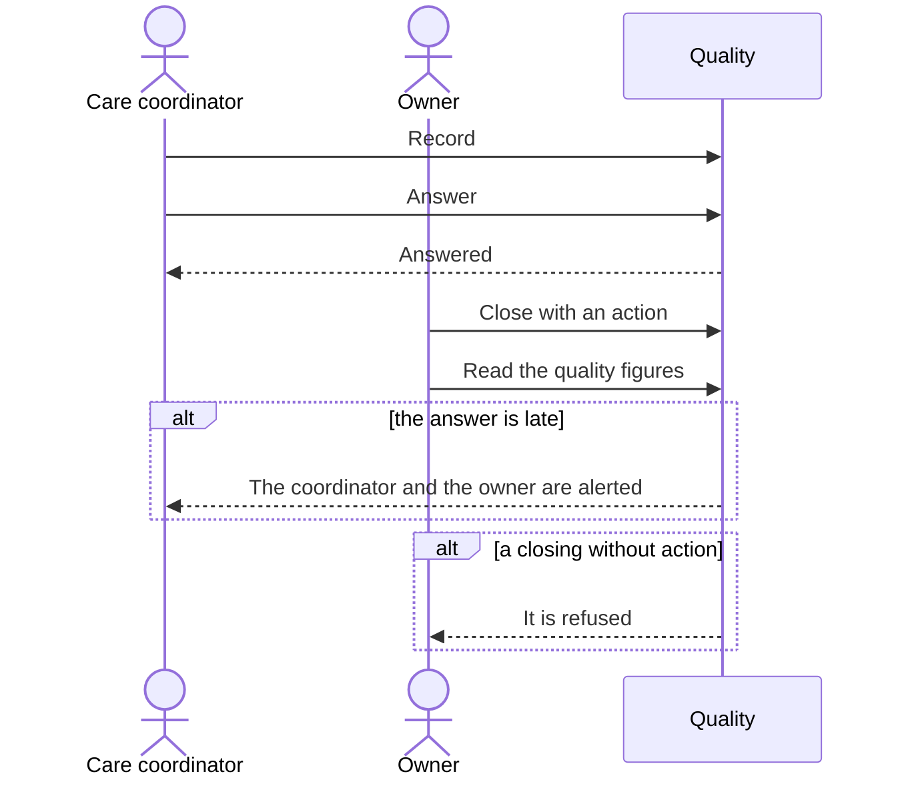

🏠 [Specs](../../../../README.md) › 🏷️ [Sectors](../../../README.md) › 🏠 [SC04 Home care](../../README.md) ›
📝 [Use cases](../README.md) › 📝 [Use cases: FL-SC04-05 People and quality](README.md) ›
📝 UC-SC04-12 Handle quality, complaints and satisfaction

# 📝 UC-SC04-12 Handle quality, complaints and satisfaction

**Status:** ✅ specified

## Summary

The care coordinator records complaints, answers them within the set delay and closes them with an action; the owner
runs the yearly satisfaction survey.

## Personas

- [U25 Care coordinator](../../../../01-users/personas/u25-care-coordinator.md)
- [U13 Owner](../../../../01-users/personas/u13-owner.md)

## Goal

Every complaint answered and followed to its close.

## Trigger

A complaint, or the yearly survey.

## Frequency

A few a month; one survey a year.

## Preconditions

- The SC04 sector pack is installed for the company,
  [UC-F14-02](../../../../02-functional/f14-plugin-store/use-cases/01-find-and-install/uc-f14-02-install-a-plugin-or-sector-pack.md),
  and its users have their roles,
  [UC-F1-06](../../../../02-functional/f01-administration/use-cases/04-edit-a-role/uc-f01-06-edit-a-role-and-its-record-rules.md).

## Postconditions

- **Success:** the complaint is answered and closed with its action.
- **Failed:** the complaint stays open and alerts.

## Main flow

1. The care coordinator records the complaint on
   [S-SC04-12 Quality](../../screens/05-people-and-quality/s-sc04-12-quality.md).
2. The care coordinator answers within the delay ([BR-SC04-14](../../business-rules/br-sc04-14-complaints-answered.md)).
3. The owner closes it with the action taken.
4. The owner reads complaints by kind and the survey's results for the quarter.

## Alternative flows

- 1a. The yearly satisfaction survey: the survey goes to every recipient,
  [UC-F5-12](../../../../02-functional/f05-social-media/use-cases/08-pages-forms-surveys-and-whatsapp/uc-f05-12-run-surveys-and-live-polls.md).

## Error flows

- 2e. The answer is late: the coordinator and the owner are alerted (after 10 working days).
- 3e. A closing without action: it is refused.
- Any step: a call to a service or an outside system fails: it is retried first
  ([BR-F3-32](../../../../02-functional/f03-assistant/business-rules/br-f03-32-retry-before-an-error.md)), then the
  error message pattern ([D122](../../../../06-decisions/ux/d122-error-message-standard.md)) says what failed; what was
  typed is kept.

## Business rules

- [BR-SC04-14 Complaints answered](../../business-rules/br-sc04-14-complaints-answered.md)

## Entities

- [E-SC04-10 Complaint](../../data/e-sc04-10-complaint.md)

## Permissions

The care coordinator and owner roles; the record rules of their role and site apply,
[UC-F1-06](../../../../02-functional/f01-administration/use-cases/04-edit-a-role/uc-f01-06-edit-a-role-and-its-record-rules.md).

## Notifications

None beyond the in-app updates of the records concerned.

## Audit events

Every creation, change and state change of complaint records, with who, when and the values before and after (T3).

## AI involvement

The AI assistant answers questions on the complaint records of this use case, with links, and prepares them as drafts
the user confirms. It works within the user's rights,
[BR-F3-34](../../../../02-functional/f03-assistant/business-rules/br-f03-34-every-capability-is-reachable-from-the-assistant.md),
and never deletes or does anything irreversible without the user's confirmation,
[BR-F3-07](../../../../02-functional/f03-assistant/business-rules/br-f03-07-no-deletes-no-irreversible-acts.md).

## API, MCP and A2A exposure

Through the API and webhooks (T5) and the MCP and A2A gateway (T6), with the caller's rights,
[BR-F3-34](../../../../02-functional/f03-assistant/business-rules/br-f03-34-every-capability-is-reachable-from-the-assistant.md),
reading, creating and changing the records of this use case; nothing irreversible without a person's confirmation.

## Screens

- [S-SC04-12 Quality](../../screens/05-people-and-quality/s-sc04-12-quality.md)

## Flowchart

See [FL-SC04-05 People and quality](../../flows/fl-sc04-05-people-and-quality.md#flowchart).

## Sequence diagram

## Acceptance criteria

1. **Given** the example home-care service's complaint from M. Petit on 2 November about a late visit **when** it is
   answered and closed **then** it shows its answer and action and counts in the quarter's quality figures.
2. **Given** a complaint of 2 November unanswered on 17 November **when** the delay passes **then** the coordinator and
   the owner are alerted (after 10 working days).

## Non-functional notes

[D408](../../../../06-decisions/technical/d408-performance-and-profiles.md)'s targets
([performance](../../../../05-non-functional/performance.md)): 95 % of screens within 1 second; lists paged on the
server, the first page within 1 second; reports within 5 seconds or in the background. WCAG 2.2 AA and RGAA
([D46](../../../../06-decisions/ux/d46-accessibility-standard.md)).

## Regulatory references

None specific to this use case; the sector's legal rules are listed in [SC04 regulatory](../../regulatory.md).

## Related use cases

- [UC-SC04-14 Report activity to funders and authorities](uc-sc04-14-report-activity-to-funders-and-authorities.md)

## Open questions

None open.

---

⬅️ [UC-SC04-11](../04-bill-and-fund/uc-sc04-11-pay-carers-travel-time-and-split-shifts.md) · ⬆️ [Up](README.md) ·
➡️ [UC-SC04-13 Manage carers' skills and training](uc-sc04-13-manage-carers-skills-and-training.md)
