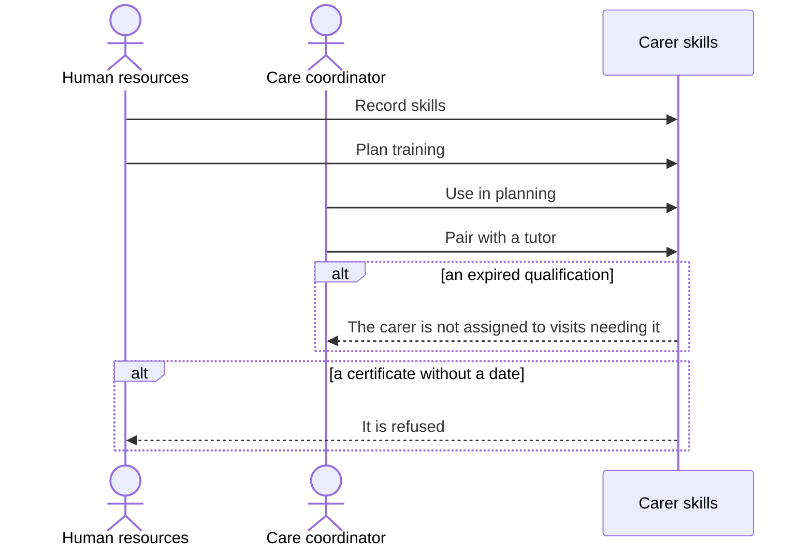

🏠 [Specs](../../../../README.md) › 🏷️ [Sectors](../../../README.md) › 🏠 [SC04 Home care](../../README.md) ›
📝 [Use cases](../README.md) › 📝 [Use cases: FL-SC04-05 People and quality](README.md) ›
📝 UC-SC04-13 Manage carers' skills and training

# 📝 UC-SC04-13 Manage carers' skills and training

**Status:** ✅ specified

## Summary

The care coordinator and HR record carers' qualifications, plan training before expiry, and the planning uses only
current ones.

## Personas

- [U25 Care coordinator](../../../../01-users/personas/u25-care-coordinator.md)
- [U06 Human resources](../../../../01-users/personas/u06-hr.md)

## Goal

Carers assigned only to what they are qualified for.

## Trigger

A new carer, a training, an expiry.

## Frequency

Monthly review.

## Preconditions

- The SC04 sector pack is installed for the company,
  [UC-F14-02](../../../../02-functional/f14-plugin-store/use-cases/01-find-and-install/uc-f14-02-install-a-plugin-or-sector-pack.md),
  and its users have their roles,
  [UC-F1-06](../../../../02-functional/f01-administration/use-cases/04-edit-a-role/uc-f01-06-edit-a-role-and-its-record-rules.md).

## Postconditions

- **Success:** qualifications are current and used by the optimiser.
- **Failed:** the carer is not assigned to that kind of visit.

## Main flow

1. HR records qualifications on [S-SC04-13 Carer skills](../../screens/05-people-and-quality/s-sc04-13-carer-skills.md).
2. HR plans training before expiry,
   [UC-F9-25](../../../../02-functional/f09-hr-and-projects/use-cases/09-train-and-protect/uc-f09-25-run-the-training-plan-with-opco-funding.md).
3. The care coordinator sees them used by the rounds
   ([BR-SC04-06](../../business-rules/br-sc04-06-carers-match-the-needs.md)).
4. The care coordinator pairs a new carer with a tutor for their first visits.

## Alternative flows

- 2a. Tutoring a new carer: the new carer goes with a tutor on the first visits.

## Error flows

- 3e. An expired qualification: the carer is not assigned to visits needing it.
- 1e. A certificate without a date: it is refused.
- Any step: a call to a service or an outside system fails: it is retried first
  ([BR-F3-32](../../../../02-functional/f03-assistant/business-rules/br-f03-32-retry-before-an-error.md)), then the
  error message pattern ([D122](../../../../06-decisions/ux/d122-error-message-standard.md)) says what failed; what was
  typed is kept.

## Business rules

- [BR-SC04-06 Carers match the needs](../../business-rules/br-sc04-06-carers-match-the-needs.md)
- [BR-F9-17 Mandatory trainings must be current for the work that needs them](../../../../02-functional/f09-hr-and-projects/business-rules/br-f09-17-mandatory-trainings-must-be-current-for-the-work-that-needs-them.md)

## Entities

- [E-SC04-11 Carer qualification](../../data/e-sc04-11-carer-qualification.md)

## Permissions

The care coordinator and human resources roles; the record rules of their role and site apply,
[UC-F1-06](../../../../02-functional/f01-administration/use-cases/04-edit-a-role/uc-f01-06-edit-a-role-and-its-record-rules.md).

## Notifications

None beyond the in-app updates of the records concerned.

## Audit events

Every creation, change and state change of carer qualification records, with who, when and the values before and after
(T3).

## AI involvement

The AI assistant answers questions on the carer qualification records of this use case, with links, and prepares them as
drafts the user confirms. It works within the user's rights,
[BR-F3-34](../../../../02-functional/f03-assistant/business-rules/br-f03-34-every-capability-is-reachable-from-the-assistant.md),
and never deletes or does anything irreversible without the user's confirmation,
[BR-F3-07](../../../../02-functional/f03-assistant/business-rules/br-f03-07-no-deletes-no-irreversible-acts.md).

## API, MCP and A2A exposure

Through the API and webhooks (T5) and the MCP and A2A gateway (T6), with the caller's rights,
[BR-F3-34](../../../../02-functional/f03-assistant/business-rules/br-f03-34-every-capability-is-reachable-from-the-assistant.md),
reading, creating and changing the records of this use case; nothing irreversible without a person's confirmation.

## Screens

- [S-SC04-13 Carer skills](../../screens/05-people-and-quality/s-sc04-13-carer-skills.md)

## Flowchart

See [FL-SC04-05 People and quality](../../flows/fl-sc04-05-people-and-quality.md#flowchart).

## Sequence diagram

## Acceptance criteria

1. **Given** the example home-care service's N. R. qualified for personal care until 2028-01-31 **when** rounds for
   January 2028 are optimised **then** she can be given personal care visits.
2. **Given** N. R.'s personal care ending 2028-01-31 **when** a personal care visit is planned on 2028-02-01 **then**
   the carer is not assigned to visits needing it.

## Non-functional notes

[D408](../../../../06-decisions/technical/d408-performance-and-profiles.md)'s targets
([performance](../../../../05-non-functional/performance.md)): 95 % of screens within 1 second; lists paged on the
server, the first page within 1 second; reports within 5 seconds or in the background. WCAG 2.2 AA and RGAA
([D46](../../../../06-decisions/ux/d46-accessibility-standard.md)).

## Regulatory references

None specific to this use case; the sector's legal rules are listed in [SC04 regulatory](../../regulatory.md).

## Related use cases

- [UC-SC04-03 Plan visits and optimise rounds](../02-plan-the-rounds/uc-sc04-03-plan-visits-and-optimise-rounds.md)

## Open questions

None.

---

⬅️ [UC-SC04-12 Handle quality, complaints and satisfaction](uc-sc04-12-handle-quality-complaints-and-satisfaction.md) ·
⬆️ [Up](README.md) ·
➡️ [UC-SC04-14 Report activity to funders and authorities](uc-sc04-14-report-activity-to-funders-and-authorities.md)
