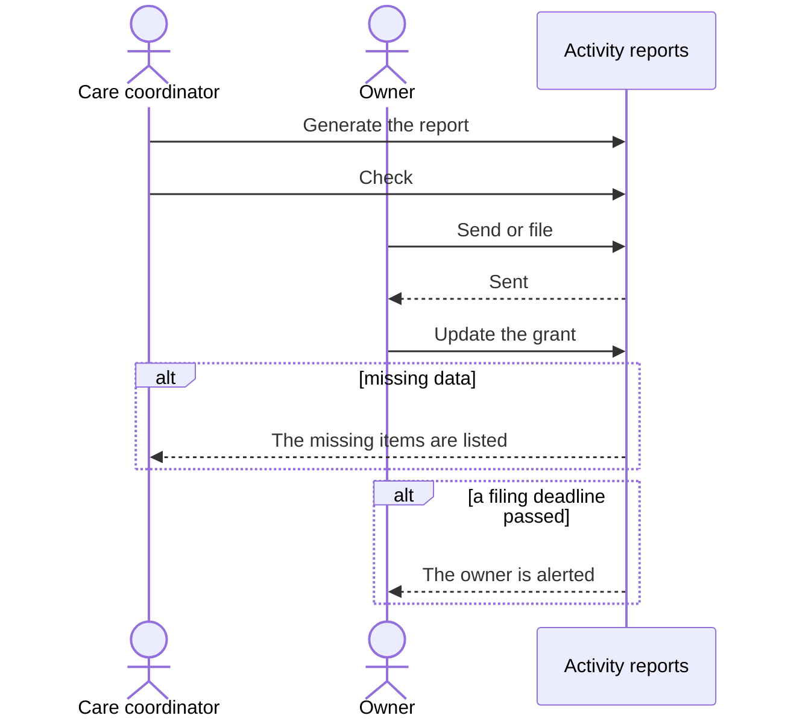

🏠 [Specs](../../../../README.md) › 🏷️ [Sectors](../../../README.md) › 🏠 [SC04 Home care](../../README.md) ›
📝 [Use cases](../README.md) › 📝 [Use cases: FL-SC04-05 People and quality](README.md) ›
📝 UC-SC04-14 Report activity to funders and authorities

# 📝 UC-SC04-14 Report activity to funders and authorities

**Status:** ✅ specified

## Summary

The care coordinator generates hours by funder, the quarterly statements and the yearly report, checks them and sends or
files them; operating grants are followed as grants.

## Personas

- [U25 Care coordinator](../../../../01-users/personas/u25-care-coordinator.md)
- [U13 Owner](../../../../01-users/personas/u13-owner.md)

## Goal

Funders and authorities get their figures on time.

## Trigger

Quarter end, year end, or a funder's request.

## Frequency

Quarterly and yearly.

## Preconditions

- The SC04 sector pack is installed for the company,
  [UC-F14-02](../../../../02-functional/f14-plugin-store/use-cases/01-find-and-install/uc-f14-02-install-a-plugin-or-sector-pack.md),
  and its users have their roles,
  [UC-F1-06](../../../../02-functional/f01-administration/use-cases/04-edit-a-role/uc-f01-06-edit-a-role-and-its-record-rules.md).

## Postconditions

- **Success:** the report is sent or filed; grants show their conditions met.
- **Failed:** the report is held with what is missing.

## Main flow

1. The care coordinator generates the report on
   [S-SC04-14 Activity reports](../../screens/05-people-and-quality/s-sc04-14-activity-reports.md): hours by funder and
   activity.
2. The care coordinator checks it.
3. The owner sends or files it.
4. An operating grant's conditions are marked met,
   [UC-F8-22](../../../../02-functional/f08-accounting/use-cases/07-client-money-grants-and-non-profits/uc-f08-22-account-for-a-grant.md).

## Alternative flows

- 1a. A funder's own format: the report is exported in that format.

## Error flows

- 2e. Missing data: the missing items are listed.
- 3e. A filing deadline passed: the owner is alerted.
- Any step: a call to a service or an outside system fails: it is retried first
  ([BR-F3-32](../../../../02-functional/f03-assistant/business-rules/br-f03-32-retry-before-an-error.md)), then the
  error message pattern ([D122](../../../../06-decisions/ux/d122-error-message-standard.md)) says what failed; what was
  typed is kept.

## Business rules

- [BR-SC04-02 Activities need their registration](../../business-rules/br-sc04-02-activities-need-their-registration.md)
- [BR-F8-14 A grant is earned as its conditions are met](../../../../02-functional/f08-accounting/business-rules/br-f08-14-a-grant-is-earned-as-its-conditions-are-met.md)

## Entities

- [E-SC04-12 Activity report](../../data/e-sc04-12-activity-report.md)
- [E-F8-18 Grant](../../../../02-functional/f08-accounting/data/e-f08-18-grant.md)

## Permissions

The care coordinator and owner roles; the record rules of their role and site apply,
[UC-F1-06](../../../../02-functional/f01-administration/use-cases/04-edit-a-role/uc-f01-06-edit-a-role-and-its-record-rules.md).

## Notifications

None beyond the in-app updates of the records concerned.

## Audit events

Every creation, change and state change of activity report, grant records, with who, when and the values before and
after (T3).

## AI involvement

The AI assistant answers questions on the activity report, grant records of this use case, with links, and prepares them
as drafts the user confirms. It works within the user's rights,
[BR-F3-34](../../../../02-functional/f03-assistant/business-rules/br-f03-34-every-capability-is-reachable-from-the-assistant.md),
and never deletes or does anything irreversible without the user's confirmation,
[BR-F3-07](../../../../02-functional/f03-assistant/business-rules/br-f03-07-no-deletes-no-irreversible-acts.md).

## API, MCP and A2A exposure

Through the API and webhooks (T5) and the MCP and A2A gateway (T6), with the caller's rights,
[BR-F3-34](../../../../02-functional/f03-assistant/business-rules/br-f03-34-every-capability-is-reachable-from-the-assistant.md),
reading, creating and changing the records of this use case; nothing irreversible without a person's confirmation.

## Screens

- [S-SC04-14 Activity reports](../../screens/05-people-and-quality/s-sc04-14-activity-reports.md)

## Flowchart

See [FL-SC04-05 People and quality](../../flows/fl-sc04-05-people-and-quality.md#flowchart).

## Sequence diagram

## Acceptance criteria

1. **Given** the example home-care service's Q4 with 2,140 hours for the département **when** the report is generated
   **then** it shows 2,140 hours by activity.
2. **Given** visits of Q4 without a funder **when** the département's Q4 report is generated **then** the missing items
   are listed.

## Non-functional notes

[D408](../../../../06-decisions/technical/d408-performance-and-profiles.md)'s targets
([performance](../../../../05-non-functional/performance.md)): 95 % of screens within 1 second; lists paged on the
server, the first page within 1 second; reports within 5 seconds or in the background. WCAG 2.2 AA and RGAA
([D46](../../../../06-decisions/ux/d46-accessibility-standard.md)).

## Regulatory references

Legal values from the France country pack:
[CR-FR-102 Personal-services declaration, approval and authorisation](../../../../10-country-packs/france/home-care/cr-fr-102-personal-services-registration.md),
[CR-FR-105 Billing the département for allowances](../../../../10-country-packs/france/home-care/cr-fr-105-departmental-allowances-billing.md).

## Related use cases

- [UC-SC04-12 Handle quality, complaints and satisfaction](uc-sc04-12-handle-quality-complaints-and-satisfaction.md)

## Open questions

None.

---

⬅️ [UC-SC04-13 Manage carers' skills and training](uc-sc04-13-manage-carers-skills-and-training.md) ·
⬆️ [Up](README.md) ·
➡️ [UC-SC04-15 Ask the AI assistant about the rounds](../03-visit/uc-sc04-15-ask-the-assistant-about-the-rounds.md)
