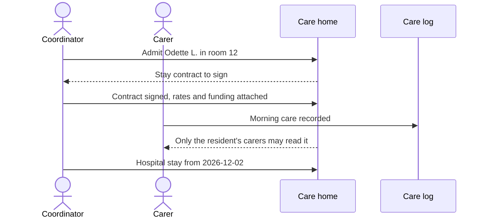

🏠 [Specs](../../../../README.md) › 🏷️ [Sectors](../../../README.md) › 🏠 [SC04 Home care](../../README.md) ›
📝 [Use cases](../README.md) › 📝 [Use cases: FL-SC04-06 Care homes, CESU, agent mode, childcare and nursing](README.md) ›
📝 UC-SC04-16 Run a care home

# 📝 UC-SC04-16 Run a care home

**Status:** ✅ specified

## Summary

A care home keeps its residents: the waiting list, admission, room, stay contract, daily rates, personal care plan and
the daily care given. The coordinator admits and follows residents; the carers record care from their phones in the
rooms. Residents' care records are health data: hosted by an approved host, seen only by the staff who care for the
resident, with every access logged.

## Personas

- [U25 Care coordinator](../../../../01-users/personas/u25-care-coordinator.md)
- [U26 Carer](../../../../01-users/personas/u26-carer.md)

## Goal

A resident's stay, contract, funding and daily care are kept in one record that only the people who need it can read.

## Trigger

A person joins the waiting list, a room is free, a resident is admitted, goes to hospital or leaves.

## Frequency

A few admissions a month in a home of 60 beds; the care record is written several times a day.

## Preconditions

- The home is set up with its rooms and its daily rates in the sector pack's settings.
- The resident is a care recipient with a funding ([E-SC04-01 Care recipient](../../data/e-sc04-01-care-recipient.md),
  [E-SC04-02 Care funding](../../data/e-sc04-02-care-funding.md)) or is created at the waiting list.

## Postconditions

- **Succeeded:** the resident is saved ([E-SC04-14 Resident](../../data/e-sc04-14-resident.md)) with their room,
  contract and care plan; the daily care is written in the care log
  ([E-SC04-06 Care log entry](../../data/e-sc04-06-care-log-entry.md)).
- **Failed:** the resident stays on the waiting list or the contract stays unsigned; the missing element is shown.

## Main flow

1. The coordinator opens the care home screen
   ([S-SC04-16 Care home](../../screens/06-care-homes-cesu-and-nursing/s-sc04-16-care-home.md)) and adds a person to the
   waiting list with their level of dependency.
2. When a room is free, the coordinator offers it to the first suitable person and records the admission date, the room
   and the stay contract.
3. The resident or their representative signs the stay contract with the e-signature
   [UC-F6-04](../../../../02-functional/f06-customers-and-sales/use-cases/02-quote-to-order/uc-f06-04-accept-or-sign-a-quote.md);
   the daily rates and the funding are attached
   ([UC-SC04-01](../01-take-on-a-recipient/uc-sc04-01-register-a-care-recipient-and-their-funding.md)).
4. The care plan is written for the resident
   ([UC-SC04-02](../01-take-on-a-recipient/uc-sc04-02-assess-needs-and-write-the-care-plan.md)) and the carers see it on
   their phones.
5. The carers record the care given each day in the care log
   ([UC-SC04-05](../03-visit/uc-sc04-05-keep-the-care-log-and-report-incidents.md)); only the carers of the resident and
   the coordinator can read it
   ([BR-SC04-16](../../business-rules/br-sc04-16-residents-care-records-follow-health-data-rules.md)).
6. The coordinator marks a hospital stay as Absent, and the departure or death as Left, with the invoice closed to that
   date ([UC-SC04-08](../04-bill-and-fund/uc-sc04-08-bill-recipients-and-funders.md)).

## Alternative flows

- 2a. No room is free: the person stays on the waiting list, ranked by date and urgency.
- 5a. A relative asks to read the care record: the resident or their representative decides what is shared
  ([UC-SC04-07](../05-people-and-quality/uc-sc04-07-give-the-family-access.md)).
- 6a. A hospital stay: the accommodation rate may be reduced for the days away as the contract says.

## Error flows

- 3e. The stay contract is late, as [CR-FR-256](../../../../10-country-packs/france/home-care/cr-fr-256-care-home-resident-contract.md) sets the delays: in a home entitled to social aid, the contract
  not handed over within 15 days of admission, or not signed within 1 month, alerts the coordinator; in another home,
  a contract not signed before admission holds the admission and alerts the coordinator. The law wins over the earlier
  wording ([D573](../../../../06-decisions/foundations/d573-precedence-between-spec-pages.md)).
- 5e. A user without a care role opens a care record: access is refused and logged.
- 2e. The funding file is incomplete: the admission can go ahead but the invoice is held and the gap is listed.
- Any step: a service does not answer; the call is retried first
  ([BR-F3-32](../../../../02-functional/f03-assistant/business-rules/br-f03-32-retry-before-an-error.md)), then the
  message follows the error pattern ([D122](../../../../06-decisions/ux/d122-error-message-standard.md)) and what the
  user typed stays on the screen.

## Business rules

- [BR-SC04-16](../../business-rules/br-sc04-16-residents-care-records-follow-health-data-rules.md)
- [BR-SC04-04](../../business-rules/br-sc04-04-health-data-hosted-and-restricted.md)
- [BR-SC04-15](../../business-rules/br-sc04-15-records-kept-no-longer-than-needed.md)

## Entities

- [E-SC04-14 Resident](../../data/e-sc04-14-resident.md): created, changed
- [E-SC04-01 Care recipient](../../data/e-sc04-01-care-recipient.md): read, the care recipient behind the resident
- [E-SC04-03 Care plan](../../data/e-sc04-03-care-plan.md): read, the resident's care plan
- [E-SC04-06 Care log entry](../../data/e-sc04-06-care-log-entry.md): created, the daily care log
- [E-SC04-02 Care funding](../../data/e-sc04-02-care-funding.md): read, the funding of the stay

## Permissions

Coordinator admits and follows residents; carers read the records of their residents and write the care log.
A relative sees only what the resident shares; the home's owner sees counts, not records.

## Notifications

The coordinator, in the app: a room is free, a stay contract is late (CR-FR-256), a resident is back from hospital. The
carers: a care plan changed.

## Audit events

Each admission, room change, absence and departure; each reading of a care record, with who, when and why; each contract
signed.

## AI involvement

No AI step of its own. The AI assistant may open the screen and prefill it from the user's words; the user checks and
confirms
[BR-F3-07](../../../../02-functional/f03-assistant/business-rules/br-f03-07-no-deletes-no-irreversible-acts.md).

## API, MCP and A2A exposure

T5 operations of the capability for the personas above: create, read, update and list. The MCP tool of the
capability may read and propose, never confirm alone. No A2A skill.

## Screens

- [S-SC04-16 Care home](../../screens/06-care-homes-cesu-and-nursing/s-sc04-16-care-home.md)

## Flowchart

See
[FL-SC04-06 Care homes, CESU, agent mode, childcare and nursing](../../flows/fl-sc04-06-care-homes-cesu-and-nursing.md#flowchart).

## Sequence diagram

## Acceptance criteria

1. **Given** a home not entitled to social aid and a resident to admit on 2026-09-01 **when** the stay contract is
   unsigned that day **then** the admission is held and the coordinator is alerted.
2. **Given** a user without a care role **when** they open a resident's care record **then** access is refused and
   logged.
3. **Given** a resident's hospital stay from 2026-12-02 to 2026-12-09 **when** the invoice is prepared **then** the days
   away are shown as the contract's rule says.
4. **Given** two persons on the waiting list for one room **when** the room is free **then** the person with the earlier
   date and the higher urgency is offered it first.
5. **Given** a home entitled to social aid and a resident admitted on 2026-09-01 **when** the contract is handed over on
   2026-09-10 and still unsigned on 2026-10-02 **then** the resident stays Admitted and the coordinator is alerted that
   the 1-month delay has passed.

## Non-functional notes

The screen answers within 2 seconds for 10,000 records; every change is audited.

## Regulatory references

A care home signs a written stay contract with the resident or their representative; the contract states the
services and their prices. The care record is health data and must be hosted by an approved health-data host; access is
limited to those who need it and is logged. The France-pack rule on care-home contracts is listed below.
Related:
[CR-FR-055](../../../../10-country-packs/france/data-protection/cr-fr-055-health-data-hosting.md),
[CR-FR-131](../../../../10-country-packs/france/health-practice/cr-fr-131-medical-record-access.md),
[CR-FR-052](../../../../10-country-packs/france/data-protection/cr-fr-052-storage-limitation.md).

- France-pack rule:
  [CR-FR-256 Care-home resident contract](../../../../10-country-packs/france/home-care/cr-fr-256-care-home-resident-contract.md)

## Related use cases

- [UC-SC04-17 Accept CESU vouchers](uc-sc04-17-accept-cesu-vouchers.md)
- [UC-SC04-01](../01-take-on-a-recipient/uc-sc04-01-register-a-care-recipient-and-their-funding.md)
- [UC-SC04-02](../01-take-on-a-recipient/uc-sc04-02-assess-needs-and-write-the-care-plan.md)

## Open questions

None.

---

⬅️ [UC-SC04-15 Ask the AI assistant about the rounds](../03-visit/uc-sc04-15-ask-the-assistant-about-the-rounds.md) ·
⬆️ [Up](README.md) · ➡️ [UC-SC04-17 Accept CESU vouchers](uc-sc04-17-accept-cesu-vouchers.md)
