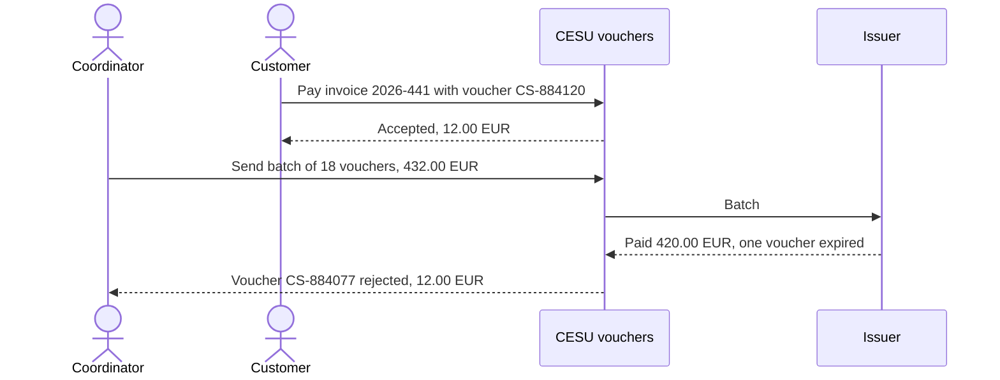

🏠 [Specs](../../../../README.md) › 🏷️ [Sectors](../../../README.md) › 🏠 [SC04 Home care](../../README.md) ›
📝 [Use cases](../README.md) › 📝 [Use cases: FL-SC04-06 Care homes, CESU, agent mode, childcare and nursing](README.md) ›
📝 UC-SC04-17 Accept CESU vouchers

# 📝 UC-SC04-17 Accept CESU vouchers

**Status:** 🔄 waiting for the owner

## Summary

A home-care provider accepts CESU vouchers (the prefinanced service cheques that employers and funds give their staff or
members) as payment for its services. The coordinator records each voucher against the invoice it pays, sends them to
the issuer in batches and reconciles the issuer's reimbursement, voucher by voucher.

## Personas

- [U25 Care coordinator](../../../../01-users/personas/u25-care-coordinator.md)
- [U09 Customer](../../../../01-users/personas/u09-customer.md)

## Goal

Every voucher received is turned into money: matched to an invoice, sent in time, and reimbursed or followed up when
rejected.

## Trigger

A customer pays an invoice with vouchers, a batch is due to be sent, or the issuer pays.

## Frequency

Several vouchers a day for a provider with many customers; a batch each week or month.

## Preconditions

- The provider is registered with the issuer to accept vouchers.
- The invoice to pay exists ([E-SC04-08 Care invoice](../../data/e-sc04-08-care-invoice.md)) for services eligible to
  vouchers.

## Postconditions

- **Succeeded:** the voucher is saved ([E-SC04-15 CESU voucher](../../data/e-sc04-15-cesu-voucher.md)) linked to its
  invoice; the batch is sent and later reconciled with the issuer's payment.
- **Failed:** the voucher is not accepted as payment; the invoice stays open and the reason is shown.

## Main flow

1. The coordinator, or the customer on the phone, enters the voucher (its number, its face value and its issuer) on the
   CESU screen ([S-SC04-17 CESU](../../screens/06-care-homes-cesu-and-nursing/s-sc04-17-cesu.md)) against the invoice.
2. simple-ERP checks the voucher: valid dates, not already used, eligible for the invoice's services, and the amount not
   above the invoice.
3. The voucher is accepted and the invoice is paid for that amount
   [UC-F6-07](../../../../02-functional/f06-customers-and-sales/use-cases/03-invoice-and-get-paid/uc-f06-07-get-paid-online-and-reconcile.md).
4. The coordinator groups accepted vouchers into a batch for each issuer and sends it, on paper or electronically.
5. The issuer pays; simple-ERP matches the payment to the batch, voucher by voucher
   ([BR-SC04-17](../../business-rules/br-sc04-17-cesu-vouchers-are-reconciled-with-the-issuer.md)).
6. Reimbursed vouchers are final; a rejected voucher goes back to the coordinator with the issuer's reason.

## Alternative flows

- 2a. The voucher is an electronic one the customer pays with from the phone: the code is checked with the issuer at
  once.
- 6a. A rejected voucher is corrected (a wrong number) and sent again in a later batch.
- 3a. The voucher is worth less than the invoice: the invoice is part paid and the rest is asked from the customer.

## Error flows

- 2e. The voucher is expired, already used or not eligible: it is rejected with the reason and the invoice stays open.
- 5e. The issuer pays less than the batch: the difference is listed by voucher and the coordinator asks the issuer about
  each.
- 4e. A batch is sent after the issuer's limit date: the vouchers are flagged at risk.
- Any step: a service does not answer; the call is retried first
  ([BR-F3-32](../../../../02-functional/f03-assistant/business-rules/br-f03-32-retry-before-an-error.md)), then the
  message follows the error pattern ([D122](../../../../06-decisions/ux/d122-error-message-standard.md)) and what the
  user typed stays on the screen.

## Business rules

- [BR-SC04-17](../../business-rules/br-sc04-17-cesu-vouchers-are-reconciled-with-the-issuer.md)
- [BR-SC04-11](../../business-rules/br-sc04-11-billing-splits-between-funders.md)

## Entities

- [E-SC04-15 CESU voucher](../../data/e-sc04-15-cesu-voucher.md): created, changed
- [E-SC04-08 Care invoice](../../data/e-sc04-08-care-invoice.md): changed, the invoice a voucher pays
- [E-SC04-02 Care funding](../../data/e-sc04-02-care-funding.md): read, the funding of the recipient

## Permissions

Coordinator records, batches and reconciles vouchers; the customer enters their own vouchers from the phone.
Accounting reads the batches and the issuer's payments.

## Notifications

The coordinator, in the app: a batch is due, the issuer paid less than expected, a voucher is rejected. The customer:
the voucher is accepted.

## Audit events

Each voucher received, accepted, batched, reimbursed or rejected; each batch sent; each difference found with the
issuer; who and when.

## AI involvement

No AI step of its own. The AI assistant may open the screen and prefill it from the user's words; the user checks and
confirms
[BR-F3-07](../../../../02-functional/f03-assistant/business-rules/br-f03-07-no-deletes-no-irreversible-acts.md).

## API, MCP and A2A exposure

T5 operations of the capability for the personas above: create, read, update and list. The MCP tool of the
capability may read and propose, never confirm alone. No A2A skill.

## Screens

- [S-SC04-17 CESU](../../screens/06-care-homes-cesu-and-nursing/s-sc04-17-cesu.md)

## Flowchart

See
[FL-SC04-06 Care homes, CESU, agent mode, childcare and nursing](../../flows/fl-sc04-06-care-homes-cesu-and-nursing.md#flowchart).

## Sequence diagram

## Acceptance criteria

1. **Given** a batch of 18 vouchers worth 432.00 EUR **when** the issuer pays 420.00 EUR and rejects one expired voucher
   of 12.00 EUR **then** 17 vouchers are Reimbursed and one is Rejected with its reason.
2. **Given** a voucher already used on another invoice **when** it is entered again **then** it is rejected as used.
3. **Given** a voucher worth 12.00 EUR on an invoice of 30.00 EUR **when** it is accepted **then** the invoice shows
   18.00 EUR left to pay.
4. **Given** a voucher sent after the issuer's limit date **when** the batch is prepared **then** the voucher is flagged
   at risk.

## Non-functional notes

The screen answers within 2 seconds for 10,000 records; every change is audited.

## Regulatory references

A prefinanced CESU voucher is a means of payment for personal services declared by the provider; the provider
is registered with the issuer, and the voucher has a validity. The part of a service paid by an employer-financed
voucher is shown apart in the yearly tax-credit certificate. The France-pack rule is listed below. Related:
[CR-FR-102](../../../../10-country-packs/france/home-care/cr-fr-102-personal-services-registration.md),
[CR-FR-103](../../../../10-country-packs/france/tax-and-vat/cr-fr-103-home-services-tax-credit.md),
[CR-FR-104](../../../../10-country-packs/france/tax-and-vat/cr-fr-104-immediate-advance-of-tax-credit.md).

- France-pack rule, (Proposed) until its law is read:
  [CR-FR-230 CESU vouchers](../../../../10-country-packs/france/home-care/cr-fr-230-cesu-vouchers.md)

## Related use cases

- [UC-SC04-16 Run a care home](uc-sc04-16-run-a-care-home.md)
- [UC-SC04-18](uc-sc04-18-run-the-agent-mode-for-family-employers.md)
- [UC-SC04-08](../04-bill-and-fund/uc-sc04-08-bill-recipients-and-funders.md)
- [UC-SC04-09](../04-bill-and-fund/uc-sc04-09-issue-the-yearly-tax-credit-certificate.md)

## Open questions

None.

---

⬅️ [UC-SC04-16 Run a care home](uc-sc04-16-run-a-care-home.md) · ⬆️ [Up](README.md) ·
➡️ [UC-SC04-18 Run the agent mode for family employers](uc-sc04-18-run-the-agent-mode-for-family-employers.md)
