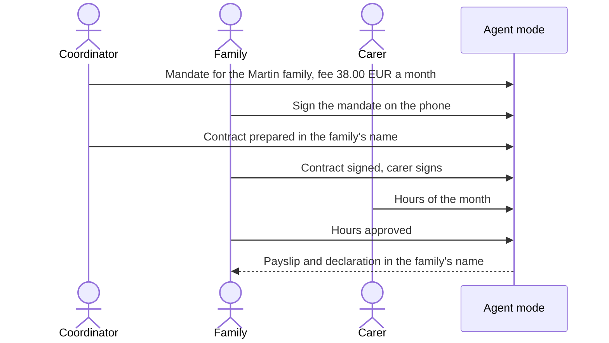

🏠 [Specs](../../../../README.md) › 🏷️ [Sectors](../../../README.md) › 🏠 [SC04 Home care](../../README.md) ›
📝 [Use cases](../README.md) › 📝 [Use cases: FL-SC04-06 Care homes, CESU, agent mode, childcare and nursing](README.md) ›
📝 UC-SC04-18 Run the agent mode for family employers

# 📝 UC-SC04-18 Run the agent mode for family employers

**Status:** ✅ specified

## Summary

In agent mode the provider helps a family employ a carer directly: the family is the employer, and the provider acts as
its agent under a written mandate. The provider finds and presents the carer, prepares the contract, the monthly payslip
and the declarations in the family's name, and invoices only its fee. The family approves the hours and pays the wages.

## Personas

- [U25 Care coordinator](../../../../01-users/personas/u25-care-coordinator.md)
- [U09 Customer](../../../../01-users/personas/u09-customer.md)

## Goal

Families employ a carer with the provider's help while the legal employer stays the family, and the provider never acts
as the employer.

## Trigger

A family asks to employ a carer with the provider's help, or a month ends for an existing mandate.

## Frequency

A mandate lasts months to years; one payslip run per mandate each month.

## Preconditions

- The family is a customer and care recipient
  ([E-F6-01](../../../../02-functional/f06-customers-and-sales/data/e-f06-01-customer-record.md),
  [E-SC04-01 Care recipient](../../data/e-sc04-01-care-recipient.md)).
- The carer is a person who may be employed by the family, with their qualifications
  ([E-SC04-11 Carer qualification](../../data/e-sc04-11-carer-qualification.md)).

## Postconditions

- **Succeeded:** the mandate is saved ([E-SC04-16 Mandate](../../data/e-sc04-16-mandate.md)) with its scope and fee;
  contracts, payslips and declarations are made in the family's name.
- **Failed:** the mandate stays Draft; no contract or payslip is prepared and the missing signature is shown.

## Main flow

1. The coordinator opens the agent mode screen
   ([S-SC04-18 Agent mode](../../screens/06-care-homes-cesu-and-nursing/s-sc04-18-agent-mode.md)) and creates a mandate
   with the family, the scope (search, contract, payslips, declarations) and the monthly fee.
2. The family signs the mandate on the phone with the e-signature
   [UC-F6-04](../../../../02-functional/f06-customers-and-sales/use-cases/02-quote-to-order/uc-f06-04-accept-or-sign-a-quote.md);
   the mandate becomes Active.
3. The coordinator presents the carer; the contract is prepared in the family's name and signed by the family and the
   carer
   [UC-F9-01](../../../../02-functional/f09-hr-and-projects/use-cases/01-people/uc-f09-01-manage-employee-records-and-contracts.md).
4. Each month the carer's hours are recorded ([UC-SC04-04](../03-visit/uc-sc04-04-visit-on-the-carer-s-phone.md)) and
   the family approves them on the phone.
5. The pay is computed under the home-help agreement
   [UC-F13-31](../../../../02-functional/f13-payroll/use-cases/09-collective-agreements-by-family/uc-f13-31-apply-the-home-help-agreement.md)
   and the payslip and the declarations are prepared in the family's name
   ([BR-SC04-18](../../business-rules/br-sc04-18-in-agent-mode-the-family-is-the-employer.md)).
6. The provider invoices its fee; at the end of the mandate the last payslip and the end-of-contract papers are
   prepared.

## Alternative flows

- 4a. The family does not approve the hours: they stay pending and the payslip waits, with a reminder.
- 3a. The family already employs the carer: the mandate covers only the payslips and declarations.
- 6a. The family ends the mandate but keeps the carer: the provider hands over the documents and the family continues
  alone.

## Error flows

- 3e. The contract names the provider as employer: it is refused, since in agent mode the family signs as the employer.
- 5e. The hours are not approved by the payroll deadline: the declaration is not sent and the family is warned of the
  risk.
- 2e. The mandate is not signed: nothing is prepared in the family's name.
- Any step: a service does not answer; the call is retried first
  ([BR-F3-32](../../../../02-functional/f03-assistant/business-rules/br-f03-32-retry-before-an-error.md)), then the
  message follows the error pattern ([D122](../../../../06-decisions/ux/d122-error-message-standard.md)) and what the
  user typed stays on the screen.

## Business rules

- [BR-SC04-18](../../business-rules/br-sc04-18-in-agent-mode-the-family-is-the-employer.md)
- [BR-SC04-01](../../business-rules/br-sc04-01-home-care-follows-the-country-pack.md)

## Entities

- [E-SC04-16 Mandate](../../data/e-sc04-16-mandate.md): created, changed
- [E-F13-02](../../../../02-functional/f13-payroll/data/e-f13-02-employee-pay-profile.md): created, the carer's pay
  profile under the family
- [E-F9-02 Contract](../../../../02-functional/f09-hr-and-projects/data/e-f09-02-contract.md): created, the employment
  contract in the family's name
- [E-SC04-11 Carer qualification](../../data/e-sc04-11-carer-qualification.md): read, the carer's qualifications

## Permissions

Coordinator manages mandates; the family approves hours and signs; the carer sees their own contract and payslips.
The provider's payroll officer prepares the payslips under the mandate.

## Notifications

The family, by email and on the phone: hours to approve, payslip ready, declaration sent. The coordinator: hours not
approved 3 days before the deadline.

## Audit events

Each mandate created, signed, changed or ended; each contract, payslip and declaration prepared for a family, with who
and when.

## AI involvement

No AI step of its own. The AI assistant may open the screen and prefill it from the user's words; the user checks and
confirms
[BR-F3-07](../../../../02-functional/f03-assistant/business-rules/br-f03-07-no-deletes-no-irreversible-acts.md).

## API, MCP and A2A exposure

T5 operations of the capability for the personas above: create, read, update and list. The MCP tool of the
capability may read and propose, never confirm alone. No A2A skill.

## Screens

- [S-SC04-18 Agent mode](../../screens/06-care-homes-cesu-and-nursing/s-sc04-18-agent-mode.md)

## Flowchart

See
[FL-SC04-06 Care homes, CESU, agent mode, childcare and nursing](../../flows/fl-sc04-06-care-homes-cesu-and-nursing.md#flowchart).

## Sequence diagram

## Acceptance criteria

1. **Given** a mandate signed by the family **when** the contract is prepared **then** it names the family as the
   employer.
2. **Given** a contract that names the provider as employer **when** it is saved **then** it is refused with the reason.
3. **Given** hours not approved by the payroll deadline **when** the deadline arrives **then** no declaration is sent
   and the family is warned.
4. **Given** a monthly fee of 38.00 EUR **when** the month is closed **then** the provider's invoice is 38.00 EUR and
   carries no wage.

## Non-functional notes

The screen answers within 2 seconds for 10,000 records; every change is audited.

## Regulatory references

In agent mode the family stays the legal employer: the contract, the payslip and the declarations name the
family, and the provider acts under a written mandate and invoices only its fee. The provider's personal-services
declaration or approval is needed. The France-pack rule is listed below. Related:
[CR-FR-102](../../../../10-country-packs/france/home-care/cr-fr-102-personal-services-registration.md),
[CR-FR-103](../../../../10-country-packs/france/tax-and-vat/cr-fr-103-home-services-tax-credit.md).

- France-pack rule:
  [CR-FR-231 Agent mode for family employers](../../../../10-country-packs/france/home-care/cr-fr-231-agent-mode.md)

## Related use cases

- [UC-SC04-17 Accept CESU vouchers](uc-sc04-17-accept-cesu-vouchers.md)
- [UC-SC04-19 Provide childcare at home](uc-sc04-19-provide-childcare-at-home.md)
- [UC-SC04-17 Accept CESU vouchers](uc-sc04-17-accept-cesu-vouchers.md)
- [UC-F13-31](../../../../02-functional/f13-payroll/use-cases/09-collective-agreements-by-family/uc-f13-31-apply-the-home-help-agreement.md)

## Open questions

None.

---

⬅️ [UC-SC04-17 Accept CESU vouchers](uc-sc04-17-accept-cesu-vouchers.md) · ⬆️ [Up](README.md) ·
➡️ [UC-SC04-19 Provide childcare at home](uc-sc04-19-provide-childcare-at-home.md)
