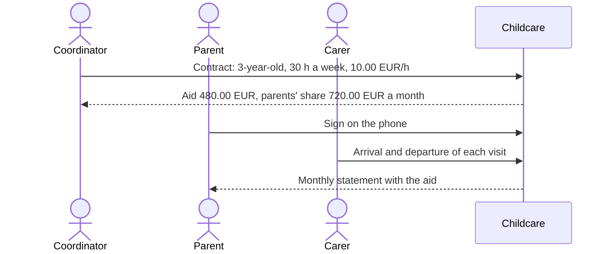

🏠 [Specs](../../../../README.md) › 🏷️ [Sectors](../../../README.md) › 🏠 [SC04 Home care](../../README.md) ›
📝 [Use cases](../README.md) › 📝 [Use cases: FL-SC04-06 Care homes, CESU, agent mode, childcare and nursing](README.md) ›
📝 UC-SC04-19 Provide childcare at home

# 📝 UC-SC04-19 Provide childcare at home

**Status:** ✅ specified

## Summary

A provider places a carer to look after children at the family's home. The coordinator agrees the contract with the
parents (the child, the hours, the rate), computes what the family allowance aid covers and what the parents owe, and
the carer records each presence from the phone. The aid follows the rules of the family allowance fund, kept as data.

## Personas

- [U25 Care coordinator](../../../../01-users/personas/u25-care-coordinator.md)
- [U26 Carer](../../../../01-users/personas/u26-carer.md)

## Goal

Parents get childcare at home with the aid they are entitled to computed correctly, and the carer's hours and the
parents' share are always known.

## Trigger

A family asks for childcare at home, a child's situation changes, or a month ends.

## Frequency

A contract lasts months to years; one statement each month.

## Preconditions

- The parents are customers and the child is a care recipient
  ([E-F6-01](../../../../02-functional/f06-customers-and-sales/data/e-f06-01-customer-record.md),
  [E-SC04-01 Care recipient](../../data/e-sc04-01-care-recipient.md)).
- The carer holds the qualification the care of children needs
  ([E-SC04-11 Carer qualification](../../data/e-sc04-11-carer-qualification.md)).

## Postconditions

- **Succeeded:** the contract is saved ([E-SC04-17 Childcare contract](../../data/e-sc04-17-childcare-contract.md)) with
  the hours, the rate, the aid and the parents' share; each month's presence is recorded and invoiced.
- **Failed:** the contract stays Draft; the aid is not applied and the parents' share is shown without it.

## Main flow

1. The coordinator opens the childcare screen
   ([S-SC04-19 Childcare](../../screens/06-care-homes-cesu-and-nursing/s-sc04-19-childcare.md)) and creates a contract
   with the parents, the child, the carer, the weekly schedule and the hourly rate.
2. SimpleERP checks the child's age for eligibility and computes the aid from the family's resources, the number of
   children, the care mode, the paid hours and the net pay, using the table of the
   country pack, and shows the parents' share
   ([BR-SC04-19](../../business-rules/br-sc04-19-family-allowance-aid-follows-the-caf-rules.md)).
3. The parents sign the contract on the phone
   [UC-F6-04](../../../../02-functional/f06-customers-and-sales/use-cases/02-quote-to-order/uc-f06-04-accept-or-sign-a-quote.md);
   the contract is Active.
4. The carer records arrival and departure at each visit on the phone
   ([UC-SC04-04](../03-visit/uc-sc04-04-visit-on-the-carer-s-phone.md)).
5. At the month's end the hours are totalled, the aid is applied and the parents' share is invoiced
   ([UC-SC04-08](../04-bill-and-fund/uc-sc04-08-bill-recipients-and-funders.md)).
6. A change (new hours, a new child) is an amendment; the aid is recomputed from its date.

## Alternative flows

- 2a. The parents ask for the aid to be paid to the provider: the invoice shows the aid as a funder's part
  [UC-F6-20](../../../../02-functional/f06-customers-and-sales/use-cases/07-special-invoicing/uc-f06-20-invoice-several-payers-with-funders-and-caps.md).
- 5a. The carer is ill: a replacement carer is sent
  ([UC-SC04-06](../02-plan-the-rounds/uc-sc04-06-replace-an-absent-carer.md)) and the hours are recorded under their
  name.
- 6a. The child reaches the age limit of the aid: the aid is recomputed from that date.

## Error flows

- 2e. The family's resources are missing: the aid is not computed and the parents' share is shown without aid, flagged.
- 4e. A visit is recorded without the carer's departure: the hours wait for the coordinator's correction.
- 1e. The carer lacks the qualification: the contract cannot be saved until a qualified carer is chosen.
- Any step: a service does not answer; the call is retried first
  ([BR-F3-32](../../../../02-functional/f03-assistant/business-rules/br-f03-32-retry-before-an-error.md)), then the
  message follows the error pattern ([D122](../../../../06-decisions/ux/d122-error-message-standard.md)) and what the
  user typed stays on the screen.

## Business rules

- [BR-SC04-19](../../business-rules/br-sc04-19-family-allowance-aid-follows-the-caf-rules.md)
- [BR-SC04-05](../../business-rules/br-sc04-05-rounds-count-travel-time.md)

## Entities

- [E-SC04-17 Childcare contract](../../data/e-sc04-17-childcare-contract.md): created, changed
- [E-SC04-04 Visit](../../data/e-sc04-04-visit.md): created, the visits of the contract
- [E-SC04-02 Care funding](../../data/e-sc04-02-care-funding.md): read, the aid as a funding
- [E-SC04-11 Carer qualification](../../data/e-sc04-11-carer-qualification.md): read, the carer's qualification

## Permissions

Coordinator manages contracts; the carer records presence on the phone; parents see their contract and statement.
The child's data is visible only to the coordinator and the child's carer.

## Notifications

The parents, by email and on the phone: the monthly statement, a replacement carer. The coordinator: a visit has no
departure, the aid changes at a birthday.

## Audit events

Each contract, amendment and aid computation with the table version used; each visit recorded; who and when.

## AI involvement

No AI step of its own. The AI assistant may open the screen and prefill it from the user's words; the user checks and
confirms
[BR-F3-07](../../../../02-functional/f03-assistant/business-rules/br-f03-07-no-deletes-no-irreversible-acts.md).

## API, MCP and A2A exposure

T5 operations of the capability for the personas above: create, read, update and list. The MCP tool of the
capability may read and propose, never confirm alone. No A2A skill.

## Screens

- [S-SC04-19 Childcare](../../screens/06-care-homes-cesu-and-nursing/s-sc04-19-childcare.md)

## Flowchart

See
[FL-SC04-06 Care homes, CESU, agent mode, childcare and nursing](../../flows/fl-sc04-06-care-homes-cesu-and-nursing.md#flowchart).

## Sequence diagram

## Acceptance criteria

1. **Given** a month of 120 hours at 10.00 EUR/h and an aid of 480.00 EUR from the table **when** the statement is
   computed **then** the cost is 1,200.00 EUR and the parents' share 720.00 EUR.
2. **Given** a family with no resources recorded **when** the aid is computed **then** no aid is applied and the share
   is flagged.
3. **Given** a carer without the qualification for children **when** the contract is saved **then** it is refused with
   the missing qualification.
4. **Given** a visit recorded without a departure **when** the month is closed **then** the hours wait for correction.

## Non-functional notes

The screen answers within 2 seconds for 10,000 records; every change is audited.

## Regulatory references

The family allowance fund pays an aid for childcare at home computed from the household's resources, the number of
children, the care mode, the paid hours and the net pay; the child's age decides only who is eligible; the table of the
aid is kept as data of the France pack, never in the page. The France-pack rule is listed below. Related:
[CR-FR-102](../../../../10-country-packs/france/home-care/cr-fr-102-personal-services-registration.md),
[CR-FR-103](../../../../10-country-packs/france/tax-and-vat/cr-fr-103-home-services-tax-credit.md),
[CR-FR-210](../../../../10-country-packs/france/labour/cr-fr-210-qualifications-tied-to-tasks.md).

- France-pack rule:
  [CR-FR-232 Childcare at home and the PAJE aid](../../../../10-country-packs/france/home-care/cr-fr-232-childcare-paje.md)

## Related use cases

- [UC-SC04-18](uc-sc04-18-run-the-agent-mode-for-family-employers.md)
- [UC-SC04-20 Run home nursing care](uc-sc04-20-run-home-nursing-care.md)
- [UC-SC04-17 Accept CESU vouchers](uc-sc04-17-accept-cesu-vouchers.md)
- [UC-SC04-04 Visit on the carer's phone](../03-visit/uc-sc04-04-visit-on-the-carer-s-phone.md)

## Open questions

None.

---

⬅️ [UC-SC04-18 Run the agent mode for family employers](uc-sc04-18-run-the-agent-mode-for-family-employers.md) ·
⬆️ [Up](README.md) · ➡️ [UC-SC04-20 Run home nursing care](uc-sc04-20-run-home-nursing-care.md)
