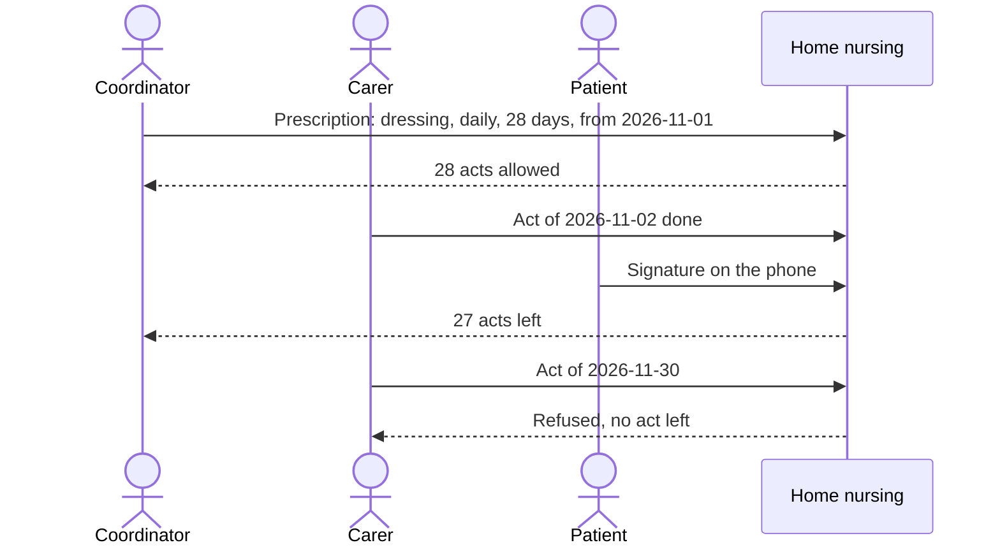

🏠 [Specs](../../../../README.md) › 🏷️ [Sectors](../../../README.md) › 🏠 [SC04 Home care](../../README.md) ›
📝 [Use cases](../README.md) › 📝 [Use cases: FL-SC04-06 Care homes, CESU, agent mode, childcare and nursing](README.md) ›
📝 UC-SC04-20 Run home nursing care

# 📝 UC-SC04-20 Run home nursing care

**Status:** ✅ specified

## Summary

A home nursing service gives nursing and personal care at home on a doctor's prescription, with nurses and nursing
assistants under a coordinating nurse. The coordinator records each prescription and the care the coordinating nurse
assessed on it; every care act is planned and done against a valid prescription, signed by the patient, and counted in
the activity the service reports to the ARS, which funds the care by a yearly global allowance: no act is billed.

## Personas

- [U25 Care coordinator](../../../../01-users/personas/u25-care-coordinator.md)
- [U26 Carer](../../../../01-users/personas/u26-carer.md)

## Goal

Every care act at home is backed by a valid prescription, written down once done and counted in the service's activity,
and none is done outside its prescription.

## Trigger

A doctor prescribes care for a patient, an act is due, or a prescription ends.

## Frequency

Several acts a day for each patient served; a prescription lasts days to months.

## Preconditions

- The patient is a care recipient with their funding
  ([E-SC04-01 Care recipient](../../data/e-sc04-01-care-recipient.md),
  [E-SC04-02 Care funding](../../data/e-sc04-02-care-funding.md)).
- The nurses' and assistants' qualifications are recorded
  ([E-SC04-11 Carer qualification](../../data/e-sc04-11-carer-qualification.md)).

## Postconditions

- **Succeeded:** the care act is saved ([E-SC04-18 Care act](../../data/e-sc04-18-care-act.md)) against its
  prescription, signed and counted in the service's activity; the prescription's count of acts left is updated.
- **Failed:** no act is planned or recorded without a valid prescription; the reason is shown.

## Main flow

1. The coordinator opens the home nursing screen
   ([S-SC04-20 Home nursing](../../screens/06-care-homes-cesu-and-nursing/s-sc04-20-home-nursing.md)) and records the
   prescription: prescriber, date, and the care the coordinating nurse assessed on it, with how many acts and until
   when (a product choice: the law does not ask the prescription to state the acts and the period, CR-FR-233).
2. The coordinator plans the acts as visits
   ([UC-SC04-03](../02-plan-the-rounds/uc-sc04-03-plan-visits-and-optimise-rounds.md)); each act is linked to the
   prescription.
3. SimpleERP checks, for each act, that the prescription is valid and still has acts left
   ([BR-SC04-20](../../business-rules/br-sc04-20-care-acts-need-a-prescription.md)).
4. The carer, on the phone, performs the act and records it with the time and a note; the patient signs on the phone.
5. The acts done are counted in the activity the service reports to the ARS
   ([UC-SC04-14](../05-people-and-quality/uc-sc04-14-report-activity-to-funders-and-authorities.md)); the care is funded
   by the ARS's yearly global allowance and no act is billed to the health insurance or the patient
   ([CR-FR-233](../../../../10-country-packs/france/health-practice/cr-fr-233-home-nursing-ssiad.md)).
6. When the prescription ends, the coordinator asks the doctor for a renewal if the care continues.

## Alternative flows

- 3a. The prescription is an electronic one: it is fetched by its number and checked
  ([CR-FR-134](../../../../10-country-packs/france/health-practice/cr-fr-134-e-prescription.md)).
- 4a. An act is done by a nursing assistant under a nurse: the nurse's name is recorded as the one who coordinates it.
- 6a. The doctor modifies the prescription: a new prescription replaces it from its date.

## Error flows

- 3e. The prescription has ended or has no act left: the act cannot be planned or recorded, and the coordinator is told
  to ask for a renewal.
- 4e. The patient cannot sign: the carer records the reason and a witness if the service's procedure asks.
- 5e. An act done without a prescription is found: it is not counted as care of the service, and an incident is opened
  ([UC-SC04-05](../03-visit/uc-sc04-05-keep-the-care-log-and-report-incidents.md)).
- Any step: a service does not answer; the call is retried first
  ([BR-F3-32](../../../../02-functional/f03-assistant/business-rules/br-f03-32-retry-before-an-error.md)), then the
  message follows the error pattern ([D122](../../../../06-decisions/ux/d122-error-message-standard.md)) and what the
  user typed stays on the screen.

## Business rules

- [BR-SC04-20](../../business-rules/br-sc04-20-care-acts-need-a-prescription.md)
- [BR-SC04-04](../../business-rules/br-sc04-04-health-data-hosted-and-restricted.md)

## Entities

- [E-SC04-18 Care act](../../data/e-sc04-18-care-act.md): created, changed
- [E-SC04-04 Visit](../../data/e-sc04-04-visit.md): created, the visit of the act
- [E-SC04-06 Care log entry](../../data/e-sc04-06-care-log-entry.md): created, the care log entry
- [E-SC04-02 Care funding](../../data/e-sc04-02-care-funding.md): read, the ARS global allowance

## Permissions

Coordinator records prescriptions and reports the activity; carers perform and record acts of their qualification. A nursing
assistant performs only the acts their qualification allows.

## Notifications

The coordinator, in the app: a prescription ends in 7 days, an act is refused for lack of prescription. The carer: the
acts of the day with their prescription.

## Audit events

Each prescription recorded, each act planned, performed, signed and reported, with who, when and the prescription used;
each refusal.

## AI involvement

No AI step of its own. The AI assistant may open the screen and prefill it from the user's words; the user checks and
confirms
[BR-F3-07](../../../../02-functional/f03-assistant/business-rules/br-f03-07-no-deletes-no-irreversible-acts.md).

## API, MCP and A2A exposure

T5 operations of the capability for the personas above: create, read, update and list. The MCP tool of the
capability may read and propose, never confirm alone. No A2A skill.

## Screens

- [S-SC04-20 Home nursing](../../screens/06-care-homes-cesu-and-nursing/s-sc04-20-home-nursing.md)

## Flowchart

See
[FL-SC04-06 Care homes, CESU, agent mode, childcare and nursing](../../flows/fl-sc04-06-care-homes-cesu-and-nursing.md#flowchart).

## Sequence diagram

## Acceptance criteria

1. **Given** a prescription of one dressing a day for 28 days from 2026-11-01 **when** an act is recorded on 2026-11-29
   **then** it is refused as the prescription ended on 2026-11-28.
2. **Given** a prescription with 3 acts left **when** an act is done **then** 2 acts are left.
3. **Given** a nursing assistant and an act reserved to a nurse **when** the act is planned **then** it is refused with
   the qualification needed.
4. **Given** an electronic prescription number **when** it is fetched **then** its prescriber, acts and dates are filled
   in.

## Non-functional notes

The screen answers within 2 seconds for 10,000 records; every change is audited.

## Regulatory references

A home nursing service gives care at home on a medical prescription, which the coordinating nurse assesses; nursing
assistants work under the coordination of that nurse, and the care is funded by a yearly global allowance from the ARS,
not billed per act; no text requires the prescription to state the acts and the period
([CR-FR-233 Home nursing services (SSIAD)](../../../../10-country-packs/france/health-practice/cr-fr-233-home-nursing-ssiad.md)). Related:
[CR-FR-134](../../../../10-country-packs/france/health-practice/cr-fr-134-e-prescription.md),
[CR-FR-133](../../../../10-country-packs/france/health-practice/cr-fr-133-third-party-payment.md),
[CR-FR-055](../../../../10-country-packs/france/data-protection/cr-fr-055-health-data-hosting.md),
[CR-FR-210](../../../../10-country-packs/france/labour/cr-fr-210-qualifications-tied-to-tasks.md).

- France-pack rule:
  [CR-FR-233 Home nursing services (SSIAD)](../../../../10-country-packs/france/health-practice/cr-fr-233-home-nursing-ssiad.md)

## Related use cases

- [UC-SC04-19 Provide childcare at home](uc-sc04-19-provide-childcare-at-home.md)
- [UC-SC04-05](../03-visit/uc-sc04-05-keep-the-care-log-and-report-incidents.md)
- [UC-SC04-08](../04-bill-and-fund/uc-sc04-08-bill-recipients-and-funders.md)

## Open questions

None.

---

⬅️ [UC-SC04-19 Provide childcare at home](uc-sc04-19-provide-childcare-at-home.md) · ⬆️ [Up](README.md)
