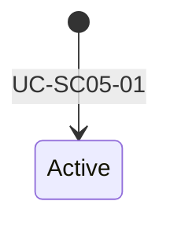

🏠 [Specs](../../../README.md) › 🏷️ [Sectors](../../README.md) › 🏭 [SC05 Manufacturing](../README.md) ›
🗃️ [Data](README.md) › 🗃️ E-SC05-01 Production setup

# 🗃️ E-SC05-01 Production setup

**Status:** ✅ specified

## Purpose

The F12 setup of a production type.

## Fields

| Name | Type | Required | Validation | Default | Example | Personal data | Custom fields |
|---|---|---|---|---|---|---|---|
| type | discrete, batch, process | yes | - | discrete | batch | no | no |
| site | site | yes | - | - | Lyon | no | no |

## Relations

As its use cases.

## Lifecycle

## Indexes and search

By number, date, partner.

## Retention

Kept for the period of its kind of record in the country pack (D293), or else its kind's default in the
[retention schedule](../../../05-non-functional/data-retention.md).

## Audit

Every change.

## Import and export

CSV, FEC where relevant.

## Used by

- [UC-SC05-01](../use-cases/01-production-setups/uc-sc05-01-set-up-the-production-type.md)

## Open questions

None.

---

⬆️ [Up](README.md) · ➡️ [E-SC05-02 Batch recipe](e-sc05-02-batch-recipe.md)
