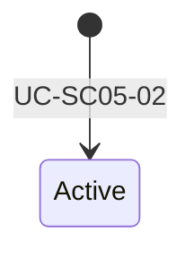

🏠 [Specs](../../../README.md) › 🏷️ [Sectors](../../README.md) › 🏭 [SC05 Manufacturing](../README.md) ›
🗃️ [Data](README.md) › 🗃️ E-SC05-02 Batch recipe

# 🗃️ E-SC05-02 Batch recipe

**Status:** ✅ specified

## Purpose

The process plant's additions to a shared recipe
([E-F12-25 Recipe](../../../02-functional/f12-manufacturing/data/e-f12-25-recipe.md)): each ingredient's nominal potency
and the yield recorded per batch.

## Fields

| Name | Type | Required | Validation | Default | Example | Personal data | Custom fields |
|---|---|---|---|---|---|---|---|
| product, version | records | yes | - | 1 | Sauce S2, v3 | no | no |
| ingredients, potency | list, percent | yes | BR-SC05-02 | 100 % | tomato 60 % | no | no |
| batch size, yield | numbers | yes | > 0 | - | 500 kg, 96 % | no | no |

## Relations

As its use cases.

## Lifecycle

## Indexes and search

By number, date, partner.

## Retention

Kept for the period of its kind of record in the country pack (D293), or else its kind's default in the
[retention schedule](../../../05-non-functional/data-retention.md).

## Audit

Every change.

## Import and export

CSV, FEC where relevant.

## Used by

- [UC-SC05-02](../use-cases/01-production-setups/uc-sc05-02-manage-recipes-with-potency-yields-and-batch-scaling.md)

## Open questions

None.

---

⬅️ [E-SC05-01 Production setup](e-sc05-01-production-setup.md) · ⬆️ [Up](README.md) ·
➡️ [E-SC05-03 Configuration rule](e-sc05-03-configuration-rule.md)
