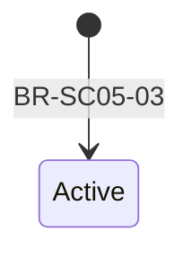

🏠 [Specs](../../../README.md) › 🏷️ [Sectors](../../README.md) › 🏭 [SC05 Manufacturing](../README.md) ›
🗃️ [Data](README.md) › 🗃️ E-SC05-03 Configuration rule

# 🗃️ E-SC05-03 Configuration rule

**Status:** ✅ specified

## Purpose

What a configurator allows.

## Fields

| Name | Type | Required | Validation | Default | Example | Personal data | Custom fields |
|---|---|---|---|---|---|---|---|
| product | product | yes | - | - | Gate G1 | no | no |
| options, constraints | lists | yes | BR-SC05-03 | - | width 3 m excludes motor M1 | no | no |

## Relations

As its use cases.

## Lifecycle

## Indexes and search

By number, date, partner.

## Retention

Kept for the period of its kind of record in the country pack (D293), or else its kind's default in the
[retention schedule](../../../05-non-functional/data-retention.md).

## Audit

Every change.

## Import and export

CSV, FEC where relevant.

## Used by

- [UC-SC05-03](../use-cases/02-made-to-order/uc-sc05-03-configure-a-product-to-order.md)

## Open questions

None.

---

⬅️ [E-SC05-02 Batch recipe](e-sc05-02-batch-recipe.md) · ⬆️ [Up](README.md) ·
➡️ [E-SC05-04 Engineered design](e-sc05-04-engineered-design.md)
