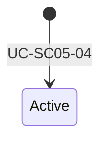

🏠 [Specs](../../../README.md) › 🏷️ [Sectors](../../README.md) › 🏭 [SC05 Manufacturing](../README.md) ›
🗃️ [Data](README.md) › 🗃️ E-SC05-04 Engineered design

# 🗃️ E-SC05-04 Engineered design

**Status:** 🔄 waiting for the owner

## Purpose

A project's own design.

## Fields

| Name | Type | Required | Validation | Default | Example | Personal data | Custom fields |
|---|---|---|---|---|---|---|---|
| project, version | records | yes | - | 1 | P-88, v2 | no | no |
| BoM, routing | records | yes | BR-SC05-04 | - | 42 lines | no | no |
| approved | date, by | no | - | - | 3 Nov | no | no |

## Relations

(Proposed) As its use cases.

## Lifecycle

## Indexes and search

(Proposed) By number, date, partner.

## Retention

Kept for the period of its kind of record in the country pack (D293), or else its kind's default in the
[retention schedule](../../../05-non-functional/data-retention.md).

## Audit

Every change.

## Import and export

(Proposed) CSV, FEC where relevant.

## Used by

- [UC-SC05-04](../use-cases/02-made-to-order/uc-sc05-04-engineer-to-order.md)

## Open questions

None.

---

⬅️ [E-SC05-03 Configuration rule](e-sc05-03-configuration-rule.md) · ⬆️ [Up](README.md) ·
➡️ [E-SC05-05 Customer-supplied part](e-sc05-05-customer-supplied-part.md)
