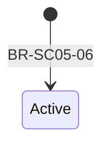

🏠 [Specs](../../../README.md) › 🏷️ [Sectors](../../README.md) › 🏭 [SC05 Manufacturing](../README.md) ›
🗃️ [Data](README.md) › 🗃️ E-SC05-06 Label template

# 🗃️ E-SC05-06 Label template

**Status:** 🔄 waiting for the owner

## Purpose

A unit, case or pallet label.

## Fields

| Name | Type | Required | Validation | Default | Example | Personal data | Custom fields |
|---|---|---|---|---|---|---|---|
| level | unit, case, pallet | yes | - | - | pallet | no | no |
| fields | barcode, lot, dates | yes | BR-SC05-06 | - | SSCC, lot, best before | no | no |

## Relations

(Proposed) As its use cases.

## Lifecycle

## Indexes and search

(Proposed) By number, date, partner.

## Retention

Kept for the period of its kind of record in the country pack (D293), or else its kind's default in the
[retention schedule](../../../05-non-functional/data-retention.md).

## Audit

Every change.

## Import and export

(Proposed) CSV, FEC where relevant.

## Used by

- [UC-SC05-06](../use-cases/03-packaging/uc-sc05-06-package-and-label.md)

## Open questions

None.

---

⬅️ [E-SC05-05 Customer-supplied part](e-sc05-05-customer-supplied-part.md) · ⬆️ [Up](README.md) ·
➡️ [E-SC05-07 Controlled document](e-sc05-07-controlled-document.md)
