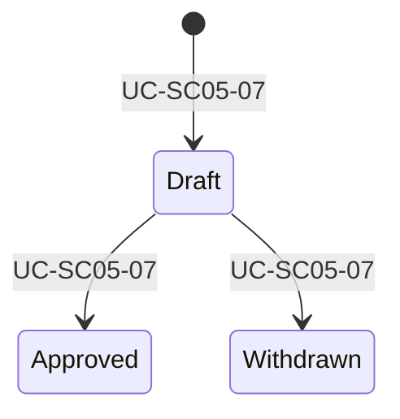

🏠 [Specs](../../../README.md) › 🏷️ [Sectors](../../README.md) › 🏭 [SC05 Manufacturing](../README.md) ›
🗃️ [Data](README.md) › 🗃️ E-SC05-07 Controlled document

# 🗃️ E-SC05-07 Controlled document

**Status:** ✅ specified

## Purpose

A procedure, instruction or form.

## Fields

| Name | Type | Required | Validation | Default | Example | Personal data | Custom fields |
|---|---|---|---|---|---|---|---|
| reference, version | text | yes | unique | - | PR-07, v4 | no | no |
| approved, review date | dates | no | BR-SC05-07 | - | 2 Nov, 2027 | no | no |
| state | draft, approved, withdrawn | yes | - | draft | approved | no | no |

## Relations

As its use cases.

## Lifecycle

## Indexes and search

By number, date, partner.

## Retention

As long as the quality system and certification need them, at least the product's life.

## Audit

Every change.

## Import and export

CSV, FEC where relevant.

## Used by

- [UC-SC05-07](../use-cases/04-quality-system/uc-sc05-07-control-quality-documents.md)
- [UC-SC05-15](../use-cases/04-quality-system/uc-sc05-15-ask-the-assistant-about-quality.md)

## Open questions

None.

---

⬅️ [E-SC05-06 Label template](e-sc05-06-label-template.md) · ⬆️ [Up](README.md) ·
➡️ [E-SC05-08 Audit](e-sc05-08-audit.md)
