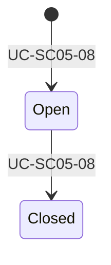

🏠 [Specs](../../../README.md) › 🏷️ [Sectors](../../README.md) › 🏭 [SC05 Manufacturing](../README.md) ›
🗃️ [Data](README.md) › 🗃️ E-SC05-08 Audit

# 🗃️ E-SC05-08 Audit

**Status:** 🔄 waiting for the owner

## Purpose

An internal or supplier audit.

## Fields

| Name | Type | Required | Validation | Default | Example | Personal data | Custom fields |
|---|---|---|---|---|---|---|---|
| scope, date | text, date | yes | - | - | welding, 12 Nov | no | no |
| findings | list | no | BR-SC05-08 | - | 2 minor | no | no |

## Relations

(Proposed) As its use cases.

## Lifecycle

## Indexes and search

(Proposed) By number, date, partner.

## Retention

(Proposed) As long as the quality system and certification need them, at least the product's life.

## Audit

Every change.

## Import and export

(Proposed) CSV, FEC where relevant.

## Used by

- [UC-SC05-08](../use-cases/04-quality-system/uc-sc05-08-run-internal-audits.md)

## Open questions

None.

---

⬅️ [E-SC05-07 Controlled document](e-sc05-07-controlled-document.md) · ⬆️ [Up](README.md) ·
➡️ [E-SC05-09 Quality action](e-sc05-09-quality-action.md)
