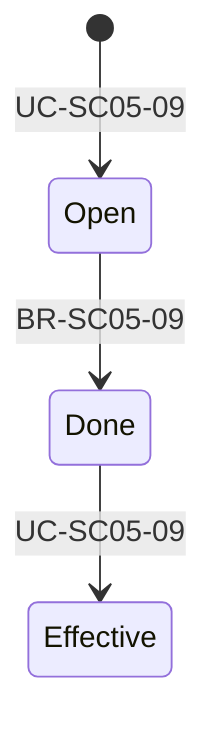

🏠 [Specs](../../../README.md) › 🏷️ [Sectors](../../README.md) › 🏭 [SC05 Manufacturing](../README.md) ›
🗃️ [Data](README.md) › 🗃️ E-SC05-09 Quality action

# 🗃️ E-SC05-09 Quality action

**Status:** 🔄 waiting for the owner

## Purpose

A corrective or preventive action.

## Fields

| Name | Type | Required | Validation | Default | Example | Personal data | Custom fields |
|---|---|---|---|---|---|---|---|
| reference, source | text | yes | - | auto | CA-41, audit | no | no |
| root cause, action, check | text | yes | BR-SC05-09 | - | worn jig | no | no |
| state | open, done, effective | yes | - | open | effective | no | no |

## Relations

(Proposed) As its use cases.

## Lifecycle

## Indexes and search

(Proposed) By number, date, partner.

## Retention

(Proposed) As long as the quality system and certification need them, at least the product's life.

## Audit

Every change.

## Import and export

(Proposed) CSV, FEC where relevant.

## Used by

- [UC-SC05-08](../use-cases/04-quality-system/uc-sc05-08-run-internal-audits.md)
- [UC-SC05-09](../use-cases/04-quality-system/uc-sc05-09-handle-corrective-and-preventive-actions.md)
- [UC-SC05-15](../use-cases/04-quality-system/uc-sc05-15-ask-the-assistant-about-quality.md)

## Open questions

None.

---

⬅️ [E-SC05-08 Audit](e-sc05-08-audit.md) · ⬆️ [Up](README.md) ·
➡️ [E-SC05-10 Supplier rating](e-sc05-10-supplier-rating.md)
