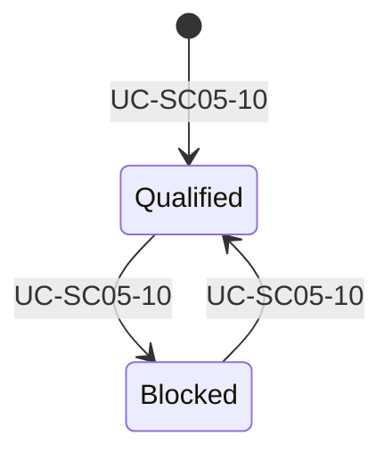

🏠 [Specs](../../../README.md) › 🏷️ [Sectors](../../README.md) › 🏭 [SC05 Manufacturing](../README.md) ›
🗃️ [Data](README.md) › 🗃️ E-SC05-10 Supplier rating

# 🗃️ E-SC05-10 Supplier rating

**Status:** ✅ specified

## Purpose

A supplier's quality status.

## Fields

| Name | Type | Required | Validation | Default | Example | Personal data | Custom fields |
|---|---|---|---|---|---|---|---|
| supplier | contact | yes | - | - | Metal SA | no | no |
| score, status | number, status | yes | BR-SC05-10 | - | 87, qualified | no | no |

## Relations

As its use cases.

## Lifecycle

## Indexes and search

By number, date, partner.

## Retention

Kept for the period of its kind of record in the country pack (D293), or else its kind's default in the
[retention schedule](../../../05-non-functional/data-retention.md).

## Audit

Every change.

## Import and export

CSV, FEC where relevant.

## Used by

- [UC-SC05-10](../use-cases/05-suppliers-and-customers/uc-sc05-10-evaluate-and-qualify-suppliers.md)

## Open questions

None.

---

⬅️ [E-SC05-09 Quality action](e-sc05-09-quality-action.md) · ⬆️ [Up](README.md) ·
➡️ [E-SC05-11 8D report](e-sc05-11-8d-report.md)
