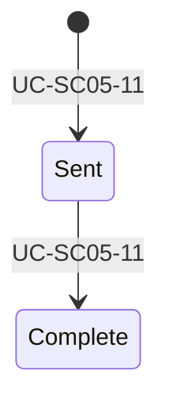

🏠 [Specs](../../../README.md) › 🏷️ [Sectors](../../README.md) › 🏭 [SC05 Manufacturing](../README.md) ›
🗃️ [Data](README.md) › 🗃️ E-SC05-11 8D report

# 🗃️ E-SC05-11 8D report

**Status:** 🔄 waiting for the owner

## Purpose

The analysis of a complaint.

## Fields

| Name | Type | Required | Validation | Default | Example | Personal data | Custom fields |
|---|---|---|---|---|---|---|---|
| complaint | record | yes | - | - | CC-12 | no | no |
| steps D1 to D8 | text, dates | yes | BR-SC05-11 | - | D4 done | no | no |

## Relations

(Proposed) As its use cases.

## Lifecycle

## Indexes and search

(Proposed) By number, date, partner.

## Retention

(Proposed) As long as the quality system and certification need them, at least the product's life.

## Audit

Every change.

## Import and export

(Proposed) CSV, FEC where relevant.

## Used by

- [UC-SC05-11](../use-cases/05-suppliers-and-customers/uc-sc05-11-analyse-customer-complaints.md)

## Open questions

None.

---

⬅️ [E-SC05-10 Supplier rating](e-sc05-10-supplier-rating.md) · ⬆️ [Up](README.md) ·
➡️ [E-SC05-12 Instrument](e-sc05-12-instrument.md)
