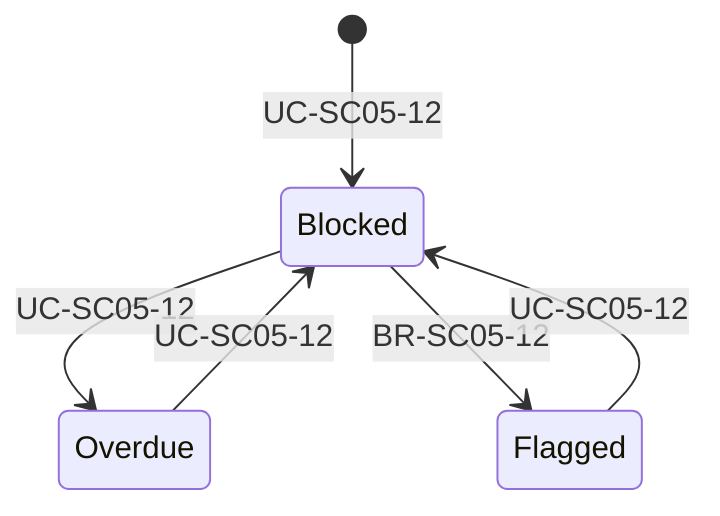

🏠 [Specs](../../../README.md) › 🏷️ [Sectors](../../README.md) › 🏭 [SC05 Manufacturing](../README.md) ›
🗃️ [Data](README.md) › 🗃️ E-SC05-12 Instrument

# 🗃️ E-SC05-12 Instrument

**Status:** 🔄 waiting for the owner

## Purpose

A measuring instrument.

## Fields

| Name | Type | Required | Validation | Default | Example | Personal data | Custom fields |
|---|---|---|---|---|---|---|---|
| reference | text | yes | unique | - | CAL-12 caliper | no | no |
| last, next calibration | dates | yes | BR-SC05-12 | - | 2026-05, 2027-05 | no | no |

## Relations

(Proposed) As its use cases.

## Lifecycle

## Indexes and search

(Proposed) By number, date, partner.

## Retention

(Proposed) As long as the quality system and certification need them, at least the product's life.

## Audit

Every change.

## Import and export

(Proposed) CSV, FEC where relevant.

## Used by

- [UC-SC05-12](../use-cases/04-quality-system/uc-sc05-12-calibrate-measuring-equipment.md)

## Open questions

None.

---

⬅️ [E-SC05-11 8D report](e-sc05-11-8d-report.md) · ⬆️ [Up](README.md) ·
➡️ [E-SC05-13 Operation qualification](e-sc05-13-operation-qualification.md)
