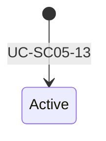

🏠 [Specs](../../../README.md) › 🏷️ [Sectors](../../README.md) › 🏭 [SC05 Manufacturing](../README.md) ›
🗃️ [Data](README.md) › 🗃️ E-SC05-13 Operation qualification

# 🗃️ E-SC05-13 Operation qualification

**Status:** ✅ specified

## Purpose

A person's qualification for an operation.

## Fields

| Name | Type | Required | Validation | Default | Example | Personal data | Custom fields |
|---|---|---|---|---|---|---|---|
| person, operation | records | yes | BR-SC05-13 | - | P. N., welding | yes | no |
| valid to | date | no | - | - | 2027-11 | no | no |

## Relations

As its use cases.

## Lifecycle

## Indexes and search

By number, date, partner.

## Retention

Kept for the period of its kind of record in the country pack (D293), or else its kind's default in the
[retention schedule](../../../05-non-functional/data-retention.md).

## Audit

Every change.

## Import and export

CSV, FEC where relevant.

## Used by

- [UC-SC05-13](../use-cases/05-suppliers-and-customers/uc-sc05-13-qualify-staff-for-operations.md)

## Open questions

None.

---

⬅️ [E-SC05-12 Instrument](e-sc05-12-instrument.md) · ⬆️ [Up](README.md) ·
➡️ [E-SC05-14 Management review](e-sc05-14-management-review.md)
