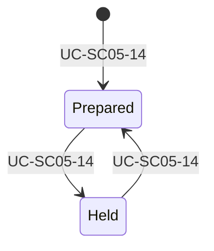

🏠 [Specs](../../../README.md) › 🏷️ [Sectors](../../README.md) › 🏭 [SC05 Manufacturing](../README.md) ›
🗃️ [Data](README.md) › 🗃️ E-SC05-14 Management review

# 🗃️ E-SC05-14 Management review

**Status:** ✅ specified

## Purpose

A yearly review.

## Fields

| Name | Type | Required | Validation | Default | Example | Personal data | Custom fields |
|---|---|---|---|---|---|---|---|
| date | date | yes | - | - | 2026-12-15 | no | no |
| objectives, decisions | lists | yes | BR-SC05-14 | - | scrap < 1 % | no | no |

## Relations

As its use cases.

## Lifecycle

## Indexes and search

By number, date, partner.

## Retention

As long as the quality system and certification need them, at least the product's life.

## Audit

Every change.

## Import and export

CSV, FEC where relevant.

## Used by

- [UC-SC05-14](../use-cases/05-suppliers-and-customers/uc-sc05-14-hold-the-management-review.md)

## Open questions

None.

---

⬅️ [E-SC05-13 Operation qualification](e-sc05-13-operation-qualification.md) · ⬆️ [Up](README.md) ·
➡️ [E-SC05-15 Bonded stock](e-sc05-15-bonded-stock.md)
