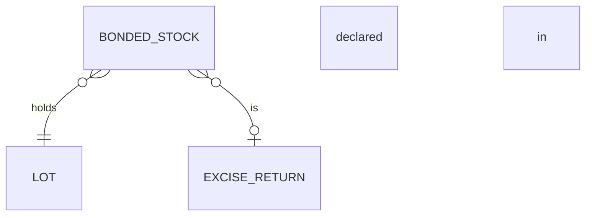
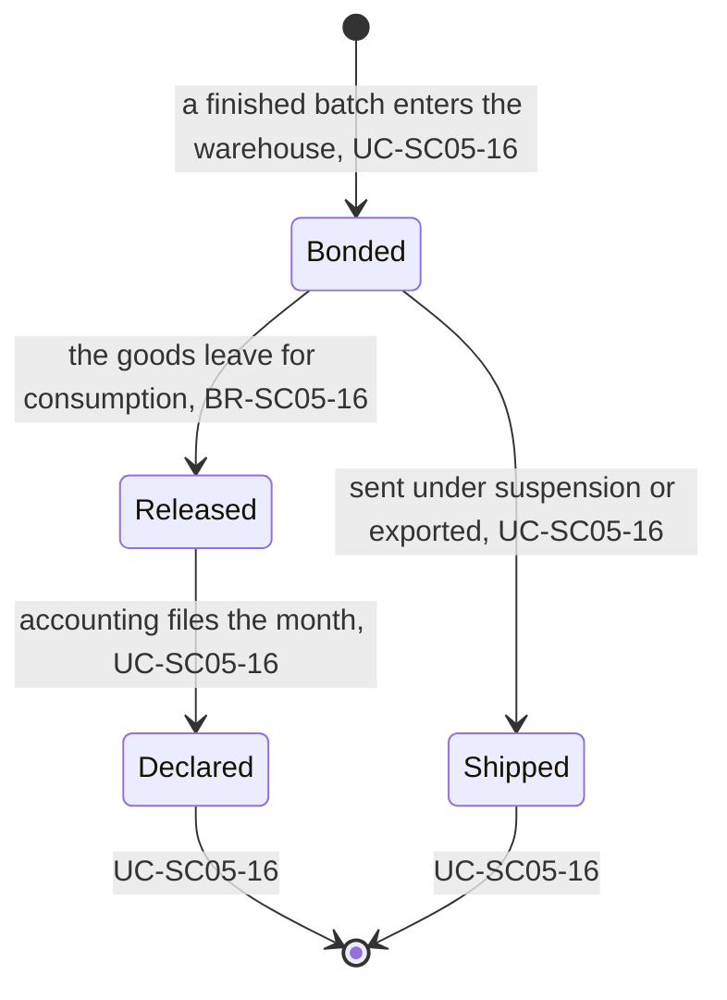

🏠 [Specs](../../../README.md) › 🏷️ [Sectors](../../README.md) › 🏭 [SC05 Manufacturing](../README.md) ›
🗃️ [Data](README.md) › 🗃️ E-SC05-15 Bonded stock

# 🗃️ E-SC05-15 Bonded stock

**Status:** ✅ specified

## Purpose

The stock of one lot held under duty suspension in a bonded warehouse, with its volume, strength and category, and the
movement that ends the suspension ([D549](../../../06-decisions/sectors/d549-benchmark-gaps-sc05-manufacturing.md)). It
is not the stock item of the lot
([E-F7-10](../../../02-functional/f07-purchasing-and-stock/data/e-f07-10-lot-or-serial.md)): it adds the excise status
and the duty the lot may owe. The duty is computed on the base of the lot's category, as
[BR-SC05-16](../business-rules/br-sc05-16-excise-is-due-when-goods-leave-the-bonded-warehouse.md) and
[CR-FR-234](../../../10-country-packs/france/tax-and-vat/cr-fr-234-alcohol-excise.md) say; pure alcohol is the base of
spirits only ([D573](../../../06-decisions/foundations/d573-precedence-between-spec-pages.md)).

## Fields

| Name | Type | Required | Validation | Default | Example | Personal data | Custom fields |
|---|---|---|---|---|---|---|---|
| lot | lot (E-F7-10) | yes | a lot of the company | - | B-204 | no | no |
| item | item (E-F7-06) | yes | an alcohol item | - | Pale ale | no | no |
| volume | number in litres | yes | above 0 | from the lot | 1,000 | no | no |
| strength | percent | yes | 0.5 to 100 | - | 5.0 | no | no |
| category | wine, cider, intermediate product, beer, spirits | yes | a category of the country pack | - | beer | no | no |
| pure alcohol | number in hectolitres | yes | computed from volume and strength | - | 0.5 | no | no |
| duty base | number, with its unit | yes | computed from the category: hectolitres for wines, ciders and intermediate products, hectolitres times the degree for beers, hectolitres of pure alcohol for spirits | - | 50 hectolitres-degree | no | no |
| movement | release, suspension, export, loss, destruction | no | one of the five | - | release | no | no |
| duty | amount in EUR | no | 0 or more, computed at release | - | 175.00 | no | no |
| consignee approval | text | no | required for a suspension | - | FR012345E1234 | no | no |
| released on | date | no | not before the lot's entry | - | 2026-10-03 | no | no |
| state | Bonded, Released, Shipped, Declared | yes | the lifecycle below | Bonded | Released | no | no |
| owner | user | yes | a user of the company | the creator | Claire P. | yes | no |

## Relations

- [E-F7-10](../../../02-functional/f07-purchasing-and-stock/data/e-f07-10-lot-or-serial.md)
- [E-F7-06 Item](../../../02-functional/f07-purchasing-and-stock/data/e-f07-06-item.md)
- [E-F8-06 Tax return](../../../02-functional/f08-accounting/data/e-f08-06-tax-return.md)

## Lifecycle

## Indexes and search

By lot, category, state, month of release and consignee approval.

## Retention

Kept six years with the declarations, and ten years with the accounting records
([CR-FR-002](../../../10-country-packs/france/accounting/cr-fr-002-accounting-records-kept-ten-years.md)).

## Audit

Every movement and every change of volume, strength, category or duty base, with who, when and the old and new value.

## Import and export

Export of the month's lines for the customs portal; import of a laboratory sheet of strengths as CSV.

## Used by

- [UC-SC05-16](../use-cases/06-excise-refurbishment-and-cutting/uc-sc05-16-declare-alcohol-excise.md)
- [UC-F12-31](../../../02-functional/f12-manufacturing/use-cases/09-recipes-and-batches/uc-f12-31-define-a-recipe-and-produce-in-batches.md)

## Open questions

None.

---

⬅️ [E-SC05-14 Management review](e-sc05-14-management-review.md) · ⬆️ [Up](README.md) ·
➡️ [E-SC05-16 Graded unit](e-sc05-16-graded-unit.md)
